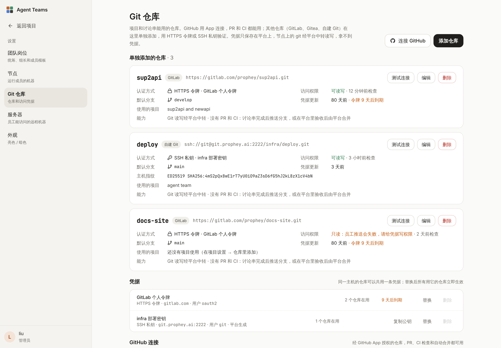
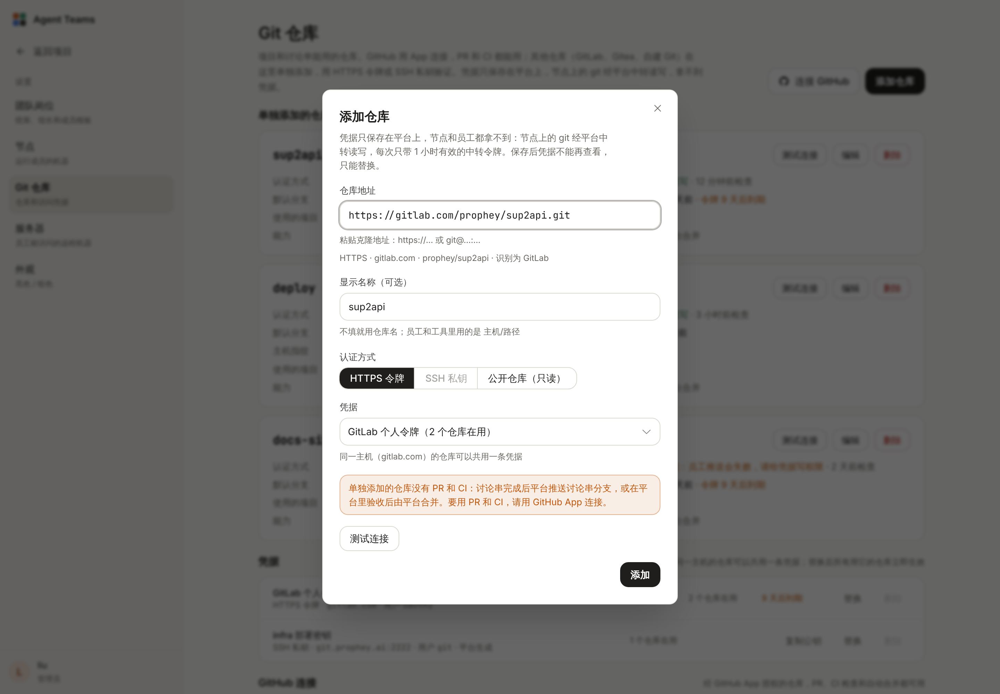
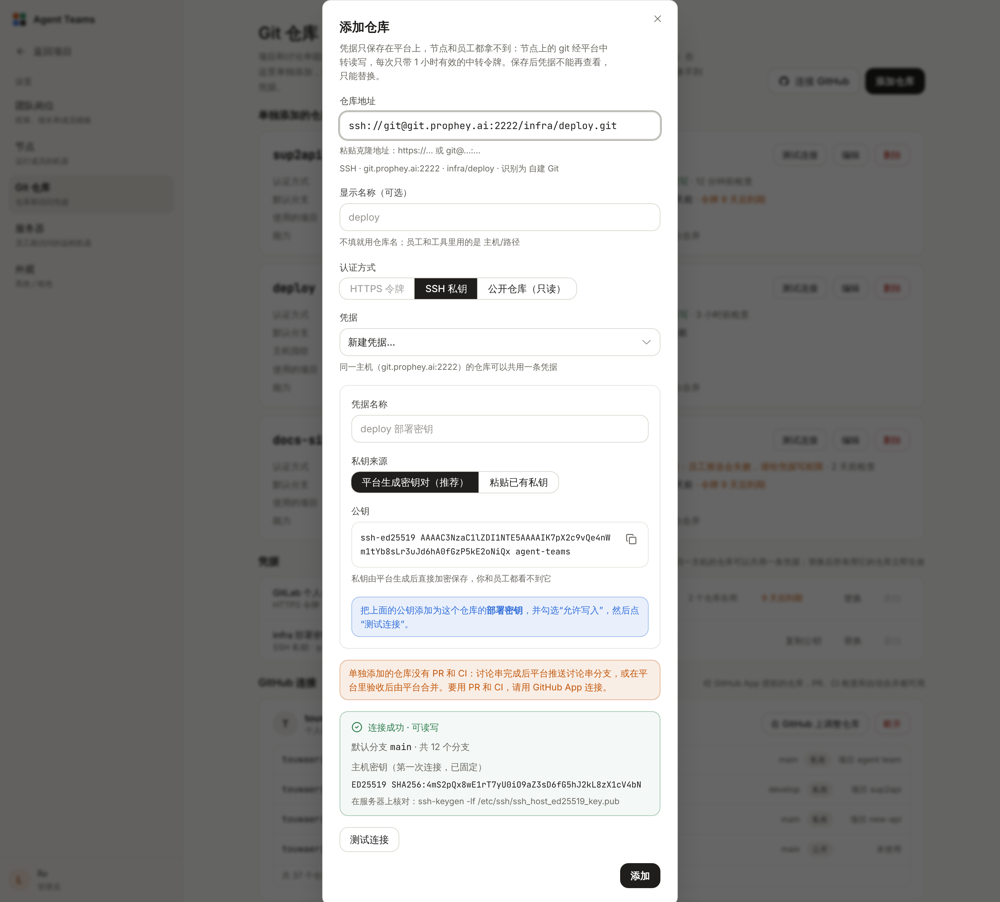

# 通用 Git 仓库接入（设计稿）

状态：**设计稿，等用户确认**（2026-11-20）。本文只做设计，不改实现；用户确认后按 §13 分期开发。界面原型在 `web/src/prototype/gitRepos/`（只在 `npm run dev` 下有，地址 `/settings/git-prototype`），截图见 PR。

和 `remote-servers.md`（凭据只在主节点、信封加密、主机密钥固定）、`architecture.md` §8（分支、合并队列、CI、PR）和 §10.4（GitHub 凭证不落盘）一起读。

## 1. 一句话

“设置 → GitHub 连接”改名为 **“设置 → Git 仓库”**：除了现在的 GitHub App 连接，还能**单独添加任意一个 Git 仓库**（GitLab、Gitea、Bitbucket、自建 Git 服务器，或者用个人令牌的 GitHub 仓库），用 **HTTPS 令牌**或 **SSH 私钥**验证。仓库属于用户，项目和讨论串像选 GitHub 仓库一样选它。凭据只存在主节点（信封加密），**节点和员工会话永远拿不到它**：节点上的 git 经主节点的 **Git 中转**（主节点上每个仓库一份裸镜像 + `git http-backend`）读写，只带 1 小时有效、绑定会话和仓库的中转令牌。PR、CI、webhook 这类 GitHub 独有的能力，在通用仓库上按 §8 降级：“提交 PR 即完成”变成“推送讨论串分支即完成”，“我来验收”在平台里看提交和改动再由平台合并，CI 关卡关闭。

## 2. 需求与边界

### 2.1 用户的需求（2026-11-20 原话）

> 将原来的 GitHub 改成 Git 仓库，然后支持指定一个单独的 Git 仓库，使用证书或者 token 去验证，后续就可以使用这个仓库。

| 编号 | 需求 | 章节 |
| --- | --- | --- |
| G1 | 设置里的“GitHub 连接”变成“Git 仓库”，GitHub App 继续可用 | §6、§11.1 |
| G2 | 能单独添加一个任意 Git 仓库（不限 GitHub） | §3、§11.2 |
| G3 | 验证方式：SSH 私钥（“证书”）或 HTTPS 令牌（token） | §3.2、§4 |
| G4 | 加好后，项目和讨论串都能用这个仓库 | §7、§11.3 |
| G5 | 凭据做法参照服务器：不下发到节点，或只下发短时凭据 | §4、§5 |

### 2.2 不做什么（第一期）

- 不做 GitLab / Gitea 的 MR、流水线 API 适配（以后，§8.4）。第一期通用仓库**只用 Git 协议**，不调任何托管平台的 API。
- 不做 Git LFS（中转先不支持，克隆时 `GIT_LFS_SKIP_SMUDGE=1`，提示里说明）。
- 不做“列出某个 GitLab 账号下所有仓库”：一次添加一个仓库，用户贴地址（需求就是“单独的仓库”）。
- 不把长期凭据下发到节点，也不提供“直接下发”的开关（§5.4 说明为什么）。
- 不做 SSH 证书（CA 签发）登录托管平台：托管平台基本只认公钥或令牌。界面上的“证书”统一叫“SSH 私钥”，并提供“平台生成密钥对、你把公钥填成部署密钥”。

## 3. 数据模型

两张新表 + `at_project_repos` 一个新列。迁移编号取下一个空号（写本文时最新是 `00330_remote_servers.sql`，暂记 `00340_git_repos.sql`），完整列注释实现时补进 `data-model.md` §2.15。

### 3.1 为什么把“凭据”和“仓库”分开

同一个 GitLab 账号下的十个仓库通常共用一个令牌；部署密钥则一个仓库一把。所以：

- `at_git_credentials`：一条凭据（令牌或私钥），**限定一个主机**（`gitlab.com`、`git.example.com:2222`），只能给这个主机上的仓库用。
- `at_git_repos`：一个仓库（地址 + 用哪条凭据）。公开仓库可以不挂凭据。

添加仓库的表单里“凭据”是下拉框：同主机已有的凭据 + “新建凭据”（展开填写），所以大多数时候用户感觉不到这是两张表。

### 3.2 `at_git_credentials`

| 列 | 类型 | 说明 |
| --- | --- | --- |
| `id` | TEXT PK | `gc_…` |
| `user_id` | TEXT NOT NULL FK | 属于谁，所有查询按它过滤 |
| `name` | TEXT NOT NULL | 显示名，例如“GitLab 个人令牌”“web 部署密钥”；同一用户内唯一 |
| `host` | TEXT NOT NULL | 小写主机，非默认端口带 `:端口`（SSH 默认 22、HTTPS 默认 443 时不写） |
| `kind` | TEXT NOT NULL | `https_token` \| `ssh_key` |
| `username` | TEXT NOT NULL DEFAULT '' | HTTPS 用户名（GitLab 用 `oauth2`、GitHub 用 `x-access-token`、Gitea 用账号名，按 §3.5 的识别结果预填）；SSH 时是登录用户，默认 `git` |
| `cred_ciphertext`、`cred_nonce`、`wrapped_dek`、`dek_nonce`、`kek_id` | BYTEA / TEXT | 信封加密（§4.1），和 `at_remote_servers` 同一套列 |
| `has_passphrase` | BOOL | 私钥是否带口令（口令和私钥一起密封） |
| `key_fingerprint` | TEXT | 私钥对应公钥的 SHA256 指纹 |
| `public_key` | TEXT | `ssh-ed25519 AAAA… agent-teams`，只有平台生成的密钥对才有，方便用户再次复制填到部署密钥 |
| `generated` | BOOL | 是平台生成的密钥对（私钥用户从没见过） |
| `expires_at` | TIMESTAMPTZ NULL | 令牌到期时间，用户可选填（GitLab 令牌必有到期日），到期前提醒（§11.2） |
| `cred_updated_at`、`created_at`、`updated_at` | TIMESTAMPTZ | |

### 3.3 `at_git_repos`

| 列 | 类型 | 说明 |
| --- | --- | --- |
| `id` | TEXT PK | `gr_…`，也出现在中转地址里（§5.2） |
| `user_id` | TEXT NOT NULL FK | |
| `slug` | TEXT NOT NULL | 仓库在平台里的名字：`<host>/<path>`，例如 `gitlab.com/acme/web`、`git.example.com/team/sub/app`（去掉 `.git`，小写主机）。同一用户内唯一。它就是 `at_project_repos.repo`、`at_thread_repos.repo`、工具参数 `repo` 里写的那个值（§3.6） |
| `name` | TEXT NOT NULL DEFAULT '' | 可选的短名，界面显示用；空时显示 slug 最后一段 |
| `url` | TEXT NOT NULL | 用户贴的克隆地址，规整后存：`https://host/path.git` 或 `ssh://user@host:port/path.git`（scp 写法 `git@host:path` 规整成 ssh://） |
| `transport` | TEXT NOT NULL | `https` \| `ssh` |
| `credential_id` | TEXT NULL FK → `at_git_credentials` ON DELETE RESTRICT | NULL = 公开仓库，只能读（推送一定失败，测试连接时就提示） |
| `provider` | TEXT NOT NULL | `github` \| `gitlab` \| `gitea` \| `bitbucket` \| `generic`，按主机自动识别、用户可改（§3.5）；第一期只用来决定网页链接和用户名预填 |
| `web_url` | TEXT NOT NULL DEFAULT '' | 仓库网页地址（识别出来的或用户填的），用来拼“比较分支”“查看提交”链接；空时界面不给链接 |
| `default_branch` | TEXT NOT NULL DEFAULT '' | 测试连接时 `ls-remote --symref HEAD` 读到的 |
| `access` | TEXT NOT NULL DEFAULT '' | `''`（没测过）\| `read` \| `write`，最近一次测试的结果 |
| `host_key`、`host_key_fp`、`host_key_mac`、`host_key_confirmed_at` | | 只有 SSH：第一次测试连接时固定的主机密钥，和服务器完全同一套做法（`remote-servers.md` §5.3） |
| `last_checked_at`、`last_error` | | 最近一次测试 / 中转同步的时间和错误 |
| `created_at`、`updated_at` | | |

约束：`(user_id, slug)` 唯一；`credential_id` 的凭据必须属于同一用户、`host` 与 url 的主机相同（应用层检查 + 外键带 `user_id` 的复合外键，做法同 `at_project_servers`）。

### 3.4 `at_project_repos` 加一列

```sql
ALTER TABLE at_project_repos
  ADD COLUMN git_repo_id TEXT REFERENCES at_git_repos(id) ON DELETE RESTRICT;
ALTER TABLE at_project_repos
  ADD CONSTRAINT at_project_repos_one_source
  CHECK (git_connection_id IS NULL OR git_repo_id IS NULL);
```

一行仓库要么来自 GitHub 连接（`git_connection_id`，现状），要么来自单独添加的仓库（`git_repo_id`）。删除仍被项目使用的单独仓库会被拒绝（RESTRICT，接口回 409 并列出项目），而不是像 GitHub 连接那样置空——单独仓库没有“换个连接”的余地。`at_thread_repos` 不变：它按 `repo`（slug）记，来源从项目行查。

### 3.5 地址识别

用户只贴一个地址，表单自动推出其余字段：

| 输入 | transport | host | path | provider | 预填用户名 |
| --- | --- | --- | --- | --- | --- |
| `https://gitlab.com/acme/web.git` | https | gitlab.com | acme/web | gitlab | `oauth2` |
| `git@gitlab.com:acme/web.git` | ssh | gitlab.com | acme/web | gitlab | `git` |
| `ssh://git@git.example.com:2222/team/app.git` | ssh | git.example.com:2222 | team/app | generic | `git` |
| `https://gitea.example.com/team/app` | https | gitea.example.com | team/app | generic（可手选 gitea） | 空（必填） |
| `https://github.com/acme/web` | https | github.com | acme/web | github | `x-access-token`，并提示“GitHub 仓库建议用 GitHub App 连接，能用 PR 和 CI” |

拒绝：带内嵌凭据的地址（`https://user:token@…`，提示把令牌填到下面的框里）、`file://`、`git://`（不加密）、本机和内网地址（复用 `remote-servers.md` §5.6 的地址限制和 `ssh_allowed_private_cidrs` 放行表，防止中转被当跳板扫内网）。

### 3.6 slug 与工作目录

现在的 `ghops.Dir` 把 `owner/name` 变成 `owner__name`。通用仓库的 slug 有主机和多级路径，规则改为：`/` → `__`，`:` → `_`（例如 `git.example.com_2222__team__sub__app`）；GitHub 仓库的目录名不变（不带 `github.com/` 前缀），已有工作目录不受影响。同一项目里 slug 唯一，所以目录不会撞。

## 4. 凭据加密存储

### 4.1 信封加密

和服务器凭据完全同一套（`remote-servers.md` §11.1，代码 `server/internal/credvault`）：每条凭据一把随机 DEK（AES-256-GCM），DEK 用从 `AGENT_TEAMS_SECRET_KEYS` 派生的 KEK 包裹。新增一个 AAD 构造函数：

```
credvault.GitCredAAD = "at-git-cred:v1 | <user_id> | <credential_id> | <kind> | <host> | <username>"
```

- 改主机、凭据类型或用户名，旧密文就解不开，接口要求同时提交新凭据（422 `credential_required`，和服务器一样）。所以数据库被人改了 `host`，中转也不会把令牌发到别的主机。
- 仓库的 SSH 主机密钥行带 MAC（HMAC-SHA256，密钥从 KEK 用 HKDF 派生，覆盖 `repo_id、host、key_type、public_key`），直接往表里写主机密钥不起作用。
- `atctl admin reseal` 增加一步：重新包裹全部 `at_git_credentials`，和服务器凭据在同一个事务里。

### 4.2 只写不读

- 接口响应（`GitCredentialView`）只有元数据：类型、主机、用户名、指纹、有没有口令、公钥（平台生成的）、到期时间、更新时间。没有任何接口能取回令牌或私钥明文，平台工具也没有。
- 编辑时凭据框显示“已保存，留空不修改”。
- “生成密钥对”：主节点用 `crypto/ed25519` 生成，私钥直接密封入库，**网页从头到尾只见到公钥**。这是 SSH 方式推荐的做法：用户不用在自己电脑上生成、也不用把私钥贴进浏览器。

### 4.3 谁在什么时候解开凭据

只有主节点上的三处代码会解开凭据，解开后只在内存里用完即弃：

1. **测试连接**（§11.2）。
2. **Git 中转**同步上游、把推送转给上游（§5）。
3. **主节点 Git 引擎**做合并队列、建分支、合并讨论串（§8.2）。

都写审计（`at_audit_log`：`git_credential_create/update/delete`、`git_repo_create/update/delete/test`、`git_repo_host_key_pin/reset`）。

## 5. 节点怎么 clone / push：主节点 Git 中转

### 5.1 方案比较

| 方案 | 做法 | 评价 |
| --- | --- | --- |
| A. 长期凭据下发到节点 | 像现在的 PAT：`cred.request` 直接回令牌，SSH 私钥写进会话 | 违反 G5；令牌长期有效、覆盖账号能访问的全部仓库，节点上任何同账号进程都能拿走。**否** |
| B. 只给 HTTPS 做反向代理 | 主节点 `/git/<id>/…` 用 `httputil.ReverseProxy` 转到上游，加上 `Authorization` | 简单；但 SSH 仓库走不了（HTTP 智能协议无状态，SSH 是有状态的，桥接很别扭），推送内容也只能透传、不好检查 |
| C. 复用 SSH 网关 | 节点 ssh 经网关，网关拿私钥登录 `git@gitlab.com`，只放行 `git-upload-pack`/`git-receive-pack` | SSH 仓库可行；HTTPS 仓库还得再做一套；两套入口、两套权限检查 |
| **D. 主节点镜像中转（推荐）** | 主节点为每个通用仓库维护一份裸镜像；节点一律用 **HTTPS 智能协议**连主节点（`git http-backend` 服务这个镜像）；主节点用自己保管的凭据，按 HTTPS 或 SSH 和上游同步 | 一个入口同时覆盖 HTTPS 和 SSH 上游；凭据只在主节点；推送在主节点的 `pre-receive` 里**逐条检查 ref**（通用仓库没有 GitHub 规则集，这里正好补上，§5.5）；镜像同时就是 §8.2 合并引擎的工作区 |

**结论：D。** 代价是主节点要磁盘（每个仓库一份裸镜像）和带宽（节点的 clone/fetch/push 都经过主节点），§5.6 给出限制和缓解。

### 5.2 结构

```
 节点（守护进程 + 员工会话）                         主节点 atctl                                     上游（GitLab / Gitea / 自建）
┌──────────────────────────────────┐            ┌────────────────────────────────────────────┐      ┌───────────────┐
│ 会话里的 git / 平台 git 作业       │   HTTPS    │ /git/<repo_id>.git/…  （新路由）             │      │               │
│  remote = https://<控制台>/git/   │  智能协议   │  ① Basic 认证 = 中转令牌（1 小时，绑定会话  │      │               │
│           gr_xxx.git             ├───────────►│     或作业 + 仓库 + 读/写）                   │      │               │
│  凭证助手 → cred.sock → 守护进程  │            │  ② fetch 前：距上次同步 > 10 s 就先同步上游 ├─────►│ fetch（令牌或  │
│   → cred.request(host=控制台,     │            │  ③ git http-backend 服务裸镜像              │      │  SSH 私钥）    │
│     path=git/gr_xxx.git)         │            │  ④ push：pre-receive 检查 ref → 同步推给上游 ├─────►│ push          │
│   ← 中转令牌（不是上游凭据）       │            │     上游成功才接受，失败原样回给 git         │      │               │
└──────────────────────────────────┘            │ 镜像：$DATA/git-mirrors/<user>/<repo_id>.git │      └───────────────┘
                                                └────────────────────────────────────────────┘
```

- 节点上的 remote URL 是 `https://<控制台域名>/git/gr_xxx.git`，**不含任何凭据**；仓库在节点上的样子和现在的 GitHub 仓库一样（守护进程自己的镜像 `state/mirrors/…`、共享克隆、worktree 都照旧，`architecture.md` §8.1）。
- 节点只需要能访问控制台（它本来就连着 `/nodes/connect`），**不需要能访问上游**。内网的自建 Git 只要主节点能到就行。

### 5.3 中转令牌（节点拿到的唯一东西）

- 沿用现有的按次领取链路（`architecture.md` §10.4、`remote-servers.md` §10.1）：git 凭证助手 → `cred.sock` → 守护进程 `CredBroker` → `cred.request {host: <控制台>, path: "git/gr_xxx.git", purpose}`。`cred.request` 本来就带 `host` 和 `path`，协议结构不用改，只是 `host` 不再固定是 `github.com`。
- 控制台按现有规则做归属校验（会话属于本节点、`open_gen` 当前、项目里有这个仓库；统筹拒绝；作业只能拿自己那个仓库），然后签一个**中转令牌**：

  ```
  agt_git.<base64url(payload)>.<HMAC-SHA256>
  payload = {repo_id, user_id, project_id, session_id | job_id, open_gen, purpose: read|push|employee, role, exp: now+1h, jti}
  ```

  HMAC 密钥从 `AGENT_TEAMS_SECRET_KEYS` 用 HKDF 派生（`info = "agent-teams/git-proxy/v1"`）。令牌是无状态的，但中转每次请求都**重新查库**：会话还活着、`open_gen` 没变、项目仍包含这个仓库、仓库仍属于这个用户——和 SSH 网关“证书只证明身份、授权逐次判断”同一个思路（`remote-servers.md` §4.7）。会话结束、讨论串结束、仓库从项目移除，令牌立即失效。
- 回给守护进程：`username = "agent-teams"`、`password = 中转令牌`、`expires_at = exp`。守护进程照旧只缓存在内存、按过期前 5 分钟刷新、`erase` 时丢弃。
- 守护进程会话环境里的凭证助手配置从固定的 `credential.https://github.com.helper` 改为**也覆盖控制台的 `/git/` 前缀**：`credential.https://<控制台>/git/.helper`（`useHttpPath=true`）。员工照常 `git fetch`、`git push origin HEAD`，不需要知道中转的存在。
- `gh` 包装只对 GitHub 仓库有效；通用仓库的员工提示词里写明“这个仓库没有 gh / PR，交付走 push_branch 和合并队列”（§8.3）。

### 5.4 为什么不提供“直接下发凭据”的开关

有人会想要“大仓库直连上游，快一点”。不提供，理由：一旦令牌到了节点，就和现在 PAT 的差距一样（`remote-servers.md` §10.3 第 1 条：长期、全仓库），而且用户很难意识到他打开了什么。真遇到大仓库，靠 §5.6 的缓存、浅克隆和节点镜像解决。

### 5.5 推送检查（pre-receive）

中转收到推送时，`git http-backend` 在镜像里运行平台装好的 `pre-receive` 钩子（钩子目录员工碰不到，镜像在主节点上）。钩子通过环境变量拿到令牌里的身份，逐条检查 `<old> <new> <ref>`：

| 令牌用途 | 允许 |
| --- | --- |
| `push`（平台推送作业，`architecture.md` §8.1） | 只有作业给定的那一个 `refs/heads/thread/<no>/<员工>` |
| `employee`（组长和成员的会话） | 任何 `refs/heads/*`，**除了**：本讨论串分支、各仓库的基准分支和默认分支、别人的 `thread/*`；不允许标签、不允许删除受保护分支、不允许非快进更新受保护分支 |
| `read` | 拒绝一切推送 |

这和现在节点上的 `pre-push` 钩子是同一张表（`AT_PROTECTED_REFS`），区别是**在主节点执行、不能被 `--no-verify` 绕过**。所以通用仓库在这一点上比 GitHub 仓库还严（GitHub 仓库靠用户自己建规则集）。

检查通过后，钩子在同一个请求里把这些 ref 推给上游（`git push --atomic <上游> <ref>…`，用主节点的凭据）；上游拒绝（权限不够、上游自己的保护分支）就让本次推送失败，把上游的错误原样写回 git 的输出，镜像不更新。所以镜像永远不会领先上游。

### 5.6 容量、并发和多副本

- **磁盘**：镜像放 `$DATA/git-mirrors/`（生产是 compose 的数据卷）。每个用户的镜像总量设上限（默认 20 GB，`at_settings.git_proxy`），超了新仓库测试连接时报错；仓库从所有项目移除 30 天后删除镜像。
- **带宽**：节点自己的镜像（`state/mirrors`）还在，所以每台节点每个仓库只完整克隆一次，之后都是增量 fetch。超大仓库可以在仓库设置里开“浅克隆”（`--depth`，以后）。
- **同步频率**：fetch 请求到来时，距上次同步超过 10 秒才先同步上游（每个仓库一把锁，同时到的请求等同一次同步）。另外合并循环需要时主动同步。
- **并发与超时**：每个仓库同一时刻一个上游同步；单次请求最长 10 分钟；每个节点到中转的并发请求数有上限（默认 8），超出排队。
- **多副本**：镜像在本地磁盘，多副本时用 Valkey 锁 `gitmirror:<repo_id>` 保证同一时刻只有一个副本动一个镜像，其他副本把 `/git/<id>` 请求反代给持锁副本（以后要多副本时再做；生产现在是单副本，第一期按单副本实现，但锁先加上）。
- **LFS**：第一期不支持，克隆设 `GIT_LFS_SKIP_SMUDGE=1`；仓库里有 `.gitattributes` 的 `filter=lfs` 时，测试连接结果里提示。

## 6. 和现有 GitHub App 怎么共存

**共存，不迁移 GitHub App。** GitHub App 是能力最全的来源（1 小时单仓库令牌、PR、CI、webhook、仓库列表），保持原样。

| 来源 | 存在哪 | 能力 | 变化 |
| --- | --- | --- | --- |
| GitHub App 连接 | `at_git_connections`（`kind = app`） | 全部 | 无。设置页里放进“GitHub 连接”分区 |
| GitHub 个人令牌（PAT）连接 | `at_git_connections`（`kind = token`） | PR、CI（令牌给的权限内）；员工会话直接拿到 PAT | **第二期迁走**（§6.1） |
| 单独添加的仓库 | `at_git_repos` + `at_git_credentials` | Git 读写，没有 PR / CI（§8） | 新增 |

### 6.1 PAT 连接的去向

PAT 连接本来就是“长期令牌下发到员工会话”（`remote-servers.md` §10.3 第 1 条，Q8 没定）。有了单独仓库，它的合理归宿是：**变成 `github.com` 主机上的一条 HTTPS 令牌凭据，项目里用到的每个仓库变成一个单独仓库**，令牌从此只在主节点。

- 第一期：PAT 连接照常工作，GitHub 页（新“Git 仓库”页的 GitHub 分区）在 PAT 卡片上加提示“个人令牌会下发到员工会话，建议转成单独仓库（令牌只留在平台）或改用 GitHub App”，并给“转成单独仓库”按钮。
- 转换由 `atctl admin convert-pat <connection_id>` 或按钮触发（Go 代码，不放 SQL 迁移，因为要解开 Fernet 再按信封加密重新密封）：建凭据、为每个用到的 `owner/name` 建 `at_git_repos`（slug 写 `github.com/owner/name`）、改 `at_project_repos` 指向它。**slug 变了**，所以只在没有进行中讨论串的项目上转，有的话按钮提示先结束讨论串。
- 用 PAT 的单独 GitHub 仓库会失去 PR / CI（第一期通用仓库不调 API）。所以按钮旁边写清楚：“要保留 PR 和 CI，请改用 GitHub App”。以后 §8.4 的 GitHub 令牌 API 适配做了，这个差别就没了。

### 6.2 代码里的分岔点

现在 `server/internal/ghops` 的 `Repo` 同时承担“找凭据”和“调 GitHub API”。改成一个小接口，GitHub 的实现就是现有代码：

```go
// server/internal/forge
type Repo interface {
    Slug() string
    Caps() Caps                       // §8.1
    DefaultBranch(ctx) (string, error)
    RefSHA(ctx, branch) (string, error)
    EnsureBranch(ctx, branch, base) (string, error)
    TrialMerge(ctx, base, head, msg) (MergeResult, error)   // GitHub: mq 分支 + merges API；Git: 镜像里 merge
    FastForward(ctx, branch, sha) error
    DeleteRef(ctx, branch) error
    Compare(ctx, base, head) ([]string, error)
    // 只有 Caps().PR 为真才调用；Git 实现返回 ErrUnsupported
    CreatePR / OpenPRFor / GetPR / MergePR / CheckRuns …
}
```

`delivery` 包里现在直接调 `ghops.GitHub` 的地方改为调 `forge.Repo`，并在 PR / CI 相关分支前判断 `Caps()`。`ghops.Find`、`ReposOf` 变成 `forge.ReposOf(project)`，按 `at_project_repos` 的来源分别构造。

## 7. 项目和讨论串怎么用

- **新建项目 / 项目设置 → 仓库**：选仓库的下拉框分两组：“GitHub”（各连接的仓库，现状）和“单独添加的仓库”。下拉框底部有“+ 添加新的 Git 仓库…”，打开和设置页同一个对话框，加好后直接选中，不用离开当前页面。
- 列表里每行仓库带来源图标和能力标签：GitHub 仓库不变；单独仓库显示“Git · 推送分支交付”（没有 PR），鼠标悬停说明 §8 的降级。
- **讨论串**：`open_thread(repos=[{repo, base}])`、`assign_task(repo)`、`enqueue_merge(repo)`、`open_pr(repo)` 的 `repo` 参数写 slug（`gitlab.com/acme/web`）。员工提示词的“## 仓库”一节给每个仓库加一行能力说明，例如“gitlab.com/acme/web：没有 PR 和 CI，完成后平台把讨论串分支推送到上游，由用户在平台里验收”。
- 一个项目可以混用 GitHub 仓库和单独仓库；PR、CI 按仓库各自判断（§8.2 的“全部仓库”规则照旧，只是每个仓库的“完成”条件不同）。
- 删除单独仓库前必须先从所有项目里移除（§3.4）；从项目移除时，进行中的讨论串里该仓库的 worktree 照常清理，中转令牌立即失效（§5.3）。

## 8. PR / CI 怎么降级

### 8.1 能力表

| 能力 `Caps` | GitHub App | 单独仓库（第一期） | 没有时怎么办 |
| --- | --- | --- | --- |
| `short_token`（节点拿短时上游令牌） | ✓ | — | 不需要：节点只拿中转令牌 |
| `repo_list`（列出可选仓库） | ✓ | ✗ | 一次添加一个，贴地址 |
| `default_branch` | API | `ls-remote --symref` | 等价 |
| `branches`（分支下拉） | API | 镜像里 `for-each-ref` | 等价 |
| `pr`（开 PR、合并 PR） | ✓ | ✗ | §8.2 |
| `ci`（读检查结果） | 要 `checks:read` | ✗ | CI 关卡关闭（§8.3） |
| `webhook` | ✓ | ✗ | 轮询镜像 |
| `gh` 命令 | ✓ | ✗ | 提示词说明 |
| 受保护分支 | 用户建规则集 + 节点 pre-push | **主节点 pre-receive 强制**（§5.5） | 更严 |

### 8.2 合并与交付

合并队列（成员分支 → 讨论串分支）在通用仓库上由**主节点 Git 引擎**在中转镜像里做，流程和 `architecture.md` §8.2 一一对应：

| 步骤 | GitHub（现状） | 单独仓库 |
| --- | --- | --- |
| 建讨论串分支 | `POST /git/refs` | 镜像里 `git branch`，推上游 |
| 试合并 | `mq/<no>/<id>` 分支 + `POST /merges` | 镜像里临时 worktree：`git merge --no-ff <成员分支>`；冲突 → 同样生成修复任务 |
| 等 CI | 试合并分支的 check | 跳过（没有 CI） |
| 快进讨论串分支 | `PATCH /git/refs` | `git push <上游> <sha>:refs/heads/thread/<no>-<slug>`，带 `--force-with-lease=<旧 sha>`；上游已变（别人推了）→ 回到试合并，最多 3 次，和 422 非快进同样处理 |
| 清理 | 删 `mq/*` | 删临时 worktree（没有 mq 分支推上游） |

讨论串完成后（`architecture.md` §8.4 的 `merge_policy`）：

| 项目设置 | GitHub 仓库 | 单独仓库 |
| --- | --- | --- |
| `pr`“提交 PR 即完成”（默认） | 开 PR，check 过了就 done | **“推送讨论串分支即完成”**：讨论串分支已在上游，组长 `finish` 后讨论串 done。讨论串页显示分支名，`web_url` 识别得出时给“在 GitLab 上比较 / 创建合并请求”链接（例如 GitLab `…/-/merge_requests/new?merge_request[source_branch]=…`），用户自己去开 MR |
| `auto`“自动合并” | check 过了合并 PR | 平台把讨论串分支合并进基准分支（按 `merge_method`：squash / merge；rebase 第一期按 merge 处理），推上游；基准分支被保护推不上去 → `merge_error` 写明“上游拒绝推送到 main（受保护分支？）”，算“等你处理” |
| `manual`“我来验收” | 验收卡片 → 合并 PR | 同样的验收卡片，但**改动在平台里看**：提交列表、`git diff --stat`、每个文件的 diff（主节点在镜像里算，新接口 `GET /api/threads/{tid}/repos/{repo}/diff`）；accept → 平台合并（同 `auto`）；reject → 照旧回给组长 |

`open_pr` 工具在单独仓库上：不报错，回“这个仓库没有 PR，讨论串分支 thread/12-x 已推送到上游；按项目设置，完成后（推送即完成 / 平台合并 / 等用户验收）”，并把讨论串推进到和开 PR 后相同的 `review` 状态，后面的流程不变。`at_thread_repos.pr_*` 在单独仓库上保持空，新增 `delivered_sha`（推送 / 合并时的讨论串 head）和 `merged_sha`。

**人工在上游合并的检测**（代替 webhook）：合并循环每 2 分钟对处于 `review` 的单独仓库同步一次镜像，基准分支已包含讨论串分支 head（`merge-base --is-ancestor`）就记为已合并并按 `endThread` 收尾。

### 8.3 CI

单独仓库第一期没有 CI 结果：项目设置的 CI 区块对这些仓库显示“这个仓库是单独添加的 Git 仓库，平台读不到它的 CI，CI 关卡不生效”。合并队列不等 CI；`ci.on_missing = fail` 对这类仓库不适用（否则永远合并不了），按 `pass` 处理并在讨论串里标“无 CI”。

### 8.4 以后：托管平台 API 适配

`forge.Repo` 留好了口子。第三期可按需加：

- **GitLab**（令牌带 `api` 范围时）：MR 代替 PR，pipeline 状态代替 check，`merge_requests/:iid/merge` 代替合并；webhook 用 GitLab 的 `X-Gitlab-Token`。
- **Gitea / Forgejo**：PR API 和 commit status，与 GitHub 很像。
- **GitHub + 令牌**：直接复用现有 `ghops` 的 PAT 代码路径（令牌留在主节点，只用于 API），这样 §6.1 转换出来的仓库也能有 PR / CI。

这些都只在主节点调用，节点侧不变。

## 9. 协议改动

很小，因为 `cred.request` 本来就带 `host` + `path`：

| 消息 | 改动 |
| --- | --- |
| `cred.request` | 不改结构；`host` 可以是控制台主机，`path` 为 `git/<repo_id>.git` |
| `cred.response` | 不改结构；`username = agent-teams`，`password` = 中转令牌 |
| `git.prepare` / `git.push` | 加 `remote_url`（可选）：有就用它，没有就沿用 `gitBaseUrl + /<owner>/<name>.git`（兼容旧守护进程与 GitHub 仓库）；加 `dir`（§3.6 的目录名，可选，缺省按旧规则） |
| `session.open` | `git_credentials` 的会话额外拿到控制台主机，守护进程据此多配一条 `credential.https://<控制台>/git/.helper` |

旧守护进程收到带 `remote_url` 的作业会忽略字段、按 GitHub 地址克隆而失败：控制台按守护进程上报的版本，不把通用仓库的作业派给不支持的节点（节点卡片提示“升级后才能用单独添加的仓库”）。

## 10. 安全分析

| 威胁 | 结果 |
| --- | --- |
| 节点被攻破 / 员工会话想拿凭据 | 只能拿到中转令牌：1 小时、绑定会话和仓库、会话结束即失效，且推送受 pre-receive 限制。上游令牌和私钥从不离开主节点 |
| 中转令牌被拷到别的机器 | 令牌不绑定 IP（节点可能在 NAT 后），但每次请求都查会话存活；最坏情况是会话存活期内、按该会话权限读写这一个仓库。比现在 GitHub 会话令牌（1 小时、不随会话结束失效）更窄 |
| 有人改数据库把 `host` 指向自己的机器 | AAD 含主机，凭据解不开；SSH 主机密钥带 MAC |
| 用中转扫内网 | 地址限制（§3.5），只能连测试通过、用户添加过的上游 |
| 员工推到受保护分支 | 主节点 pre-receive 拒绝，`--no-verify` 无效 |
| 恶意仓库内容攻击主节点（钩子、过滤器、`fsmonitor`） | 镜像是裸仓库，主节点的 git 一律 `-c core.hooksPath=<平台钩子目录> -c core.fsmonitor= -c protocol.file.allow=never`，不跑仓库里的任何东西；合并用的临时 worktree 同样设置，且不做 checkout 以外的操作（`merge` 不执行仓库里的钩子） |
| 主节点被攻破 | 所有凭据都暴露，和服务器凭据、GitHub App 私钥相同（`remote-servers.md` §14），不在本设计范围 |

## 11. 接口与网页

### 11.1 接口（实现时补进 `api.md`）

| 方法 | 路径 | 说明 |
| --- | --- | --- |
| GET / POST | `/api/git/credentials` | 列表 / 新建凭据（`kind`、`host`、`username`、`token` 或 `private_key` + `passphrase`，或 `generate: true`） |
| PATCH / DELETE | `/api/git/credentials/{id}` | 改名、替换凭据；还有仓库在用时删除回 409 |
| GET / POST | `/api/git/repos` | 列表 / 添加仓库（`url`、`name`、`credential_id` 或内联 `credential`），添加时同步做一次测试连接，失败也保存但标红 |
| GET / PATCH / DELETE | `/api/git/repos/{id}` | 详情 / 修改 / 删除（项目在用回 409，列出项目） |
| POST | `/api/git/repos/test` | **保存前**测试：表单里的地址 + 凭据（不入库），回 `ok`、`access`、`default_branch`、`host_key`、`error` |
| POST | `/api/git/repos/{id}/test` | 已保存的仓库测试连接；SSH 第一次在这里固定主机密钥 |
| POST | `/api/git/repos/{id}/host-key/reset` | 清掉已固定的主机密钥 |
| GET | `/api/git/repos/{id}/branches?q=` | 分支下拉（镜像里读） |
| GET | `/api/threads/{tid}/repos/{repo}/diff` | 验收用的提交和改动（§8.2） |
| GET / POST | `/git/{repo_id}.git/info/refs`、`/git-upload-pack`、`/git-receive-pack` | 中转，只认中转令牌，不走网页会话和 CSRF；不在 OpenAPI 里，但 `policy.csv` 照样列出 |

`POST/PATCH /api/projects` 的 `repos[]` 元素加 `git_repo_id`（和 `git_connection_id` 二选一）。测试连接的错误码沿用服务器的那套，加 `repo_not_found`、`no_write_access`、`lfs_unsupported`（提示性）。

### 11.2 网页

原型文件在 `web/src/prototype/gitRepos/`（`npm run dev:mock` 后打开 `/settings/git-prototype`、`?dialog=https`、`?dialog=ssh&tested=1`、`/settings/git-prototype/picker`）。截图：

| 设置 → Git 仓库 | 添加仓库（HTTPS 令牌） |
| --- | --- |
|  |  |
| **添加仓库（SSH，平台生成密钥对，测试通过）** | **项目里选仓库 + 无 PR 仓库的验收卡片** |
|  |  |

- **设置 → Git 仓库**（原“GitHub 连接”，路由仍是 `/settings/git`，侧栏说明“仓库和访问凭据”）：标题下一句说明；右上两个按钮“添加仓库”（主按钮）和“连接 GitHub”。
  - **单独添加的仓库**：每个仓库一张卡片，样式和“服务器”卡片一致：名称、克隆地址（等宽）、来源标签（GitLab / Gitea / 自建…）；字段：认证方式（HTTPS 令牌 / SSH 私钥 + 凭据名）、访问权限（可读写 / 只读，没测过时标黄）、默认分支、主机指纹（SSH，还没固定时标黄）、凭据更新时间（令牌快到期时标黄）、使用的项目；能力行写“没有 PR 和 CI：推送分支交付，平台内验收”；按钮：测试连接、编辑、删除。
  - **凭据**：一个紧凑的表格（名称、主机、类型、指纹或用户名、被几个仓库使用、到期），可以替换和删除；平台生成的密钥对有“复制公钥”。
  - **GitHub 连接**：现有的 GitHub App / PAT 卡片原样放这里，PAT 卡片多一条提示（§6.1）。
- **添加仓库对话框**：
  1. 仓库地址（粘贴即识别，下方实时显示“HTTPS · gitlab.com · acme/web · 识别为 GitLab”）；
  2. 显示名称（可选）；
  3. 认证方式：HTTPS 令牌 / SSH 私钥 / 公开仓库（只读）；地址是 `git@` 时默认 SSH；
  4. 凭据：下拉框（同主机已有的 + “新建凭据”）；新建时 HTTPS 填用户名（预填）、令牌、可选到期日，SSH 选“平台生成密钥对（推荐）”或“粘贴私钥”，生成后显示公钥和“去 GitLab 添加部署密钥（勾选写权限）”的链接；
  5. 底部能力说明（Callout）：“单独添加的仓库没有 PR 和 CI：讨论串完成后推送分支，或由平台合并。要用 PR 和 CI，请用 GitHub App 连接。”
  6. 按钮：“测试连接”（不保存）、“添加”。测试结果面板：认证通过 / 失败原因、读写权限、默认分支、SSH 主机密钥类型和指纹（第一次连接时固定，附核对命令）。
- **项目设置 → 仓库**、**新建项目**：§7 的分组下拉框和能力标签。
- **讨论串验收卡片**（单独仓库、`manual`）：提交数、改动统计、“查看改动”展开 diff，按钮同现在。

## 12. 待用户拍板

| # | 问题 | 推荐 |
| --- | --- | --- |
| Q1 | 节点读写经主节点中转（§5），主节点要多占磁盘和带宽，可以吗？ | 可以。凭据不出主节点只能这样做；生产磁盘够（每个仓库一份裸镜像） |
| Q2 | 凭据和仓库分开（一个令牌给同主机多个仓库用），还是每个仓库各填各的？ | 分开，表单里是下拉框，用户基本感觉不到 |
| Q3 | 单独仓库的“提交 PR 即完成”改成“推送讨论串分支即完成”，可以吗？ | 可以，并给“去 GitLab 创建合并请求”链接 |
| Q4 | 个人令牌（PAT）GitHub 连接第二期转成单独仓库（令牌不再下发会话，但失去 PR/CI，直到 §8.4） | 转，同时推荐 GitHub App |
| Q5 | 第一期就做 GitLab MR / 流水线适配吗？ | 不做，先把 Git 层做稳，第三期再按需要加 |

## 13. 分期

| 期 | 内容 |
| --- | --- |
| 第一期 | 表和迁移、凭据信封加密、设置页“Git 仓库”（添加 / 测试 / 编辑 / 删除，平台生成密钥对）、Git 中转（HTTPS + SSH 上游，pre-receive 检查）、节点 `remote_url` 与凭证助手、`forge.Repo` 抽象和 Git 引擎合并队列、`merge_policy` 三档的降级、项目和新建项目里选仓库、验收 diff 接口 |
| 第二期 | PAT 连接转换、令牌到期提醒、上游人工合并检测优化、镜像配额管理界面、浅克隆 |
| 第三期 | GitLab / Gitea / GitHub 令牌的 PR 与 CI 适配（§8.4）、多副本中转、LFS |

## 附录 A：引用的现有代码

| 位置 | 用途 |
| --- | --- |
| `server/internal/ghops/ghops.go` | 现在的仓库操作（`Repo`、`Token`、`Credential`、`Merge`、`CreatePR`、`CheckRuns`…），改成 `forge.Repo` 的 GitHub 实现 |
| `server/internal/delivery/{mergeq,pr,accept,ci,cred}.go` | 合并队列、PR、验收、CI、`cred.request` 处理，按 `Caps()` 分岔 |
| `server/internal/credvault` | 信封加密，加 `GitCredAAD` |
| `server/internal/sshdial` | SSH 拨号与主机密钥固定，测试连接和中转同步上游时复用 |
| `node/src/cred/helper.ts` 的 `gitCredentialEnv` | 凭证助手配置，加控制台 `/git/` 前缀 |
| `node/src/git/jobs.ts` 的 `GitJobs`（`gitBaseUrl`） | 作业的 remote 地址，改为优先用 `remote_url` |
| `protocol/schemas/node/cred.request.json`、`git.prepare.json`、`git.push.json` | §9 |
| `web/src/pages/settings/GitHub.vue`、`github/ConnectionCard.vue` | 改成“Git 仓库”页的 GitHub 分区 |
| `web/src/pages/settings/Servers.vue`、`servers/ServerCard.vue`、`ServerDialog.vue` | 新页面的样式参照 |
| `web/src/components/app/repo/{AddRepo,RepoRow,repo}.vue/ts`、`pages/projectSettings/RepoSection.vue` | 项目里选仓库 |
