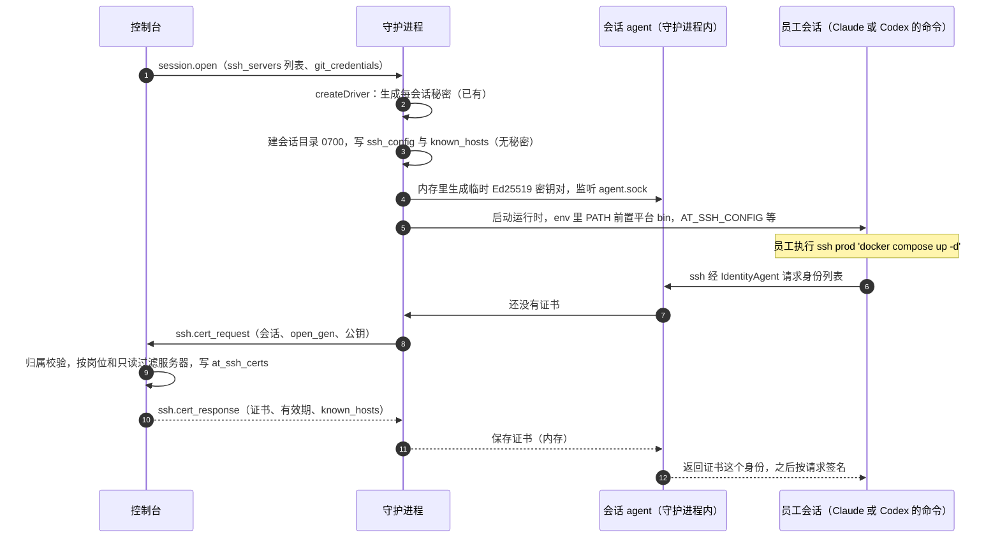
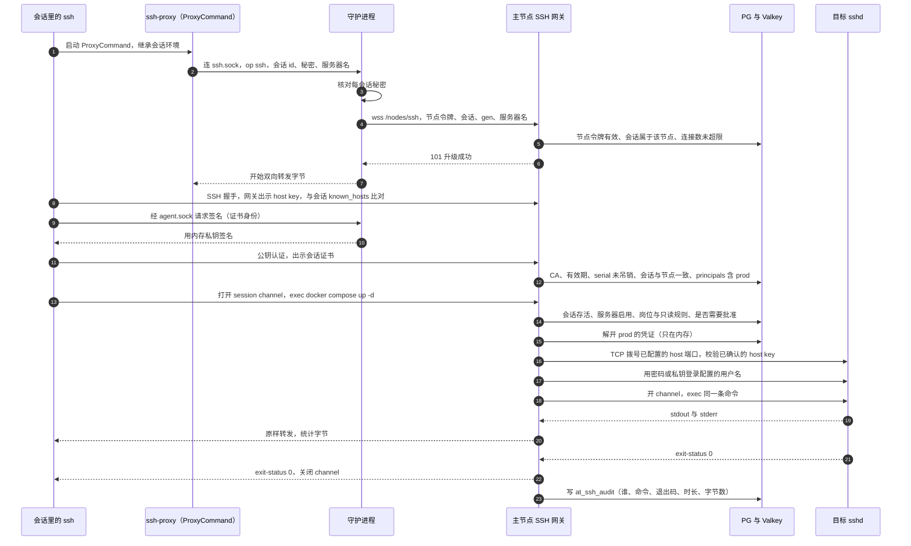
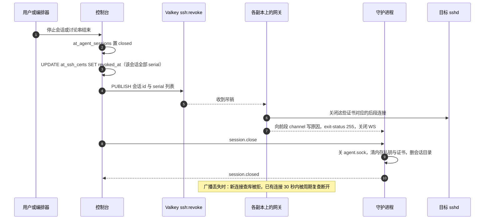

# 远程服务器访问与凭证代理（设计稿）

状态：设计稿（2026-11-19），等用户审阅；**本文只是设计，还没有任何代码**。审过之后按 §13 分期开发。

本文和 `architecture.md`（总体结构、§10 安全模型）、`protocol.md`（节点协议）、`data-model.md`（表结构）、`api.md`（网页接口）一起读。引用的现有代码位置都相对于仓库根，并已逐个打开核对过（附录 A）。

术语（首次出现时解释，后文直接用）：

| 术语 | 意思 |
| --- | --- |
| 主节点 / 控制台 | 平台服务端，Go 单二进制 `atctl`（`server/`）。本文两种叫法通用 |
| 节点 / 守护进程 | 用户机器上跑的 `agent-teams-node`（`node/`），托管员工会话 |
| 会话 | 一个员工（组长或成员）在节点上的一次 Claude Agent SDK `query()` 或一个 Codex thread，对应 `at_agent_sessions` 的一行 |
| 目标服务器 | 项目里配置的远程机器（例如 ovh、clicodeplus），员工要 ssh 上去部署 |
| SSH 网关 | 主节点里新增的一个模块：对节点扮演 sshd，对目标服务器扮演 ssh 客户端，在中间桥接 |
| 会话证书 | 平台 CA 给某个会话签的 **SSH 用户证书**（OpenSSH 证书格式，`ssh-keygen -s` 签出来的那种），只用来向 SSH 网关证明“我是哪个会话”，到不了目标服务器 |
| CA | 证书颁发者。这里是平台自己持有的一对 Ed25519 密钥，私钥只在主节点 |
| ProxyCommand | ssh 客户端的一个配置项：不自己连 TCP，而是起一个子进程，把 SSH 字节流交给它的 stdin/stdout |
| ssh-agent 协议 | ssh 客户端向“代理”要公钥列表、请代理签名的本地协议（unix socket），私钥不交给 ssh 进程 |
| TOFU | Trust On First Use，首次连接时信任对方公钥。本文要求由**人**在网页确认，不由 AI 确认 |
| DEK / KEK | 信封加密里的“数据密钥”（每条凭证一把）和“包裹密钥”（主密钥，用来加密 DEK） |

---

## 1. 一句话

员工会话里的 `ssh prod` 不直接连目标服务器，而是经节点守护进程、一条到主节点同域名同端口的 WebSocket，连到主节点的 **SSH 网关**；会话用主节点临时签发的**会话证书**（有效 10 分钟、私钥只在守护进程内存里）向网关证明身份；网关每次建连、每个通道都重新核对“会话还活着、项目还授权这台服务器、需要时用户批准过”，再用只存在主节点的密码或私钥登录目标服务器，把两段桥接起来并记审计。节点上不留任何凭证，会话结束证书立即作废。GitHub 走同样的思路（现状已基本做到，§10 列出剩下的差距）。

## 2. 需求与边界

### 2.1 用户已定的需求

| 编号 | 需求 |
| --- | --- |
| R1 | 工作节点以后要做 CI/CD（部署到 ovh、clicodeplus 等），要能 ssh 到远程服务器 |
| R2 | 远程服务器在**项目**上配置：主机、端口、用户名，认证方式为密码或 SSH 私钥，保存在平台后端，加密存储 |
| R3 | 所有节点访问远程服务器都经主节点转发：密码和私钥只在主节点，不下发节点，AI 读不到 |
| R4 | 节点不留配置：不写 `~/.ssh`、不落盘；只在启动会话时给这一个会话临时接上；会话结束或被停止即失效；宿主机其他进程不能借用 |
| R5 | GitHub 凭证同样思路：App 私钥只在主节点，会话按次领取 1 小时、限定仓库和权限的安装令牌，经 git 凭证助手领取，不进环境变量常量、不进 remote URL、不落盘 |
| R6 | 轮换只在主节点做：记录每个凭证的创建时间、计划轮换时间，快到期提醒；节点不需要重新下发 |
| R7 | 会话凭证首选“平台自己当 CA，给会话签短期 SSH 用户证书”，证书只用于“节点 ssh 客户端 → 主节点网关”这一段；真正的密码/私钥仍只在主节点 |

末尾 §16 有“需求 → 章节”对照表。

### 2.2 不做什么

- 不做“远程签名”（主节点只替节点签 SSH 挑战、节点直连目标）：因为要支持**密码登录**，密码必须由持有它的一方在 SSH 握手里发出去，只能由主节点终结 SSH（用户已确认这个方向）。
- 不管节点自己的网络出口：员工仍然可以直接 `/usr/bin/ssh some-host`（不经平台），但那样拿不到任何平台凭证。本文只保证“平台凭证只经网关使用”，不负责节点的网络策略。
- 不支持自带 SSH 实现、不读 ssh_config 的工具（paramiko/fabric、Terraform 的 remote-exec、Go 写的部署工具）直连平台服务器。第一期只支持“最终调用 OpenSSH `ssh` 命令”的工具（§7.3）。
- 不给 AI 任何“查看凭证”的途径：没有平台工具、没有接口能取回明文。

## 3. 总体结构

```
 节点（用户机器，守护进程同一系统账号）                                 主节点（atctl）                         目标服务器
┌───────────────────────────────────────────────────────┐        ┌──────────────────────────────────────┐   ┌───────────┐
│ 员工会话（Claude 子进程 / Codex app-server 的命令）     │        │ httpapi  /nodes/ssh（WS 升级）        │   │  sshd     │
│   $ ssh prod 'docker compose up -d'                   │        │   │ ① 节点令牌认证                    │   │           │
│     └ 平台 bin/ssh 包装：ssh -F <会话 ssh_config>      │        │   ▼                                  │   │           │
│        ├ IdentityAgent = 会话 agent socket ───────┐   │        │ sshgw（新增）                         │   │           │
│        └ ProxyCommand = agent-teams-node ssh-proxy │   │        │   ② SSH 服务端：校验会话证书         │   │           │
│              │ ssh.sock（每会话秘密）               │   │  WSS   │   ③ 逐次校验：会话存活/授权/批准      │SSH│           │
│              ▼                                     ▼   │ 443端口│   ④ SSH 客户端：用密码或私钥登录 ────┼──►│           │
│ 守护进程：ssh 代理（每次连接开一条 WS） ───────────────┼──────►│   ⑤ 桥接 exec/shell/scp/sftp         │   │           │
│           会话 agent（内存里的临时 Ed25519 私钥 + 证书）│        │   ⑥ 审计 at_ssh_audit                 │   │           │
│ 已有：cred.sock（GitHub 令牌）、主 WS /nodes/connect ───┼──────►│ nodegw（已有）：ssh.cert_request 签证书│   └───────────┘
└───────────────────────────────────────────────────────┘        │ PG：at_remote_*、at_ssh_*（新增）      │
                                                                 └──────────────────────────────────────┘
```

要点：

- **两段 SSH**：节点 ssh 客户端 ↔ 网关（用会话证书），网关 ↔ 目标（用项目配置的密码或私钥）。两段各自加密；守护进程只转发第一段的密文，**守护进程和节点上的任何进程都看不到第二段的凭证**。
- **两层身份**：WebSocket 用节点令牌认证（是哪台节点），WebSocket 里跑的 SSH 用会话证书认证（是哪个会话）；网关要求两者一致（证书里的节点 = 链路节点）。
- **会话签证书走已有主连接**（新协议消息 `ssh.cert_request/response`，§12），数据走另开的 WebSocket（§6）。

## 4. 会话证书（R7，首选方案）

### 4.1 CA 密钥放哪

- 平台持有两对**互相独立**的 Ed25519 密钥：
  - **会话 CA**（`ssh_session_ca`）：给会话签用户证书。只有网关校验这些证书，所以 CA 公钥**不需要发给任何人**，目标服务器也不信任它（到不了目标，这正是 R7 要的）。
  - **网关 host key**（`ssh_gateway_host_key`）：网关对节点 ssh 客户端出示的主机密钥（§5.4）。
  - 以后（§11.8）若对目标服务器也用证书，再加第三对**目标 CA**，与会话 CA 分开：会话 CA 泄露不应能登录任何目标服务器。
- 存放：`at_settings` 里各一行，私钥按 §11.1 的信封加密密封（AAD = 键名）。主节点启动时解开放进进程内存；多副本都从库里读同一把（§5.8）。第一次启动时自动生成，管理员页显示公钥指纹与创建时间。
- 不放进环境变量，不写日志，`atctl admin reseal` 一并重新包裹（§11.1）。
- 轮换：生成新 CA，新签的证书用新 CA；网关在“旧 CA 签出的证书全部过期”（最多一个有效期，10 分钟）之前两把都接受，之后删除旧 CA。因为证书寿命短，CA 轮换对节点零影响。

### 4.2 谁生成会话密钥对（评估与结论）

| 做法 | 私钥在哪 | 评价 |
| --- | --- | --- |
| A. 主节点生成密钥对，连私钥一起下发 | 经 WS 到节点，再到某个文件或 env | 私钥过网络、会落进某处，违反“私钥不出生成者”的常识，**否** |
| B. 守护进程在内存里生成临时密钥对，只把公钥发给主节点签名；私钥写成会话目录里的文件给 `ssh -i` | 磁盘文件（0600） | 违反 R4（落盘），且同账号进程直接拷走文件即可离线使用到证书过期，**否** |
| C. 守护进程内存里生成，私钥**不交给 ssh 进程**，经每会话的 **ssh-agent 协议 unix socket** 提供签名（`IdentityAgent <socket>`） | 只在守护进程内存 | 不落盘；私钥本身拿不走，同账号进程最多能在会话存活期内“借用签名”（且仍要过网关的逐次校验和节点绑定）；ssh/scp/sftp/rsync/git 都原生支持 `IdentityAgent` |
| D. 守护进程自己当 SSH 客户端，会话里的 ssh 只连本地 | 内存 | 要在 Node 里实现一个完整 SSH 客户端或中间人，且会话里的 `ssh` 命令就不再是真的 OpenSSH，兼容性差，**否** |

**结论：C。** 具体：

- 时机：每次守护进程为会话**创建驱动**时（`node/src/daemon.ts` 的 `Daemon.createDriver` → `Daemon.sessionEnv`，即首次打开、恢复、停放后再起、崩溃后重启都会走到）生成一对新的 Ed25519 密钥（`node:crypto` 的 `generateKeyPairSync('ed25519')`），只放在该会话对象里；驱动销毁时丢弃。这和现有 GitHub 每会话秘密的时机一致（`node/src/cred/server.ts` 的 `CredServer.register` 在 `Daemon.credEnv` 里每次打开都换新）。
- agent socket：守护进程为该会话监听 `<会话目录>/agent.sock`（§7.2，目录 0700、socket 0600），只实现 ssh-agent 协议里的两条请求：`SSH_AGENTC_REQUEST_IDENTITIES`（返回**证书**这一个身份）和 `SSH_AGENTC_SIGN_REQUEST`（用内存私钥签名，只接受证书或其公钥的 blob）；其余请求（添加、删除、锁定、扩展）一律回失败。实现很小（几十行，按 RFC draft-miller-ssh-agent 的帧格式），不需要新 npm 依赖。
- **不设** `SSH_AUTH_SOCK` 环境变量（那会让会话里所有 ssh 调用都试这把证书，也会被别的工具误用），只在会话 ssh_config 里写 `IdentityAgent`。

### 4.3 证书里放什么

| 字段 | 值 | 说明 |
| --- | --- | --- |
| 类型 | `ssh-ed25519-cert-v01@openssh.com`，用户证书 | |
| Serial | 全局递增（`at_ssh_certs.serial`） | 吊销按序号 |
| KeyId | `s_<会话>/g<open_gen>/em_<员工>/th_<讨论串>/n_<节点>` | 只为日志好读；**授权判断不信 KeyId**，以库里 serial 对应的行为准 |
| ValidPrincipals | 本项目里这个会话**此刻可用**的服务器名，例如 `["prod","staging"]` | 签发时按 §9.1 的规则（岗位、只读）过滤；需要批准但还没批准的服务器**也放进来**，批准在连接时等（§9.2） |
| ValidAfter / ValidBefore | 签发时间 − 60 s / 签发时间 + 10 min | 60 s 容忍节点时钟偏差；有效期见 §4.4 |
| critical options | **不用** `force-command`、`source-address` | `force-command` 由网关自己按通道类型决定，不需要证书来限；`source-address` 无意义：网关看到的连接来自本机 WebSocket 桥，不是节点 IP。网关遇到任何 critical option 都拒绝（防以后误签） |
| extensions | `permit-pty`；第一期**不放** `permit-port-forwarding`、`permit-agent-forwarding`、`permit-X11-forwarding`、`permit-user-rc`；自定义扩展 `session@agent-teams.dev=<会话 id>`、`gen@agent-teams.dev=<open_gen>`、`node@agent-teams.dev=<节点 id>` | 端口转发即使以后开放，也只对 `allow_port_forward` 的服务器签（§5.2）。自定义扩展名按 OpenSSH 约定带 `@域名` |
| SignatureKey | 会话 CA | |

### 4.4 有效期与续签

- 有效期 **10 分钟**（待拍板 Q7，可选 5～15 分钟）。证书只在 SSH **认证那一刻**被检查，已经建好的连接（例如 30 分钟的部署）不受证书过期影响；它们由 §4.7 的周期复查和吊销来管。
- 续签：守护进程在证书剩余 < 3 分钟或下一次 agent 签名请求到来时剩余 < 3 分钟，就用**同一把公钥**发 `ssh.cert_request` 换一张新证书（同一驱动生命周期内密钥对不变）；空闲会话不主动续签，下次用时按需签。签发是主连接上的一次往返（几毫秒），失败（主节点不可达）时 ssh 认证失败并在 stderr 说明，不重试死循环。
- 签发时机：会话打开时**不预签**，第一次需要（agent 收到 `REQUEST_IDENTITIES`）时才签。好处：从不用 ssh 的会话不产生证书和审计行。

### 4.5 绑定会话

证书和会话是一对一的，三道绑定：

1. **签发时**：`ssh.cert_request {session_id, open_gen, public_key}` 走主连接，控制台先过 `protocol.md` §2.3 的归属校验（会话属于本节点、未关闭、`open_gen` 是当前值、项目所有者 = 节点所有者，现有实现 `server/internal/nodegw/owner.go` 的 `Gateway.checkSession`），再签。
2. **证书里**：自定义扩展写死会话、`open_gen` 和节点；`at_ssh_certs` 记下 serial → (会话, gen, 节点, 公钥指纹)。
3. **使用时**：网关要求“证书的节点 = 这条 WebSocket 用节点令牌认证出来的节点”“证书的会话 = WebSocket 请求头里声明的会话”“该会话当前 `open_gen` = 证书的 gen”。所以证书被拷到别的节点、或会话换代（停放后重开）后，旧证书即刻无用。

### 4.6 吊销

- 主节点侧状态是唯一依据：`at_ssh_certs.revoked_at` + 会话本身的状态（`at_agent_sessions.state`、`open_gen`）。
- **会话结束立即作废**：控制台在会话变为 `closed`/`crashed`、`open_gen` 前进、讨论串结束、项目删除、服务器被删除或停用、凭证被用户“立即断开”时，把相关 serial 标 `revoked_at`，并在 Valkey 频道 `ssh:revoke` 广播 `{serials, session_id}`；每个副本上的网关收到后**立即断开**这些证书建立的所有连接（目标侧连接一并关闭）。
- 网关建连时**总是查库**（serial 未吊销、会话活着），不信任本地缓存，所以即使广播丢了，新连接也进不来；已建立的连接靠下一节的周期复查兜底（最多 30 秒）。
- 过期 30 天后的 `at_ssh_certs` 行由每日清理删除（审计表里另有一份引用，§9.4）。

### 4.7 证书与“逐次校验”的关系

证书**只证明身份**（这是哪个会话、哪台节点），**不代表授权**。网关在下列每个时点都重新查库判断：

| 时点 | 检查 |
| --- | --- |
| WebSocket 升级 | 节点令牌有效、所有者 active；请求的会话属于该节点（同 `owner.go` 的规则）；连接数限额（§5.7） |
| SSH 认证（公钥认证，证书） | 证书由会话 CA 签、在有效期、无 critical option、serial 存在且未吊销、扩展里的会话/gen/节点与上一行一致；请求的服务器名在 principals 里 |
| 打开每个 session channel（exec / shell / subsystem）| 会话仍活着且 gen 未变；项目里这台服务器仍存在、启用、凭证有效；岗位限制、只读规则（§9.1）仍允许；需要批准时已批准（§9.2，未批准则在这里等）|
| 连接存续期间，每 30 秒 | 同上一行的前三项；不再满足就向 channel 写一行原因到 stderr、发 `exit-status 255`、断开 |
| 目标侧 | host key 必须等于已确认的指纹（§5.3），否则拒绝 |

一句话：证书让网关不必相信节点说的“我是谁”，逐次校验决定“现在还让不让”。

### 4.8 备选：不透明 bearer 会话令牌走 ProxyCommand

做法：主节点给会话一个随机令牌（像 `AT_CRED_SECRET` 那样放进会话 env），ProxyCommand 带着它连网关；网关再用一个固定的、所有会话共用的“空认证”SSH 服务端，或用 keyboard-interactive 把令牌当密码收。

| 对比项 | 会话证书（首选） | bearer 令牌 |
| --- | --- | --- |
| 秘密形态 | 私钥只在守护进程内存，ssh 进程只拿到“签名服务” | 一串字符串，在会话 env 里（同账号进程可读 `/proc/<pid>/environ`），能被拷走 |
| 被偷后能做什么 | 只能在本节点、会话存活期内借签名（仍受网关全部校验）；离开本节点无用 | 只要节点令牌没被一起偷走也用不了（同样绑定节点），但令牌本身可在会话期内任意复制给同机其它进程 |
| 过期 | 证书自带 10 分钟有效期，网关不查库也知道过期 | 要自己做过期和续期 |
| 网关认证代码 | 标准 SSH 公钥认证（`golang.org/x/crypto/ssh` 的 `CertChecker`） | 自定义认证方式或滥用 keyboard-interactive |
| 与 OpenSSH 工具的兼容 | ssh/scp/sftp/rsync/git/ansible 原生走 agent | ProxyCommand 能带令牌，但令牌必须在 env 或命令行里 |
| 额外生成的东西 | 一把内存密钥 + 一张证书 | 一个令牌 |
| 实现量 | 节点多一个极小的 agent（§4.2） | 略少 |

**为什么首选证书**：它满足 R7 的“只用来向网关鉴权、不额外生成一堆东西”，同时比令牌少一个“可复制的字符串”；有效期、身份、principals 都在证书里，由标准库校验，网关逻辑更简单。代价是节点上要实现一个很小的 ssh-agent，可接受。

## 5. SSH 网关（主节点终结 SSH）

新包 `server/internal/sshgw`，用 `golang.org/x/crypto/ssh`（`go.mod` 已有 `golang.org/x/crypto v0.59.0`，只是新增导入子包，不增加模块依赖）。

### 5.1 两段连接

- **前段（节点 → 网关）**：网关对每条 `/nodes/ssh` WebSocket 调 `ssh.NewServerConn`，`ServerConfig` 只开公钥认证（`PublicKeyCallback` 里用 `ssh.CertChecker` 校验会话证书，见 §4.7），不开密码和 keyboard-interactive；不接受非证书的普通公钥。
- **后段（网关 → 目标）**：前段认证通过、第一个 channel 打开时，网关按服务器配置 `ssh.Dial("tcp", host:port, ClientConfig{User, Auth, HostKeyCallback})`。一个前段连接对应一个后段连接（1:1），前段关闭后段跟着关。
- **用户名**：目标用户名一律取服务器配置；前段 ssh 客户端发来的用户名必须等于服务器名（会话 ssh_config 里每个 `Host <名>` 都写了 `User <名>`），否则拒绝并提示“用户名由平台配置，请直接 `ssh <服务器名>`，不要写 `user@`”。这样 `ssh root@prod` 不会被悄悄换成别的用户执行。

### 5.2 功能支持

| 功能 | 第一期 | 做法 / 理由 |
| --- | --- | --- |
| `exec`（`ssh prod 'cmd'`） | 支持 | 在后段开 session channel 发同样的 `exec`；stdin/stdout/stderr 双向拷贝；`exit-status`、`exit-signal` 原样回传 |
| 交互式 shell + pty | 支持 | 转发 `pty-req`（终端类型、行列、modes）、`shell`、`window-change`；会话里的 AI 一般不用交互 shell，但 Claude 的 Bash 工具偶尔会 `ssh -t` |
| 信号 | 支持 | 转发 `signal` 请求（OpenSSH 服务端从 7.9 起支持，老服务端忽略） |
| `env` 请求 | 只转发 `LANG`、`LC_*` | 与 sshd 默认 `AcceptEnv` 一致；其他丢弃，防止把节点环境带到目标 |
| scp | 支持 | 现代 scp（OpenSSH 9.0+）默认走 sftp 子系统；`scp -O` 走 `exec scp -t/-f`，都是透传 |
| sftp 子系统 | 支持 | 转发 `subsystem sftp`；第一期只透传并记字节数，第二期解析 sftp 包记文件级操作（§9.4） |
| 其它子系统 | 拒绝 | 只放行 `sftp` |
| 本地端口转发 `direct-tcpip`（`ssh -L`） | **默认关**，第三期按服务器开关 | 风险：把目标服务器变成进入其内网的跳板（例如连目标机房里的数据库）。开了也只允许服务器配置里列出的 `目的主机:端口`（默认只 `127.0.0.1:*` 的指定端口），由**目标 sshd** 去连（网关在后段开 `direct-tcpip` channel），网关本身从不主动连这些地址；证书要带 `permit-port-forwarding` |
| 远程转发 `tcpip-forward`（`ssh -R`） | 不支持 | 会让目标反向连进节点或网关，没有部署场景需要 |
| agent 转发 | 不支持 | 会让目标服务器反过来用会话 agent 签名（等于把会话身份交给目标机上的任何人）；部署需要的 git 拉取请在目标机上用它自己的部署密钥 |
| X11 | 不支持 | 无图形需求；X11 转发是公认的高风险面（目标可读写节点的显示） |
| `keepalive@openssh.com` 等全局请求 | 回应 | 保活 |

不支持的请求回 `false`，并在审计里记一行 `denied`（§9.4）。

### 5.3 目标 host key 固定

- 每台服务器在 `at_remote_host_keys` 里有已确认的主机公钥（可以多把：rsa/ecdsa/ed25519）。后段 `HostKeyCallback` 只接受**已确认**的公钥，`HostKeyAlgorithms` 按已确认的类型设置。
- 来源两种：
  1. **配置时填写**：用户粘贴 `ssh-keyscan` 输出或 `known_hosts` 行，直接是 `trusted`。
  2. **首次连接由用户确认**：用户点“测试连接”时，网关连一次目标，拿到主机公钥但**不发送凭证**就断开，把公钥存为 `pending`，网页弹窗显示类型和 SHA256 指纹，请用户对照（例如到服务器控制台看 `ssh-keygen -lf /etc/ssh/ssh_host_ed25519_key.pub`）后点“确认”。只有用户（网页会话）能确认；**AI 发起的连接遇到没确认的 host key 一律失败**，不会触发确认流程，也不会因此出卡片让 AI 劝用户点。
- **指纹变化**：后段看到的公钥不在已确认列表里 → 拒绝连接，不发送凭证；记审计 `host_key_mismatch`，把新公钥存为 `pending`（标“变化”），给项目所有者发通知；会话 stderr 提示“目标服务器的主机密钥变了，已拒绝连接，请用户在项目设置里核实”。用户核实后可以“接受新密钥（旧的作废）”。不提供“忽略校验”的开关。

### 5.4 网关自己的 host key 怎么让会话信任

- 网关用一把固定的 host key（§4.1 的 `ssh_gateway_host_key`，所有副本共用）。
- 会话 ssh_config 每个 `Host` 都写 `HostKeyAlias agent-teams-gateway`，会话目录里的 `known_hosts` 只有一行 `agent-teams-gateway ssh-ed25519 AAAA…`，并设 `StrictHostKeyChecking yes`、`UpdateHostKeys no`、`GlobalKnownHostsFile /dev/null`。
- 为什么不用 `@cert-authority`：known_hosts 是每次签证书时由主节点随证书一起下发（`ssh.cert_response.known_hosts`）、每个会话现生成的，换 host key 时下发里同时列新旧两行即可，没必要再引入 host CA。若以后节点要长期缓存信任（目前不会），再改成 `@cert-authority`。

### 5.5 keyboard-interactive 和需要 2FA 的目标

- 只有“密码”时：后段 `Auth` 依次给 `ssh.Password(pw)` 和 `ssh.KeyboardInteractive`；后者只在服务器发来**恰好一个、不回显**的问题时用密码作答（PAM 默认的 `Password:` 提示），其他形状的问题一律放弃。这覆盖了把密码认证配成 keyboard-interactive 的常见 sshd。
- 真正的 2FA（验证码、Duo 推送）：**第一期不支持**，配置页提示“请为部署用户配置 SSH 密钥登录”。不存 TOTP 种子（那等于平台替人做第二因素，失去 2FA 的意义）。若以后确实需要，可做“把问题转成网页卡片、由用户实时输入验证码”的第三期功能（每次连接都要人在场，适合偶尔的人工运维，不适合 CI/CD）。
- 私钥带口令：配置时一并填口令，同样加密保存；网关用 `ssh.ParsePrivateKeyWithPassphrase` 解开，只在内存里。

### 5.6 目标地址限制（防止网关被当跳板扫内网）

- 后段只会连**服务器配置里的 host:port**，前段客户端无法指定任何地址（没有 `-J`/`direct-tcpip` 到任意地址的路径）。
- 配置时校验 host：解析后的地址若是回环、链路本地（含云元数据 `169.254.169.254`）、主节点自身所在的私有网段（例如 compose 内网里 PG/Valkey 的地址）或未指定地址，拒绝保存，除非部署管理员在 `at_settings` 的 `ssh_allowed_private_cidrs` 里显式放行（自托管时目标确实可能在内网）。**每次拨号前再解析、再校验一次**，防 DNS 重绑定。
- “测试连接”和真实连接都限速（每服务器每分钟 10 次新连接），失败多次暂停，防止拿网关做端口扫描或暴力尝试。

### 5.7 连接数与超时

| 限制 | 默认 | 说明 |
| --- | --- | --- |
| 每会话同时连接 | 4 | 部署脚本通常一两条；`ansible -f` 会开多条，可在服务器上调大 |
| 每台服务器同时连接（全平台） | 8 | 防止把目标打满 |
| 每项目同时连接 | 16 | |
| 握手超时 | 15 s（前段认证）/ 20 s（后段拨号 + 认证） | |
| 空闲超时 | 30 min 无任何数据（双向）断开 | 可按服务器配置；部署命令长时间无输出时用 `ServerAliveInterval` 保活不算数据，需要的话调大 |
| 单连接最长 | 6 h | 防止遗忘的交互 shell 常驻 |
| 保活 | 前段、后段都每 30 s `keepalive@openssh.com` | |

计数放在 Valkey（`INCR`/`DECR` + 过期兜底），多副本共享。

### 5.8 主节点多实例

- 现状是单副本起步、可横向扩展（`architecture.md` §3.1）。`/nodes/ssh` 是普通的 HTTP 升级请求，可以落在**任何副本**上：网关在本副本直接终结两段 SSH，不需要与持有该节点主连接的副本是同一个（这一点比方案 (a) 复用主连接好，§6）。
- 共享的东西都在 PG / Valkey：CA 和网关 host key（PG，所有副本相同）、证书吊销（PG + `ssh:revoke` 广播）、连接计数（Valkey）、审计（PG）。
- 副本重启或滚动升级会断开其上的 SSH 连接（和普通 sshd 重启一样），部署脚本应可重入；网关在关闭前向所有 channel 写“平台重启，连接中断”并发 `exit-status 255`。

## 6. 传输通道

### 6.1 现状

- 节点只有一条长连接：`wss://<console>/nodes/connect`（`protocol.md` §1）。服务端 `server/internal/nodegw/gateway.go`（`Gateway.ServeWS`，`github.com/coder/websocket`，`SetReadLimit(MaxFrame)`，4 MiB）、`server/internal/nodegw/link.go`（`link.reader` **逐帧串行**处理，`link.write` 一把发送锁、**文本帧** JSON）、`server/internal/nodegw/registry.go`（命令经 Valkey 频道 `node:<id>:cmd` 转到持有链路的副本）。可靠命令先写 `at_node_commands`（`server/internal/nodegw/outbox.go` 的 `Gateway.Enqueue`、`Gateway.flush`）。
- 节点端：`node/src/link/client.ts`（`Link`，`ws` 库，`JSON.stringify` 文本帧）、`node/src/link/dispatcher.ts`（按 lane 串行执行命令）、`node/src/link/outbox.ts`（可靠消息先写 `state/outbox/*.jsonl`）。
- 已有“守护进程走普通 HTTP 路由、用节点令牌认证”的先例：`server/internal/orchapi/attachments.go` 的 `API.nodeAttachment`（`GET /nodes/attachments/{id}`，调用 `Gateway.Authenticate`），路由挂在 `server/internal/orchapi/api.go`（`API.registerNodeLinks` 挂 `/nodes/connect`），授权行在 `server/internal/httpapi/authz/policy.csv`（`node-token` 主体）。
- 值得注意：主连接的读循环里，`cred.request` 是**同步**处理的（`link.handleUnreliableOwned` → `delivery.Engine.Credential` 去 GitHub 铸令牌），一次慢请求就会让这条链路上后面的所有帧排队。这对“在主连接上跑大流量数据”是个直接的反证。

### 6.2 三个方案

| | (a) 复用主连接多路复用 | (b) 另开专用 WebSocket（同域名同端口） | (c) 独立 TCP 端口直接暴露 sshd |
| --- | --- | --- | --- |
| 改动 | 新增二进制帧类型、按流编号多路复用、每流窗口流控；`link.reader` 改成数据帧不进处理器；发件箱绕开 | 新路由 `GET /nodes/ssh`（WS 升级），一条 SSH 连接一条 WS，二进制帧 | 主节点多监听一个端口（例如 2222），节点 ssh 直连 |
| 队头阻塞 | 严重：同一 TCP 上一个 1 GB 的 scp 会让 `session.send`、审批、心跳排队；现有 45 s 无帧断线规则可能被触发；读循环串行还会把数据和控制消息互相拖慢 | 无：每条 SSH 连接自己的 TCP，和主连接互不影响 | 无 |
| 流控 / 背压 | 要自己实现（每流窗口 + WINDOW_ADJUST），等于在 WS 里再做一遍 SSH 已经做过的事 | 交给 TCP + SSH 自己的 channel 窗口，网关和守护进程只做“读满就暂停”的管道 | 同 (b) |
| 帧格式 | 现有协议是 JSON 文本帧 + Schema 校验，需扩出二进制帧和例外规则 | 新路由只用二进制帧，不进 Schema，不碰现有协议 | — |
| 多副本 | 数据必须经持有主连接的那个副本，或再加副本间转发 | 任何副本都能接 | 任何副本，但要负载均衡器支持 TCP |
| 部署 / 网络 | 无新端口 | 无新端口、同一 TLS 证书、Caddy 已经代理 WebSocket（`/nodes/connect` 就是）| 新端口要开防火墙、TLS 之外的 SSH 端口常被公司网络封、会暴露到公网被扫 |
| 节点身份 | 主连接已认证 | 每条 WS 用节点令牌认证（同主连接） | 只有 SSH 证书，失去“节点令牌”这一层；且 sshd 端口直接对公网 |
| 握手开销 | 无 | 每条 ssh 多一次 TLS + WS 握手（几十毫秒） | 无 |

### 6.3 推荐：(b)

理由：现有主连接是为“小 JSON 控制消息 + 可靠重放”设计的（串行读循环、发件箱、4 MiB 帧上限、Schema 校验），把字节流塞进去收益为零、风险很大；(c) 多开端口、少一层节点认证，且公网 SSH 端口会持续被扫。(b) 不改现有协议、不开新端口、天然多副本，代价只是每条 ssh 多一次握手，部署场景完全可以接受。

### 6.4 `/nodes/ssh` 草案

```
GET /nodes/ssh  （WebSocket 升级，wss）
Authorization: Bearer <节点令牌>
X-AT-Session: s_01JD…        会话 id
X-AT-Open-Gen: 3
X-AT-Server: prod             服务器名（会话 ssh_config 里的 Host 名）
Sec-WebSocket-Protocol: agent-teams-ssh.v1
```

- 认证同 `Gateway.Authenticate`；会话归属同 `owner.go` 的 `checkSession`；服务器名必须是会话所属项目里的服务器；任何一项不符 → 401/404，不升级（并计入 `node_message_rejected` 同类审计）。
- 升级后：二进制帧，双向就是一条 SSH 字节流；不压缩（SSH 已加密，压缩无用且有 CRIME 类风险）；WS 层 ping 30 s。
- 授权行：`policy.csv` 加 `p, node-token, /nodes/ssh, GET`（新路由没有这一行就会被拒，`server/internal/httpapi/authz_test.go` 会失败提醒）。
- 守护进程侧：每次 `ssh-proxy` 连上 `ssh.sock` 就开一条新的 WS；连接失败时 ProxyCommand 以非零退出、在 stderr 写原因（ssh 会显示“kex_exchange_identification: Connection closed”之前的那行）。

## 7. 会话接入

### 7.1 流程



### 7.2 节点上会出现的东西

全部在守护进程控制的目录里，**没有一个文件含秘密**，会话结束删除：

| 东西 | 位置 | 内容 | 权限 |
| --- | --- | --- | --- |
| 会话目录 | `$XDG_RUNTIME_DIR/agent-teams-ssh/<会话>/`（tmpfs；没有 `XDG_RUNTIME_DIR` 时用 `<data>/agent-teams/run-ssh/<会话>/`）。故意**不放在** `runtimeDir`（`$XDG_RUNTIME_DIR/agent-teams`，它在沙箱的 `denyRead` 里，§8.3） | 下面三项 | 目录 0700 |
| `ssh_config` | 会话目录 | 每台可用服务器一个 `Host` 块（见下） | 0600 |
| `known_hosts` | 会话目录 | 一行网关 host key（§5.4） | 0600 |
| `agent.sock` | 会话目录 | ssh-agent 协议，签名用的私钥在守护进程内存 | 0600 |
| `ssh.sock` | `<runtimeDir>/ssh.sock`，与现有 `cred.sock` 同目录、同规则（`node/src/cred/server.ts` 的 `credSocketPath`）；沙箱节点见 §8.3 | ProxyCommand 用来让守护进程开 WS；请求带每会话秘密 | 0600 |
| 平台 bin 包装 | `<data>/agent-teams/platform/bin/`（已有，`node/src/git/platform.ts` 的 `installPlatformFiles` 写 `gh` 包装；员工不可写） | 新增 `ssh`、`scp`、`sftp` | 0755 |

`ssh_config` 示例（主节点随证书下发服务器列表，守护进程生成）：

```
# agent-teams：本会话可用的服务器，会话结束后删除
Host prod
  User prod
  HostKeyAlias agent-teams-gateway
  ProxyCommand /usr/bin/node /…/agent-teams-node ssh-proxy --server prod
Host staging
  User staging
  HostKeyAlias agent-teams-gateway
  ProxyCommand /usr/bin/node /…/agent-teams-node ssh-proxy --server staging
Host prod staging
  IdentityAgent /run/user/1000/agent-teams-ssh/s_01JD…/agent.sock
  IdentitiesOnly yes
  IdentityFile none
  UserKnownHostsFile /run/user/1000/agent-teams-ssh/s_01JD…/known_hosts
  GlobalKnownHostsFile /dev/null
  StrictHostKeyChecking yes
  UpdateHostKeys no
  ForwardAgent no
  ForwardX11 no
  ControlMaster no
  ServerAliveInterval 30
```

- ProxyCommand 的参数里**没有秘密**：`ssh-proxy` 子命令从自己继承的环境里读 `AT_CRED_SESSION`/`AT_CRED_SECRET`（ssh 会把环境原样传给 ProxyCommand），像 `git-credential` 一样连 socket（`node/src/cred/helper.ts` 的 `askSocket` 同一套格式，`op: "ssh"`），守护进程核对秘密后把这条 unix 连接和新开的 `/nodes/ssh` WS 对接成管道。
- `ControlMaster no`：第一期不复用连接，避免主连接进程在会话结束后还活着（ansible 自己的 ControlPersist 见 §7.3）。
- 只想“零文件”的话也可以全部改用命令行 `-o` 选项加 `KnownHostsCommand`（OpenSSH 8.5+），代价是包装脚本复杂、老版本 ssh 不支持；这些文件不含秘密、在 tmpfs、会话结束删除，推荐保留文件方案。

### 7.3 包装与间接调用 ssh 的工具

ssh **不从环境变量读配置文件位置**（没有 `SSH_CONFIG` 这种变量），所以必须包装：

- 平台 bin 里的 `ssh`：`exec <真实 ssh> -F "$AT_SSH_CONFIG" "$@"`；`scp`、`sftp` 同理（两者都支持 `-F` 并会传给 ssh）。真实 ssh 的路径由守护进程启动时在 PATH 里找（跳过平台 bin 自己，同 `node/src/git/gh-install.ts` 的 `ghOnPath` 跳过包装目录的做法），写死进包装脚本。会话没有 `AT_SSH_CONFIG`（没配服务器的项目、统筹）时包装直接 `exec` 真实命令，行为与没包装一样。
- 需要节点装 OpenSSH 客户端（`IdentityAgent` 需要 7.3+）；守护进程启动时探测版本，写进 `hello` 的新字段 `ssh_client`，节点页显示，没有时项目设置里提示“该节点不能用远程服务器”。
- **rsync**：默认用 PATH 里的 `ssh`，即我们的包装，`rsync -az dist/ prod:/srv/app/` 直接可用；`-e "ssh -p 22"` 这种写法里的 `ssh` 也走 PATH，同样可用。
- **git over ssh**（例如在节点上 `git push prod:/srv/repo.git`）：git 默认调用 PATH 里的 `ssh`，即包装，可用；不设置 `GIT_SSH_COMMAND`（免得覆盖员工自己的设置）。会话里若有人设了 `GIT_SSH_COMMAND=ssh -i …`，其中的 `ssh` 仍走 PATH 包装。
- **ansible**：默认 `ansible_ssh_executable=ssh`（走 PATH），inventory 写 `prod` 这类服务器名即可；ansible 会加自己的 `-o ControlMaster=auto -o ControlPersist=60s -o ControlPath=~/.ansible/cp/…`，主连接进程会在会话结束后最多再活 60 秒，但会话一结束证书就吊销、网关立即断开其连接（§4.6），所以借不到。不要在 inventory 里写 `ansible_user`（§5.1 会拒绝）。系统提示词里写明这两条。
- **docker `-H ssh://prod`**：docker CLI 调用 PATH 里的 `ssh`，可用。
- 不支持：自带 SSH 实现的工具（§2.2）。

### 7.4 Claude Agent SDK 怎么注入

调用链（全部已核实）：

1. `node/src/daemon.ts` 的 `Daemon.createDriver` 为每次运行构造 `DriverContext`，其中 `env: this.sessionEnv(spec)`。
2. `Daemon.sessionEnv` 调 `node/src/sessions/env.ts` 的 `buildEnv`：从 `base`（守护进程环境）**逐项挑选**（`passList` 白名单，`AGENT_TEAMS_*` 一律去掉，注释写明“SDK env 是替换不是合并”），再叠加 `extra`（员工身份、`spec.env`）和 `fixed`（`Daemon.claudeFixed` + `Daemon.credEnv` 的 GitHub 变量），`pathPrefix` 在有 `AT_CRED_SOCK` 时把平台 bin 放到 PATH 最前。
3. `node/src/sessions/claude/driver.ts` 把 `this.ctx.env` 交给 `node/src/sessions/claude/options.ts` 的 `buildClaudeOptions`，后者设 `env: { ...i.env, ...claudeCompactEnv(i.context) }` 传给 SDK；claude 子进程及其 Bash 工具都继承这份环境。

要改的：

- `Daemon.sessionEnv` 增加 `sshEnv(spec)`：当 `spec.ssh_servers` 非空且员工不是统筹时，返回 `AT_SSH_CONFIG=<会话目录>/ssh_config`；`AT_CRED_SOCK/SESSION/SECRET` 已经由 `credEnv` 给了（SSH 复用同一个每会话秘密，`ssh.sock` 校验方式与 `cred.sock` 相同）。`pathPrefix` 的条件改为“有 cred 或有 ssh”。
- 没给 `git_credentials` 但给了 `ssh_servers` 的会话（理论上不会，组长和成员两者都有）也要注册秘密：把 `CredServer.register` 从 `credEnv` 里提出来，两者共用。
- 沙箱：`buildSettings` 里的 `sandbox` 需要能连 `ssh.sock` 与会话 `agent.sock`，见 §8.3。

### 7.5 Codex 怎么注入，以及共用 app-server 意味着什么

- 每个节点只有**一个** `codex app-server` 进程（`node/src/sessions/codex/hub.ts` 的 `CodexHub.ensure`，注释“One `codex app-server` per node”），它的环境是 `Daemon.codexServerEnv`（只有基础变量和 `CODEX_HOME`，**不含**任何会话的秘密）。多个 Codex 会话 = 同一进程里的多个 thread（`CodexHub.register(threadId, …)` 按 threadId 路由）。
- 会话的环境通过每个 thread 的配置注入：`node/src/sessions/codex/driver.ts` 的 `CodexDriver.threadParams` 设 `shell_environment_policy: { inherit: "core", set: this.ctx.env }`，`thread/start` / `thread/resume` 时带上；Codex 给这个 thread 起的每条命令用这份环境（`set` 覆盖 `PATH`，所以平台 bin 包装同样生效）。SSH 不需要额外改 Codex 驱动：`ctx.env` 里有了 `AT_SSH_CONFIG` 和 PATH，就和 GitHub 凭证一样生效。
- **对隔离的含义**（要老实说）：
  - 所有 Codex 会话的命令都是同一个 app-server 进程的子进程、同一个系统账号；app-server 进程内存里同时有每个 thread 的 `set` 环境（含各自的 `AT_CRED_SECRET`）。thread A 的命令可以读 thread B 正在运行的命令的 `/proc/<pid>/environ`，同账号下也能 `ptrace` app-server（取决于内核 `ptrace_scope`），从而拿到 B 的秘密，冒充 B 去签证书、连服务器。
  - 所以“每会话隔离”在 Codex 上**只是环境变量层面的隔离**，挡得住“误用”（A 的命令默认只看到自己的变量），挡不住同节点上一个恶意的命令。好在网关的每一次校验都按“证书 → 会话 → 项目 → 服务器授权”来，B 冒用得到的仍只是 B 本来就有的权限；跨项目时，两个会话都在这台节点上，本来就属于同一个节点所有者。
  - 平台现在只把 Codex 派到 `agent_user` 或标记为 `isolated` 的节点（`server/internal/roles/roles.go` 校验岗位的节点、`server/internal/core/staff.go` 挑节点时都检查 `n.Isolated || n.Isolation == "agent_user"`）。但守护进程目前**从不**上报 `agent_user`（`node/src/isolation.ts` 的 `probeIsolation` 注释：守护进程以自己的账号跑员工），所以 Codex 实际只会落在管理员手工标 `isolated` 的节点（例如容器）。彻底的做法见 §8.4。

### 7.6 一次 ssh exec 的全链路



### 7.7 会话结束与吊销（各种结束方式都要清干净）

| 结束方式 | 节点侧（守护进程） | 主节点侧 |
| --- | --- | --- |
| 正常关闭（`session.close`） | `SessionManager.close`（`node/src/sessions/manager.ts`）最后调 `onSessionGone` → `Daemon.forgetSession`（现在做 `credServer.unregister`、`toolhost.remove`）；新增：关 `agent.sock`、丢弃内存私钥和证书、断开该会话所有 `ssh-proxy` 管道、删除会话目录 | 会话行 `closed` → 吊销该会话所有 serial，广播 `ssh:revoke` |
| 停放（空闲后停驱动）、换代（`open_gen` 前进） | 驱动销毁时同上（会话对象还在，但这一代的密钥和证书作废；再起时新生成） | gen 前进 → 吊销旧 gen 的 serial |
| 被用户停止 / 讨论串结束 | 同正常关闭 | 同上，另外讨论串结束时把该讨论串的服务器批准（§9.2）一起失效 |
| 运行时崩溃（自动重启） | `SessionManager.onExit` → 重启前销毁旧驱动的密钥；重启后新密钥 | 崩溃到最终 `crashed` 时吊销 |
| 守护进程崩溃或重启 | 内存里的私钥随进程消失，**物理上**无法再签名；启动时清空 `agent-teams-ssh/` 下所有会话目录（不论是谁的） | 节点链路断开时不立即吊销（会话可能马上恢复），但旧证书的私钥已经没了，等它自然过期（≤10 分钟）；守护进程重连后 `sessions.report` 里没有的会话按现有逻辑收尾，届时吊销 |
| 节点被删除 / 节点令牌轮换 | — | 吊销该节点所有未过期证书，断开其所有 `/nodes/ssh` 连接 |


