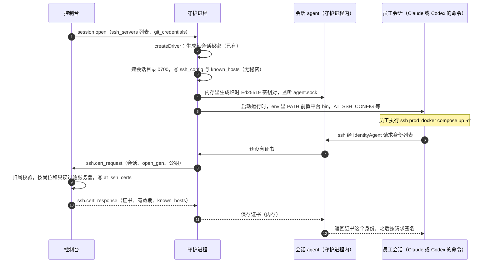
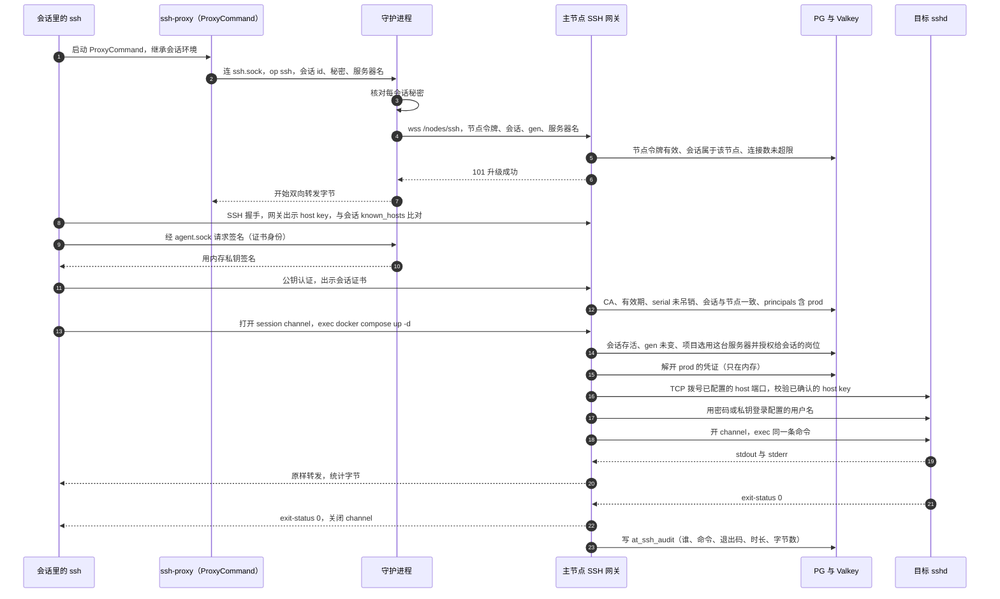
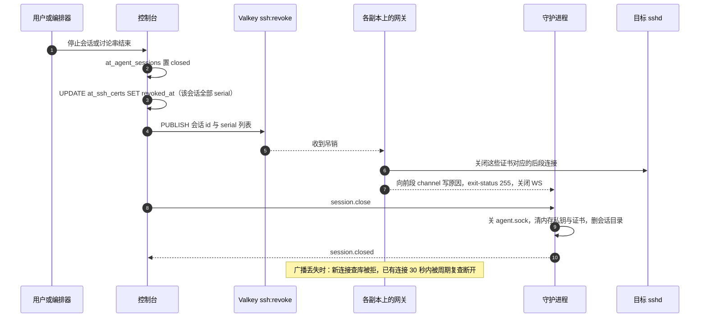
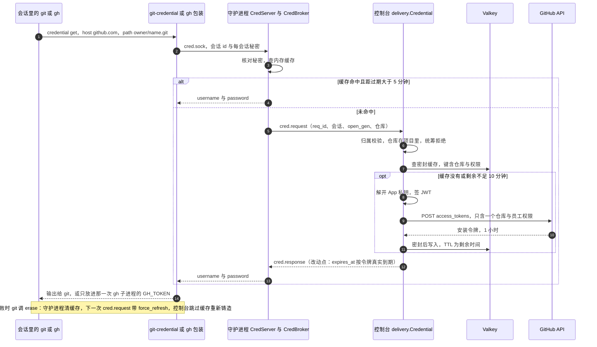
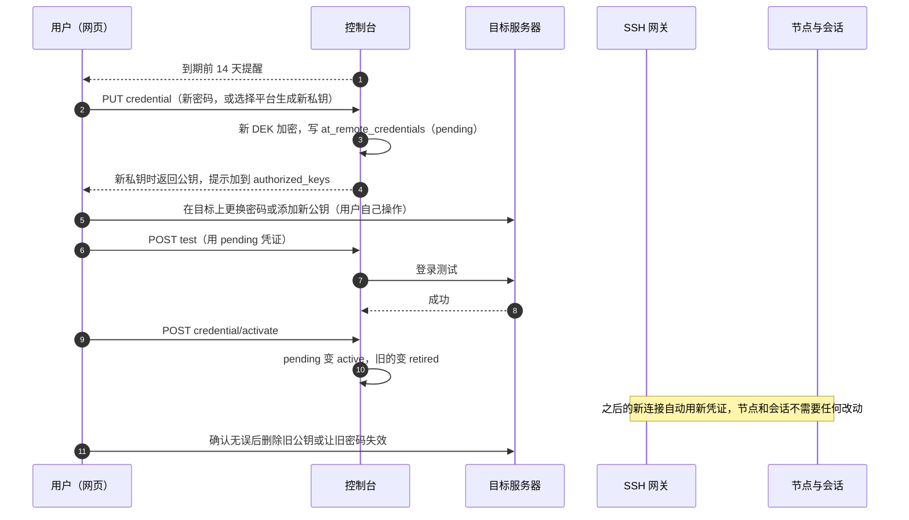

# 远程服务器访问与凭证代理（设计稿）

状态：**已实现（#38，2026-11-20）**。本文最初是 #29 写的设计稿；#38 按用户 2026-11-20 的决定实现了第一期，并把本文同步成实现后的样子。安全验证的命令和结果见 `remote-servers-verification.md`，端到端脚本是 `server/scripts/e2e-ssh/run.sh`。

**实现与最初设计的差异（以这里和代码为准）**：

| 方面 | 最初设计 | #38 实现 |
| --- | --- | --- |
| 服务器放在哪 | 项目上配置（`/api/projects/{pid}/servers` 增删改） | **用户设置 → 服务器**里全局配置，属于用户；项目在“项目设置 → 环境”里勾选用哪些（§9.1、§11.4） |
| 谁能用 | 按项目授权（组长和成员都能用），再加 `allowed_roles`、`allow_read_only`、`require_approval` 三个开关 | **按岗位授权**：每台选用的服务器勾选哪些岗位能用，没勾的岗位用不了；统筹、组长、只读岗位（审查 / 决策）不能勾（§9.1） |
| 首次连接批准 | 讨论串首次连接要用户批准（卡片、等待、预先批准） | **以后**（第一期不做，§9.2） |
| 表 | `at_remote_servers` + `at_remote_credentials` + `at_remote_host_keys` + `at_remote_grants`，迁移 00310 | `at_remote_servers`（凭证直接存在服务器行上，只存一条已确认的 host key）+ `at_project_servers` + `at_project_server_grants` + `at_ssh_certs` + `at_ssh_audit`，迁移 **`00330_remote_servers.sql`**（`data-model.md` §2.14，§11.2） |
| host key | 可存多把，`pending` → 用户点“确认” | 用户第一次“测试连接”时固定看到的那把（同时醒目显示类型和指纹，附 `ssh-keygen -lf` 核对命令）；之后不一致就拒绝并提供“重置主机密钥”；网关自己从不固定（§5.3） |
| 凭证轮换 | `pending`/`active` 两阶段、`rotate_after`、到期提醒 | 在设置里直接替换凭证（节点零操作，记 `cred_updated_at`）；两阶段轮换和到期提醒是**以后**（§11.5、§11.6） |
| 协议 | 另有 `ssh.revoke` | 没有 `ssh.revoke`：控制台侧吊销 + 网关断开是唯一依据，节点靠 `ssh.servers_update` 跟上；`ssh.cert_response.error` 多一个 `rate_limited`（§12，`protocol.md` §8.1） |
| 连接计数 | Valkey 共享 | 每个副本各自计数（§5.7） |
| 审计 | 另有 `sftp_op`、shell 录屏 | 第一期只有 `connect/disconnect/exec/shell/subsystem/denied/auth_fail/host_key_mismatch/test`；sftp 逐操作审计和录屏是**以后**（§9.4） |

**第一期不做**（以后再说）：首次连接人工批准卡片、端口转发、交互 shell 录屏、sftp 逐操作审计、测试连接多次失败后暂停、`sandbox` 级节点上的 Claude 会话注入 SSH（这类会话不给服务器）、PAT 连接收紧（员工会话仍直接拿 PAT，§10.3 第 1 条、Q8）、凭证两阶段轮换与到期提醒、`ssh_allowed_private_cidrs` 的管理界面（要放行内网段时由管理员直接写 `at_settings`）。

本文和 `architecture.md`（总体结构、§10 安全模型）、`protocol.md`（节点协议）、`data-model.md`（表结构）、`api.md`（网页接口）一起读。引用的现有代码位置都相对于仓库根，并已逐个打开核对过（附录 A）。

术语（首次出现时解释，后文直接用）：

| 术语 | 意思 |
| --- | --- |
| 主节点 / 控制台 | 平台服务端，Go 单二进制 `atctl`（`server/`）。本文两种叫法通用 |
| 节点 / 守护进程 | 用户机器上跑的 `agent-teams-node`（`node/`），托管员工会话 |
| 会话 | 一个员工（组长或成员）在节点上的一次 Claude Agent SDK `query()` 或一个 Codex thread，对应 `at_agent_sessions` 的一行 |
| 服务器（目标服务器） | 员工能访问的远程机器（例如 ovh、clicodeplus），员工要 ssh 上去部署。用户在“设置 → 服务器”里配置，项目里按岗位授权。区别于**节点**（运行 agent 的工作机器） |
| SSH 网关 | 主节点里新增的一个模块：对节点扮演 sshd，对目标服务器扮演 ssh 客户端，在中间桥接 |
| 会话证书 | 平台 CA 给某个会话签的 **SSH 用户证书**（OpenSSH 证书格式，`ssh-keygen -s` 签出来的那种），只用来向 SSH 网关证明“我是哪个会话”，到不了目标服务器 |
| CA | 证书颁发者。这里是平台自己持有的一对 Ed25519 密钥，私钥只在主节点 |
| ProxyCommand | ssh 客户端的一个配置项：不自己连 TCP，而是起一个子进程，把 SSH 字节流交给它的 stdin/stdout |
| ssh-agent 协议 | ssh 客户端向“代理”要公钥列表、请代理签名的本地协议（unix socket），私钥不交给 ssh 进程 |
| TOFU | Trust On First Use，首次连接时信任对方公钥。本文要求由**人**在网页“测试连接”时固定，不由 AI 的连接固定 |
| DEK / KEK | 信封加密里的“数据密钥”（每条凭证一把）和“包裹密钥”（主密钥，用来加密 DEK） |

---

## 1. 一句话

员工会话里的 `ssh prod` 不直接连目标服务器，而是经节点守护进程、一条到主节点同域名同端口的 WebSocket，连到主节点的 **SSH 网关**；会话用主节点临时签发的**会话证书**（有效 10 分钟、私钥只在守护进程内存里）向网关证明身份；网关每次建连、每个通道都重新核对“会话还活着、项目还把这台服务器授权给它的岗位”，再用只存在主节点的密码或私钥登录目标服务器，把两段桥接起来并记审计。节点上不留任何凭证，会话结束证书立即作废。GitHub 走同样的思路（现状已基本做到，§10 列出剩下的差距）。

## 2. 需求与边界

### 2.1 用户已定的需求

| 编号 | 需求 |
| --- | --- |
| R1 | 工作节点以后要做 CI/CD（部署到 ovh、clicodeplus 等），要能 ssh 到远程服务器 |
| R2 | 远程服务器：主机、端口、用户名，认证方式为密码或 SSH 私钥，保存在平台后端，加密存储。（2026-11-20 改为：在**用户设置**里全局配置，项目在环境页选用并按岗位授权） |
| R3 | 所有节点访问远程服务器都经主节点转发：密码和私钥只在主节点，不下发节点，AI 读不到 |
| R4 | 节点不留配置：不写 `~/.ssh`、不落盘；只在启动会话时给这一个会话临时接上；会话结束或被停止即失效；宿主机其他进程不能借用 |
| R5 | GitHub 凭证同样思路：App 私钥只在主节点，会话按次领取 1 小时、限定仓库和权限的安装令牌，经 git 凭证助手领取，不进环境变量常量、不进 remote URL、不落盘 |
| R6 | 轮换只在主节点做：记录每个凭证的创建时间、计划轮换时间，快到期提醒；节点不需要重新下发 |
| R7 | 会话凭证首选“平台自己当 CA，给会话签短期 SSH 用户证书”，证书只用于“节点 ssh 客户端 → 主节点网关”这一段；真正的密码/私钥仍只在主节点 |

末尾 §16 有“需求 → 章节”对照表。

### 2.2 不做什么

- 不做“远程签名”（主节点只替节点签 SSH 挑战、节点直连目标）：因为要支持**密码登录**，密码必须由持有它的一方在 SSH 握手里发出去，只能由主节点终结 SSH（用户已确认这个方向）。
- 不管节点自己的网络出口：员工仍然可以直接 `/usr/bin/ssh some-host`（不经平台），但那样拿不到任何平台凭证。本文只保证“平台凭证只经网关使用”，不负责节点的网络策略。
- 不支持自带 SSH 实现、不读 ssh_config 的工具（paramiko/fabric、Terraform 的 remote-exec、Go 写的部署工具）直连平台服务器。第一期只支持“最终调用 OpenSSH `ssh` 命令”的工具（§7.3）。
- 不给 AI 任何“查看凭证”的途径：没有平台工具、没有接口能取回明文。

## 3. 总体结构

```
 节点（用户机器，守护进程同一系统账号）                                 主节点（atctl）                         目标服务器
┌───────────────────────────────────────────────────────┐        ┌──────────────────────────────────────┐   ┌───────────┐
│ 员工会话（Claude 子进程 / Codex app-server 的命令）     │        │ httpapi  /nodes/ssh（WS 升级）        │   │  sshd     │
│   $ ssh prod 'docker compose up -d'                   │        │   │ ① 节点令牌认证                    │   │           │
│     └ 平台 bin/ssh 包装：ssh -F <会话 ssh_config>      │        │   ▼                                  │   │           │
│        ├ IdentityAgent = 会话 agent socket ───────┐   │        │ sshgw（新增）                         │   │           │
│        └ ProxyCommand = agent-teams-node ssh-proxy │   │        │   ② SSH 服务端：校验会话证书         │   │           │
│              │ ssh.sock（每会话秘密）               │   │  WSS   │   ③ 逐次校验：会话存活/授权/批准      │SSH│           │
│              ▼                                     ▼   │ 443端口│   ④ SSH 客户端：用密码或私钥登录 ────┼──►│           │
│ 守护进程：ssh 代理（每次连接开一条 WS） ───────────────┼──────►│   ⑤ 桥接 exec/shell/scp/sftp         │   │           │
│           会话 agent（内存里的临时 Ed25519 私钥 + 证书）│        │   ⑥ 审计 at_ssh_audit                 │   │           │
│ 已有：cred.sock（GitHub 令牌）、主 WS /nodes/connect ───┼──────►│ nodegw（已有）：ssh.cert_request 签证书│   └───────────┘
└───────────────────────────────────────────────────────┘        │ PG：at_remote_*、at_ssh_*（新增）      │
                                                                 └──────────────────────────────────────┘
```

要点：

- **两段 SSH**：节点 ssh 客户端 ↔ 网关（用会话证书），网关 ↔ 目标（用项目配置的密码或私钥）。两段各自加密；守护进程只转发第一段的密文，**守护进程和节点上的任何进程都看不到第二段的凭证**。
- **两层身份**：WebSocket 用节点令牌认证（是哪台节点），WebSocket 里跑的 SSH 用会话证书认证（是哪个会话）；网关要求两者一致（证书里的节点 = 链路节点）。
- **会话签证书走已有主连接**（新协议消息 `ssh.cert_request/response`，§12），数据走另开的 WebSocket（§6）。

## 4. 会话证书（R7，首选方案）

### 4.1 CA 密钥放哪

- 平台持有两对**互相独立**的 Ed25519 密钥：
  - **会话 CA**（`ssh_session_ca`）：给会话签用户证书。只有网关校验这些证书，所以 CA 公钥**不需要发给任何人**，目标服务器也不信任它（到不了目标，这正是 R7 要的）。
  - **网关 host key**（`ssh_gateway_host_key`）：网关对节点 ssh 客户端出示的主机密钥（§5.4）。
  - 以后（§11.8）若对目标服务器也用证书，再加第三对**目标 CA**，与会话 CA 分开：会话 CA 泄露不应能登录任何目标服务器。
- 存放：`at_settings` 里各一行，私钥按 §11.1 的信封加密密封（AAD = 键名）。主节点启动时解开放进进程内存；多副本都从库里读同一把（§5.8）。第一次启动时自动生成，管理员页显示公钥指纹与创建时间。
- 不放进环境变量，不写日志，`atctl admin reseal` 一并重新包裹（§11.1）。
- 轮换：生成新 CA，新签的证书用新 CA；网关在“旧 CA 签出的证书全部过期”（最多一个有效期，10 分钟）之前两把都接受，之后删除旧 CA。因为证书寿命短，CA 轮换对节点零影响。

### 4.2 谁生成会话密钥对（评估与结论）

| 做法 | 私钥在哪 | 评价 |
| --- | --- | --- |
| A. 主节点生成密钥对，连私钥一起下发 | 经 WS 到节点，再到某个文件或 env | 私钥过网络、会落进某处，违反“私钥不出生成者”的常识，**否** |
| B. 守护进程在内存里生成临时密钥对，只把公钥发给主节点签名；私钥写成会话目录里的文件给 `ssh -i` | 磁盘文件（0600） | 违反 R4（落盘），且同账号进程直接拷走文件即可离线使用到证书过期，**否** |
| C. 守护进程内存里生成，私钥**不交给 ssh 进程**，经每会话的 **ssh-agent 协议 unix socket** 提供签名（`IdentityAgent <socket>`） | 只在守护进程内存 | 不落盘；私钥本身拿不走，同账号进程最多能在会话存活期内“借用签名”（且仍要过网关的逐次校验和节点绑定）；ssh/scp/sftp/rsync/git 都原生支持 `IdentityAgent` |
| D. 守护进程自己当 SSH 客户端，会话里的 ssh 只连本地 | 内存 | 要在 Node 里实现一个完整 SSH 客户端或中间人，且会话里的 `ssh` 命令就不再是真的 OpenSSH，兼容性差，**否** |

**结论：C。** 具体：

- 时机：每次守护进程为会话**创建驱动**时（`node/src/daemon.ts` 的 `Daemon.createDriver` → `Daemon.sessionEnv`，即首次打开、恢复、停放后再起、崩溃后重启都会走到）生成一对新的 Ed25519 密钥（`node:crypto` 的 `generateKeyPairSync('ed25519')`），只放在该会话对象里；驱动销毁时丢弃。这和现有 GitHub 每会话秘密的时机一致（`node/src/cred/server.ts` 的 `CredServer.register` 在 `Daemon.credEnv` 里每次打开都换新）。
- agent socket：守护进程为该会话监听 `<会话目录>/agent.sock`（§7.2，目录 0700、socket 0600），只实现 ssh-agent 协议里的两条请求：`SSH_AGENTC_REQUEST_IDENTITIES`（返回**证书**这一个身份）和 `SSH_AGENTC_SIGN_REQUEST`（用内存私钥签名，只接受证书或其公钥的 blob）；其余请求（添加、删除、锁定、扩展）一律回失败。实现很小（几十行，按 RFC draft-miller-ssh-agent 的帧格式），不需要新 npm 依赖。
- **不设** `SSH_AUTH_SOCK` 环境变量（那会让会话里所有 ssh 调用都试这把证书，也会被别的工具误用），只在会话 ssh_config 里写 `IdentityAgent`。

### 4.3 证书里放什么

| 字段 | 值 | 说明 |
| --- | --- | --- |
| 类型 | `ssh-ed25519-cert-v01@openssh.com`，用户证书 | |
| Serial | 全局递增（`at_ssh_certs.serial`） | 吊销按序号 |
| KeyId | `s_<会话>/g<open_gen>/em_<员工>/th_<讨论串>/n_<节点>` | 只为日志好读；**授权判断不信 KeyId**，以库里 serial 对应的行为准 |
| ValidPrincipals | 本项目里这个会话**此刻可用**的服务器名，例如 `["prod","staging"]` | 签发时按 §9.1 的规则（岗位授权；统筹、组长、只读岗位永远为空，为空就拒签 `no_servers`）过滤 |
| ValidAfter / ValidBefore | 签发时间 − 60 s / 签发时间 + 10 min | 60 s 容忍节点时钟偏差；有效期见 §4.4 |
| critical options | **不用** `force-command`、`source-address` | `force-command` 由网关自己按通道类型决定，不需要证书来限；`source-address` 无意义：网关看到的连接来自本机 WebSocket 桥，不是节点 IP。网关遇到任何 critical option 都拒绝（防以后误签） |
| extensions | `permit-pty`；第一期**不放** `permit-port-forwarding`、`permit-agent-forwarding`、`permit-X11-forwarding`、`permit-user-rc`；自定义扩展 `session@agent-teams.dev=<会话 id>`、`gen@agent-teams.dev=<open_gen>`、`node@agent-teams.dev=<节点 id>` | 端口转发即使以后开放，也只对 `allow_port_forward` 的服务器签（§5.2）。自定义扩展名按 OpenSSH 约定带 `@域名` |
| SignatureKey | 会话 CA | |

### 4.4 有效期与续签

- 有效期 **10 分钟**（待拍板 Q7，可选 5～15 分钟）。证书只在 SSH **认证那一刻**被检查，已经建好的连接（例如 30 分钟的部署）不受证书过期影响；它们由 §4.7 的周期复查和吊销来管。
- 续签：守护进程在证书剩余 < 3 分钟或下一次 agent 签名请求到来时剩余 < 3 分钟，就用**同一把公钥**发 `ssh.cert_request` 换一张新证书（同一驱动生命周期内密钥对不变）；空闲会话不主动续签，下次用时按需签。签发是主连接上的一次往返（几毫秒），失败（主节点不可达）时 ssh 认证失败并在 stderr 说明，不重试死循环。
- 签发时机：会话打开时**不预签**，第一次需要时才签。好处：从不用 ssh 的会话不产生证书和审计行。实现上（#38 t5）"第一次需要"是 `ssh-proxy` 连上 `ssh.sock` 的那一刻：ssh 先校验网关 host key、后问 agent 要身份，而 `known_hosts` 随 `ssh.cert_response` 下发，所以守护进程在对接 WebSocket **之前**先拿到证书并写好 `known_hosts`；拿不到时 `ssh-proxy` 在 stderr 写 `no session certificate: <error>` 并非零退出，而不是让 ssh 报含糊的 `Permission denied (publickey)`。agent 收到 `REQUEST_IDENTITIES` 时证书已在内存，剩余不到 3 分钟则用同一把公钥续签。

### 4.5 绑定会话

证书和会话是一对一的，三道绑定：

1. **签发时**：`ssh.cert_request {session_id, open_gen, public_key}` 走主连接，控制台先过 `protocol.md` §2.3 的归属校验（会话属于本节点、未关闭、`open_gen` 是当前值、项目所有者 = 节点所有者，现有实现 `server/internal/nodegw/owner.go` 的 `Gateway.checkSession`），再签。
2. **证书里**：自定义扩展写死会话、`open_gen` 和节点；`at_ssh_certs` 记下 serial → (会话, gen, 节点, 公钥指纹)。
3. **使用时**：网关要求“证书的节点 = 这条 WebSocket 用节点令牌认证出来的节点”“证书的会话 = WebSocket 请求头里声明的会话”“该会话当前 `open_gen` = 证书的 gen”。所以证书被拷到别的节点、或会话换代（停放后重开）后，旧证书即刻无用。

### 4.6 吊销

- 主节点侧状态是唯一依据：`at_ssh_certs.revoked_at` + 会话本身的状态（`at_agent_sessions.state`、`open_gen`）。
- **会话结束立即作废**：控制台在会话变为 `closed`/`crashed`、`open_gen` 前进、讨论串结束、项目删除、服务器被删除或改名、项目不再选用这台服务器或撤销了岗位授权时（`revoke_reason`：`session_closed`、`gen_advanced`、`server_removed`、`grant_removed` 等），把相关 serial 标 `revoked_at`，并在 Valkey 频道 `ssh:revoke` 广播 `{serials, session_id}`；每个副本上的网关收到后**立即断开**这些证书建立的所有连接（目标侧连接一并关闭）。
- 网关建连时**总是查库**（serial 未吊销、会话活着），不信任本地缓存，所以即使广播丢了，新连接也进不来；已建立的连接靠下一节的周期复查兜底（最多 30 秒）。
- 过期 30 天后的 `at_ssh_certs` 行由每日清理删除（审计表里另有一份引用，§9.4）。

### 4.7 证书与“逐次校验”的关系

证书**只证明身份**（这是哪个会话、哪台节点），**不代表授权**。网关在下列每个时点都重新查库判断：

| 时点 | 检查 |
| --- | --- |
| WebSocket 升级 | 节点令牌有效、所有者 active；请求的会话属于该节点（同 `owner.go` 的规则）；连接数限额（§5.7） |
| SSH 认证（公钥认证，证书） | 证书由会话 CA 签、在有效期、无 critical option、serial 存在且未吊销、扩展里的会话/gen/节点与上一行一致；请求的服务器名在 principals 里 |
| 打开每个 session channel（exec / shell / subsystem）| 会话仍活着且 gen 未变；项目仍选用这台服务器、仍授权给会话的岗位（§9.1，`store.SessionServerGrant`）；统筹、组长、只读会话一律拒绝。（首次连接批准是以后的事，§9.2） |
| 连接存续期间，每 30 秒 | 同上一行的前三项；不再满足就向 channel 写一行原因到 stderr、发 `exit-status 255`、断开 |
| 目标侧 | host key 必须等于已确认的指纹（§5.3），否则拒绝 |

一句话：证书让网关不必相信节点说的“我是谁”，逐次校验决定“现在还让不让”。

### 4.8 备选：不透明 bearer 会话令牌走 ProxyCommand

做法：主节点给会话一个随机令牌（像 `AT_CRED_SECRET` 那样放进会话 env），ProxyCommand 带着它连网关；网关再用一个固定的、所有会话共用的“空认证”SSH 服务端，或用 keyboard-interactive 把令牌当密码收。

| 对比项 | 会话证书（首选） | bearer 令牌 |
| --- | --- | --- |
| 秘密形态 | 私钥只在守护进程内存，ssh 进程只拿到“签名服务” | 一串字符串，在会话 env 里（同账号进程可读 `/proc/<pid>/environ`），能被拷走 |
| 被偷后能做什么 | 只能在本节点、会话存活期内借签名（仍受网关全部校验）；离开本节点无用 | 只要节点令牌没被一起偷走也用不了（同样绑定节点），但令牌本身可在会话期内任意复制给同机其它进程 |
| 过期 | 证书自带 10 分钟有效期，网关不查库也知道过期 | 要自己做过期和续期 |
| 网关认证代码 | 标准 SSH 公钥认证（`golang.org/x/crypto/ssh` 的 `CertChecker`） | 自定义认证方式或滥用 keyboard-interactive |
| 与 OpenSSH 工具的兼容 | ssh/scp/sftp/rsync/git/ansible 原生走 agent | ProxyCommand 能带令牌，但令牌必须在 env 或命令行里 |
| 额外生成的东西 | 一把内存密钥 + 一张证书 | 一个令牌 |
| 实现量 | 节点多一个极小的 agent（§4.2） | 略少 |

**为什么首选证书**：它满足 R7 的“只用来向网关鉴权、不额外生成一堆东西”，同时比令牌少一个“可复制的字符串”；有效期、身份、principals 都在证书里，由标准库校验，网关逻辑更简单。代价是节点上要实现一个很小的 ssh-agent，可接受。

## 5. SSH 网关（主节点终结 SSH）

新包 `server/internal/sshgw`，用 `golang.org/x/crypto/ssh`（`go.mod` 已有 `golang.org/x/crypto v0.59.0`，只是新增导入子包，不增加模块依赖）。

### 5.1 两段连接

- **前段（节点 → 网关）**：网关对每条 `/nodes/ssh` WebSocket 调 `ssh.NewServerConn`，`ServerConfig` 只开公钥认证（`PublicKeyCallback` 里用 `ssh.CertChecker` 校验会话证书，见 §4.7），不开密码和 keyboard-interactive；不接受非证书的普通公钥。
- **后段（网关 → 目标）**：前段认证通过、第一个 channel 打开时，网关按服务器配置 `ssh.Dial("tcp", host:port, ClientConfig{User, Auth, HostKeyCallback})`。一个前段连接对应一个后段连接（1:1），前段关闭后段跟着关。
- **用户名**：目标用户名一律取服务器配置；前段 ssh 客户端发来的用户名必须等于服务器名（会话 ssh_config 里每个 `Host <名>` 都写了 `User <名>`），否则拒绝并提示“用户名由平台配置，请直接 `ssh <服务器名>`，不要写 `user@`”。这样 `ssh root@prod` 不会被悄悄换成别的用户执行。

### 5.2 功能支持

| 功能 | 第一期 | 做法 / 理由 |
| --- | --- | --- |
| `exec`（`ssh prod 'cmd'`） | 支持 | 在后段开 session channel 发同样的 `exec`；stdin/stdout/stderr 双向拷贝；`exit-status`、`exit-signal` 原样回传 |
| 交互式 shell + pty | 支持 | 转发 `pty-req`（终端类型、行列、modes）、`shell`、`window-change`；会话里的 AI 一般不用交互 shell，但 Claude 的 Bash 工具偶尔会 `ssh -t` |
| 信号 | 支持 | 转发 `signal` 请求（OpenSSH 服务端从 7.9 起支持，老服务端忽略） |
| `env` 请求 | 只转发 `LANG`、`LC_*` | 与 sshd 默认 `AcceptEnv` 一致；其他丢弃，防止把节点环境带到目标 |
| scp | 支持 | 现代 scp（OpenSSH 9.0+）默认走 sftp 子系统；`scp -O` 走 `exec scp -t/-f`，都是透传 |
| sftp 子系统 | 支持 | 转发 `subsystem sftp`；第一期只透传并记字节数；解析 sftp 包记文件级操作是以后的事（§9.4） |
| 其它子系统 | 拒绝 | 只放行 `sftp` |
| 本地端口转发 `direct-tcpip`（`ssh -L`） | **不支持**（以后按服务器开关） | 风险：把目标服务器变成进入其内网的跳板（例如连目标机房里的数据库）。开了也只允许服务器配置里列出的 `目的主机:端口`（默认只 `127.0.0.1:*` 的指定端口），由**目标 sshd** 去连（网关在后段开 `direct-tcpip` channel），网关本身从不主动连这些地址；证书要带 `permit-port-forwarding` |
| 远程转发 `tcpip-forward`（`ssh -R`） | 不支持 | 会让目标反向连进节点或网关，没有部署场景需要 |
| agent 转发 | 不支持 | 会让目标服务器反过来用会话 agent 签名（等于把会话身份交给目标机上的任何人）；部署需要的 git 拉取请在目标机上用它自己的部署密钥 |
| X11 | 不支持 | 无图形需求；X11 转发是公认的高风险面（目标可读写节点的显示） |
| `keepalive@openssh.com` 等全局请求 | 回应 | 保活 |

不支持的请求回 `false`，并在审计里记一行 `denied`（§9.4）。

### 5.3 目标 host key 固定

- 每台服务器只存**一把**已确认的主机公钥（`at_remote_servers.host_key`、`host_key_fp`，带 `host_key_mac`：用主密钥派生的 HMAC 覆盖 id、host、port、host_key，防止有人直接写库换 key）。后段只接受这把，`HostKeyAlgorithms` 按它的类型设置；MAC 验不过就不拨号（`host_key_invalid`）。
- **固定只发生在用户的“测试连接”里**（`POST /api/servers/{id}/test`，网页会话发起）：还没固定时，第一次测试用带条件的 UPDATE 把这次看到的 key 固定下来（认证失败也固定），结果里返回 `host_key_pinned: true`、类型和 SHA256 指纹；网页醒目显示，并给出到服务器上核对的命令（例如 `ssh-keygen -lf /etc/ssh/ssh_host_ed25519_key.pub`）。员工会话的连接**从不固定**：服务器还没固定 host key 时，网关直接拒绝并提示用户先去测试连接。
- **指纹变化**：测试连接或网关后段看到的 key 与固定的不一致 → 在发送凭证之前断开；测试连接返回 `host_key_mismatch`（同时给出已固定的和这次看到的指纹），网关记审计 `host_key_mismatch`（含新旧指纹），会话 stderr 提示请用户核实。用户核实后在设置里点“重置主机密钥”（`POST /api/servers/{id}/host-key/reset`，要二次确认），再测试连接固定新的。改主机或端口也会清掉已固定的 key。

### 5.4 网关自己的 host key 怎么让会话信任

- 网关用一把固定的 host key（§4.1 的 `ssh_gateway_host_key`，所有副本共用）。
- 会话 ssh_config 每个 `Host` 都写 `HostKeyAlias agent-teams-gateway`，会话目录里的 `known_hosts` 只有一行 `agent-teams-gateway ssh-ed25519 AAAA…`，并设 `StrictHostKeyChecking yes`、`UpdateHostKeys no`、`GlobalKnownHostsFile /dev/null`。
- 为什么不用 `@cert-authority`：known_hosts 是每次签证书时由主节点随证书一起下发（`ssh.cert_response.known_hosts`）、每个会话现生成的，换 host key 时下发里同时列新旧两行即可，没必要再引入 host CA。若以后节点要长期缓存信任（目前不会），再改成 `@cert-authority`。

### 5.5 keyboard-interactive 和需要 2FA 的目标

- 只有“密码”时：后段 `Auth` 依次给 `ssh.Password(pw)` 和 `ssh.KeyboardInteractive`；后者只在服务器发来**恰好一个、不回显**的问题时用密码作答（PAM 默认的 `Password:` 提示），其他形状的问题一律放弃。这覆盖了把密码认证配成 keyboard-interactive 的常见 sshd。
- 真正的 2FA（验证码、Duo 推送）：**第一期不支持**，建议为部署用户配置 SSH 密钥登录。不存 TOTP 种子（那等于平台替人做第二因素，失去 2FA 的意义）。若以后确实需要，可做“把问题转成网页卡片、由用户实时输入验证码”的第三期功能（每次连接都要人在场，适合偶尔的人工运维，不适合 CI/CD）。
- 私钥带口令：配置时一并填口令，同样加密保存；网关用 `ssh.ParsePrivateKeyWithPassphrase` 解开，只在内存里。

### 5.6 目标地址限制（防止网关被当跳板扫内网）

- 后段只会连**服务器配置里的 host:port**，前段客户端无法指定任何地址（没有 `-J`/`direct-tcpip` 到任意地址的路径）。
- 配置时校验 host：解析后的地址若是回环、链路本地（含云元数据 `169.254.169.254`）、主节点自身所在的私有网段（例如 compose 内网里 PG/Valkey 的地址）或未指定地址，拒绝保存，除非部署管理员在 `at_settings` 的 `ssh_allowed_private_cidrs` 里显式放行（自托管时目标确实可能在内网）。**每次拨号前再解析、再校验一次**，防 DNS 重绑定。
- “测试连接”限速：每台服务器每分钟 10 次、每个用户每分钟 30 次；会话证书每会话每分钟最多签 20 张（`rate_limited`）；真实连接受 §5.7 的并发上限约束。“失败多次后暂停”是以后的事。

### 5.7 连接数与超时

| 限制 | 默认 | 说明 |
| --- | --- | --- |
| 每会话同时连接 | 4 | 部署脚本通常一两条；`ansible -f` 会开多条（目前是固定值，按服务器调整是以后的事） |
| 每台服务器同时连接（全平台） | 8 | 防止把目标打满 |
| 每项目同时连接 | 16 | |
| 握手超时 | 15 s（前段认证）/ 20 s（后段拨号 + 认证） | |
| 空闲超时 | 30 min 无任何数据（双向）断开 | 固定值；部署命令长时间无输出时用 `ServerAliveInterval` 保活不算数据 |
| 单连接最长 | 6 h | 防止遗忘的交互 shell 常驻 |
| 保活 | 前段、后段都每 30 s `keepalive@openssh.com` | |

另有每条连接最多 16 个 channel。计数目前在**每个副本的内存里**（多副本时上限按副本算），放进 Valkey 共享是以后的事。

### 5.8 主节点多实例

- 现状是单副本起步、可横向扩展（`architecture.md` §3.1）。`/nodes/ssh` 是普通的 HTTP 升级请求，可以落在**任何副本**上：网关在本副本直接终结两段 SSH，不需要与持有该节点主连接的副本是同一个（这一点比方案 (a) 复用主连接好，§6）。
- 共享的东西都在 PG / Valkey：CA 和网关 host key（PG，所有副本相同）、证书吊销（PG + `ssh:revoke` 广播）、审计（PG）。连接计数目前按副本（§5.7）。
- 副本重启或滚动升级会断开其上的 SSH 连接（和普通 sshd 重启一样），部署脚本应可重入；网关在关闭前向所有 channel 写“平台重启，连接中断”并发 `exit-status 255`。

## 6. 传输通道

### 6.1 现状

- 节点只有一条长连接：`wss://<console>/nodes/connect`（`protocol.md` §1）。服务端 `server/internal/nodegw/gateway.go`（`Gateway.ServeWS`，`github.com/coder/websocket`，`SetReadLimit(MaxFrame)`，4 MiB）、`server/internal/nodegw/link.go`（`link.reader` **逐帧串行**处理，`link.write` 一把发送锁、**文本帧** JSON）、`server/internal/nodegw/registry.go`（命令经 Valkey 频道 `node:<id>:cmd` 转到持有链路的副本）。可靠命令先写 `at_node_commands`（`server/internal/nodegw/outbox.go` 的 `Gateway.Enqueue`、`Gateway.flush`）。
- 节点端：`node/src/link/client.ts`（`Link`，`ws` 库，`JSON.stringify` 文本帧）、`node/src/link/dispatcher.ts`（按 lane 串行执行命令）、`node/src/link/outbox.ts`（可靠消息先写 `state/outbox/*.jsonl`）。
- 已有“守护进程走普通 HTTP 路由、用节点令牌认证”的先例：`server/internal/orchapi/attachments.go` 的 `API.nodeAttachment`（`GET /nodes/attachments/{id}`，调用 `Gateway.Authenticate`），路由挂在 `server/internal/orchapi/api.go`（`API.registerNodeLinks` 挂 `/nodes/connect`），授权行在 `server/internal/httpapi/authz/policy.csv`（`node-token` 主体）。
- 值得注意：（**已在 #38 修复**）原先主连接的读循环里，`cred.request` 是**同步**处理的（`link.handleUnreliableOwned` → `delivery.Engine.Credential` 去 GitHub 铸令牌），一次慢请求就会让这条链路上后面的所有帧排队。这对“在主连接上跑大流量数据”是个直接的反证。现在 `Credential` 只占一个槽位就返回，铸令牌在 goroutine 里做；32 个槽位占满时直接丢弃这次请求并记 WARN（不可靠消息，守护进程 10 秒后重试），读循环从不等待。

### 6.2 三个方案

| | (a) 复用主连接多路复用 | (b) 另开专用 WebSocket（同域名同端口） | (c) 独立 TCP 端口直接暴露 sshd |
| --- | --- | --- | --- |
| 改动 | 新增二进制帧类型、按流编号多路复用、每流窗口流控；`link.reader` 改成数据帧不进处理器；发件箱绕开 | 新路由 `GET /nodes/ssh`（WS 升级），一条 SSH 连接一条 WS，二进制帧 | 主节点多监听一个端口（例如 2222），节点 ssh 直连 |
| 队头阻塞 | 严重：同一 TCP 上一个 1 GB 的 scp 会让 `session.send`、审批、心跳排队；现有 45 s 无帧断线规则可能被触发；读循环串行还会把数据和控制消息互相拖慢 | 无：每条 SSH 连接自己的 TCP，和主连接互不影响 | 无 |
| 流控 / 背压 | 要自己实现（每流窗口 + WINDOW_ADJUST），等于在 WS 里再做一遍 SSH 已经做过的事 | 交给 TCP + SSH 自己的 channel 窗口，网关和守护进程只做“读满就暂停”的管道 | 同 (b) |
| 帧格式 | 现有协议是 JSON 文本帧 + Schema 校验，需扩出二进制帧和例外规则 | 新路由只用二进制帧，不进 Schema，不碰现有协议 | — |
| 多副本 | 数据必须经持有主连接的那个副本，或再加副本间转发 | 任何副本都能接 | 任何副本，但要负载均衡器支持 TCP |
| 部署 / 网络 | 无新端口 | 无新端口、同一 TLS 证书、Caddy 已经代理 WebSocket（`/nodes/connect` 就是）| 新端口要开防火墙、TLS 之外的 SSH 端口常被公司网络封、会暴露到公网被扫 |
| 节点身份 | 主连接已认证 | 每条 WS 用节点令牌认证（同主连接） | 只有 SSH 证书，失去“节点令牌”这一层；且 sshd 端口直接对公网 |
| 握手开销 | 无 | 每条 ssh 多一次 TLS + WS 握手（几十毫秒） | 无 |

### 6.3 推荐：(b)

理由：现有主连接是为“小 JSON 控制消息 + 可靠重放”设计的（串行读循环、发件箱、4 MiB 帧上限、Schema 校验），把字节流塞进去收益为零、风险很大；(c) 多开端口、少一层节点认证，且公网 SSH 端口会持续被扫。(b) 不改现有协议、不开新端口、天然多副本，代价只是每条 ssh 多一次握手，部署场景完全可以接受。

### 6.4 `/nodes/ssh` 草案

```
GET /nodes/ssh  （WebSocket 升级，wss）
Authorization: Bearer <节点令牌>
X-AT-Session: s_01JD…        会话 id
X-AT-Open-Gen: 3
X-AT-Server: prod             服务器名（会话 ssh_config 里的 Host 名）
Sec-WebSocket-Protocol: agent-teams-ssh.v1
```

- 认证同 `Gateway.Authenticate`；会话归属同 `owner.go` 的 `checkSession`；服务器名必须是会话所属项目里的服务器；任何一项不符 → 401/404，不升级（并计入 `node_message_rejected` 同类审计）。
- 升级后：二进制帧，双向就是一条 SSH 字节流；不压缩（SSH 已加密，压缩无用且有 CRIME 类风险）；WS 层 ping 30 s。
- 授权行：`policy.csv` 加 `p, node-token, /nodes/ssh, GET`（新路由没有这一行就会被拒，`server/internal/httpapi/authz_test.go` 会失败提醒）。
- 守护进程侧：每次 `ssh-proxy` 连上 `ssh.sock` 就开一条新的 WS；连接失败时 ProxyCommand 以非零退出、在 stderr 写原因（ssh 会显示“kex_exchange_identification: Connection closed”之前的那行）。

## 7. 会话接入

### 7.1 流程



### 7.2 节点上会出现的东西

全部在守护进程控制的目录里，**没有一个文件含秘密**，会话结束删除：

| 东西 | 位置 | 内容 | 权限 |
| --- | --- | --- | --- |
| 会话目录 | `$XDG_RUNTIME_DIR/agent-teams-ssh/<会话>/`（tmpfs；没有 `XDG_RUNTIME_DIR` 时用 `<data>/agent-teams/run-ssh/<会话>/`）。故意**不放在** `runtimeDir`（`$XDG_RUNTIME_DIR/agent-teams`，它在沙箱的 `denyRead` 里，§8.3）。路径长度见表下说明 | 下面三项 | 目录 0700 |
| `ssh_config` | 会话目录 | 每台可用服务器一个 `Host` 块（见下） | 0600 |
| `known_hosts` | 会话目录 | 一行网关 host key（§5.4） | 0600 |
| `agent.sock` | 会话目录 | ssh-agent 协议，签名用的私钥在守护进程内存 | 0600 |
| `ssh.sock` | `<runtimeDir>/ssh.sock`，与现有 `cred.sock` 同目录、同规则（`node/src/cred/server.ts` 的 `credSocketPath`）；沙箱节点见 §8.3 | ProxyCommand 用来让守护进程开 WS；请求带每会话秘密 | 0600 |
| 平台 bin 包装 | `<data>/agent-teams/platform/bin/`（已有，`node/src/git/platform.ts` 的 `installPlatformFiles` 写 `gh` 包装；员工不可写） | 新增 `ssh`、`scp`、`sftp` | 0755 |

**socket 路径长度**：unix socket 路径有上限（Linux `sun_path` 108 字节，macOS 104 字节）。会话 id 是 `s_` + 26 位 ULID，`<data>/agent-teams/run-ssh/<会话>/agent.sock` 在 HOME 较深时很容易超长。照现有 `node/src/cred/server.ts` 的 `credSocketPath` 的做法处理：它先算 `<runtimeDir>/cred.sock`，字节长度不超过 `MAX_SOCKET_PATH`（100，给两个平台都留了余量）就用；超了就改用系统临时目录下的短路径 `<tmpdir>/agent-teams-<uid>-<sha256(runtimeDir) 前 12 位>/cred.sock`。会话目录同理：先算 `<会话目录>/agent.sock`，超过 100 字节时，会话目录改为 `<tmpdir>/agent-teams-ssh-<uid>-<sha256(父目录) 前 12 位>/<sha256(会话 id) 前 12 位>/`（目录 0700，创建时检查属主是自己，与 `CredServer.start` 检查目录属主的做法相同）。`ssh_config` 里写的都是最终路径，所以 ssh 不关心用的是哪一种。

`ssh_config` 示例（主节点随证书下发服务器列表，守护进程生成）：

```
# agent-teams：本会话可用的服务器，会话结束后删除
Host prod
  User prod
  HostKeyAlias agent-teams-gateway
  ProxyCommand /usr/bin/node /…/agent-teams-node ssh-proxy --server prod
Host staging
  User staging
  HostKeyAlias agent-teams-gateway
  ProxyCommand /usr/bin/node /…/agent-teams-node ssh-proxy --server staging
Host prod staging
  IdentityAgent /run/user/1000/agent-teams-ssh/s_01JD…/agent.sock
  UserKnownHostsFile /run/user/1000/agent-teams-ssh/s_01JD…/known_hosts
  GlobalKnownHostsFile /dev/null
  StrictHostKeyChecking yes
  UpdateHostKeys no
  ForwardAgent no
  ForwardX11 no
  ControlMaster no
  ServerAliveInterval 30
```

- ProxyCommand 的参数里**没有秘密**：`ssh-proxy` 子命令从自己继承的环境里读 `AT_CRED_SESSION`/`AT_CRED_SECRET`（ssh 会把环境原样传给 ProxyCommand），像 `git-credential` 一样连 socket（`node/src/cred/helper.ts` 的 `askSocket` 同一套格式，`op: "ssh"`），守护进程核对秘密后把这条 unix 连接和新开的 `/nodes/ssh` WS 对接成管道。
- 不写 `IdentitiesOnly yes`：OpenSSH 在它打开时只用“配置里列出的密钥文件”，会把 agent 提供的证书挡掉；员工的 HOME（`<root>/agent-home/`）下没有 `~/.ssh/id_*`，所以 ssh 实际只会出示 agent 里那张证书。
- **会话中途服务器列表变化**（推荐方案：主动推送）：`ssh_config` 只有列在里面的 `Host` 才会走 ProxyCommand 和 agent；新加的服务器如果不在配置里，`ssh new-server` 会当作普通主机直连，既不经网关，也不会触发证书重签。所以项目的服务器被新增、删除、改名、启用或停用，或岗位限制、只读规则改变时，控制台对该项目所有存活的组长和成员会话发一条**可靠**命令 `ssh.servers_update {session_id, open_gen, servers: [{name}]}`（§12）。守护进程收到后原子地重写该会话的 `ssh_config`（先写临时文件再 rename），并**丢弃内存里的现有证书**，下次签名时按新列表重签（principals 跟着变）。删除和改名额外走 §4.6 的吊销：旧名字的连接立即断开；改名在会话里等于“删掉旧名、加上新名”。不选“重开会话才生效”，因为组长和成员会话是常驻的，可能一开就是几天，让用户为了加一台服务器去重启员工会话代价太大；而这条消息很便宜，旧守护进程不认识它时（没有 `ssh_gateway` 特性）就不发。
- `ControlMaster no`：第一期不复用连接，避免主连接进程在会话结束后还活着（ansible 自己的 ControlPersist 见 §7.3）。
- 只想“零文件”的话也可以全部改用命令行 `-o` 选项加 `KnownHostsCommand`（OpenSSH 8.5+），代价是包装脚本复杂、老版本 ssh 不支持；这些文件不含秘密、在 tmpfs、会话结束删除，推荐保留文件方案。

**节点侧实现（#38 t5，`node/src/ssh/`）**：`agent.ts`（ssh-agent 协议，只回 `REQUEST_IDENTITIES`/`SIGN_REQUEST`）、`config.ts`（会话目录、短路径回退、`ssh_config` 渲染、启动清理）、`proxy.ts`（`ssh.sock` 服务端和 `agent-teams-node ssh-proxy` 子命令；请求是一行 JSON `{"op":"ssh","session","secret","server"}`，回 `{"ok":true}` 后这条 unix 连接就是 SSH 字节流，用的是 `cred.sock` 同一个每会话秘密，`CredServer.verify` 用 `timingSafeEqual` 核对）、`hub.ts`（每会话状态、证书请求与重试、`/nodes/ssh` 拨号与管道）、`prompt.ts`（系统提示词里的一段说明）。状态按**驱动**生命周期：`Daemon.createDriver` 建（新密钥、新目录），`SessionManager` 的 `onDriverGone`（关闭、停放、崩溃、启动失败）丢，`onSessionGone` 再清掉 `servers_update` 版本号。停放中的会话收到 `ssh.servers_update` 时只更新并持久化 `spec.ssh_servers`，下次起驱动按新列表生成。会话中途从“没有服务器”变成“有”的，正在跑的进程环境改不了，要等下一个驱动（停放后再起或重开）才有 `AT_SSH_CONFIG`。ProxyCommand 里写的是 `--socket <ssh.sock>`（不是秘密），`--server <名>`。

### 7.3 包装与间接调用 ssh 的工具

ssh **不从环境变量读配置文件位置**（没有 `SSH_CONFIG` 这种变量），所以必须包装：

- 平台 bin 里的 `ssh`：`exec <真实 ssh> -F "$AT_SSH_CONFIG" "$@"`；`scp`、`sftp` 同理（两者都支持 `-F` 并会传给 ssh）。真实 ssh 的路径由守护进程启动时在 PATH 里找（跳过平台 bin 自己，同 `node/src/git/gh-install.ts` 的 `ghOnPath` 跳过包装目录的做法），写死进包装脚本。会话没有 `AT_SSH_CONFIG`（没配服务器的项目、统筹）时包装直接 `exec` 真实命令，行为与没包装一样。
- 需要节点装 OpenSSH 客户端（`IdentityAgent` 需要 7.3+）；守护进程启动时探测版本，写进 `hello` 的新字段 `ssh_client`，节点页显示。没有 OpenSSH 的节点上会话不注入（守护进程不建 ssh_config），在网页里给出提示是以后的事。
- **rsync**：默认用 PATH 里的 `ssh`，即我们的包装，`rsync -az dist/ prod:/srv/app/` 直接可用；`-e "ssh -p 22"` 这种写法里的 `ssh` 也走 PATH，同样可用。
- **git over ssh**（例如在节点上 `git push prod:/srv/repo.git`）：git 默认调用 PATH 里的 `ssh`，即包装，可用；不设置 `GIT_SSH_COMMAND`（免得覆盖员工自己的设置）。会话里若有人设了 `GIT_SSH_COMMAND=ssh -i …`，其中的 `ssh` 仍走 PATH 包装。
- **ansible**：默认 `ansible_ssh_executable=ssh`（走 PATH），inventory 写 `prod` 这类服务器名即可；ansible 会加自己的 `-o ControlMaster=auto -o ControlPersist=60s -o ControlPath=~/.ansible/cp/…`，主连接进程会在会话结束后最多再活 60 秒，但会话一结束证书就吊销、网关立即断开其连接（§4.6），所以借不到。不要在 inventory 里写 `ansible_user`（§5.1 会拒绝）。系统提示词里写明这两条。
- **docker `-H ssh://prod`**：docker CLI 调用 PATH 里的 `ssh`，可用。
- 不支持：自带 SSH 实现的工具（§2.2）。

### 7.4 Claude Agent SDK 怎么注入

调用链（全部已核实）：

1. `node/src/daemon.ts` 的 `Daemon.createDriver` 为每次运行构造 `DriverContext`，其中 `env: this.sessionEnv(spec)`。
2. `Daemon.sessionEnv` 调 `node/src/sessions/env.ts` 的 `buildEnv`：从 `base`（守护进程环境）**逐项挑选**（`passList` 白名单，`AGENT_TEAMS_*` 一律去掉，注释写明“SDK env 是替换不是合并”），再叠加 `extra`（员工身份、`spec.env`）和 `fixed`（`Daemon.claudeFixed` + `Daemon.credEnv` 的 GitHub 变量），`pathPrefix` 在有 `AT_CRED_SOCK` 时把平台 bin 放到 PATH 最前。
3. `node/src/sessions/claude/driver.ts` 把 `this.ctx.env` 交给 `node/src/sessions/claude/options.ts` 的 `buildClaudeOptions`，后者设 `env: { ...i.env, ...claudeCompactEnv(i.context) }` 传给 SDK；claude 子进程及其 Bash 工具都继承这份环境。

要改的：

- `Daemon.sessionEnv` 增加 `sshEnv(spec)`：当 `spec.ssh_servers` 非空且员工不是统筹时，返回 `AT_SSH_CONFIG=<会话目录>/ssh_config`；`AT_CRED_SOCK/SESSION/SECRET` 已经由 `credEnv` 给了（SSH 复用同一个每会话秘密，`ssh.sock` 校验方式与 `cred.sock` 相同）。`pathPrefix` 的条件改为“有 cred 或有 ssh”。
- 没给 `git_credentials` 但给了 `ssh_servers` 的会话（理论上不会，组长和成员两者都有）也要注册秘密：把 `CredServer.register` 从 `credEnv` 里提出来，两者共用。
- 沙箱：`buildSettings` 里的 `sandbox` 需要能连 `ssh.sock` 与会话 `agent.sock`，见 §8.3。

### 7.5 Codex 怎么注入，以及共用 app-server 意味着什么

- 每个节点只有**一个** `codex app-server` 进程（`node/src/sessions/codex/hub.ts` 的 `CodexHub.ensure`，注释“One `codex app-server` per node”），它的环境是 `Daemon.codexServerEnv`（只有基础变量和 `CODEX_HOME`，**不含**任何会话的秘密）。多个 Codex 会话 = 同一进程里的多个 thread（`CodexHub.register(threadId, …)` 按 threadId 路由）。
- 会话的环境通过每个 thread 的配置注入：`node/src/sessions/codex/driver.ts` 的 `CodexDriver.threadParams` 设 `shell_environment_policy: { inherit: "core", set: this.ctx.env }`，`thread/start` / `thread/resume` 时带上；Codex 给这个 thread 起的每条命令用这份环境（`set` 覆盖 `PATH`，所以平台 bin 包装同样生效）。SSH 不需要额外改 Codex 驱动：`ctx.env` 里有了 `AT_SSH_CONFIG` 和 PATH，就和 GitHub 凭证一样生效。
- **对隔离的含义**（要老实说）：
  - 所有 Codex 会话的命令都是同一个 app-server 进程的子进程、同一个系统账号；app-server 进程内存里同时有每个 thread 的 `set` 环境（含各自的 `AT_CRED_SECRET`）。thread A 的命令可以读 thread B 正在运行的命令的 `/proc/<pid>/environ`，同账号下也能 `ptrace` app-server（取决于内核 `ptrace_scope`），从而拿到 B 的秘密，冒充 B 去签证书、连服务器。
  - 所以“每会话隔离”在 Codex 上**只是环境变量层面的隔离**，挡得住“误用”（A 的命令默认只看到自己的变量），挡不住同节点上一个恶意的命令。好在网关的每一次校验都按“证书 → 会话 → 项目 → 服务器授权”来，B 冒用得到的仍只是 B 本来就有的权限；跨项目时，两个会话都在这台节点上，本来就属于同一个节点所有者。
  - 平台现在只把 Codex 派到 `agent_user` 或标记为 `isolated` 的节点（`server/internal/roles/roles.go` 校验岗位的节点、`server/internal/core/staff.go` 挑节点时都检查 `n.Isolated || n.Isolation == "agent_user"`）。但守护进程目前**从不**上报 `agent_user`（`node/src/isolation.ts` 的 `probeIsolation` 注释：守护进程以自己的账号跑员工），所以 Codex 实际只会落在管理员手工标 `isolated` 的节点（例如容器）。彻底的做法见 §8.4。

### 7.6 一次 ssh exec 的全链路



### 7.7 会话结束与吊销（各种结束方式都要清干净）

| 结束方式 | 节点侧（守护进程） | 主节点侧 |
| --- | --- | --- |
| 正常关闭（`session.close`） | `SessionManager.close`（`node/src/sessions/manager.ts`）最后调 `onSessionGone` → `Daemon.forgetSession`（现在做 `credServer.unregister`、`toolhost.remove`）；新增：关 `agent.sock`、丢弃内存私钥和证书、断开该会话所有 `ssh-proxy` 管道、删除会话目录 | 会话行 `closed` → 吊销该会话所有 serial，广播 `ssh:revoke` |
| 停放（空闲后停驱动）、换代（`open_gen` 前进） | 驱动销毁时同上（会话对象还在，但这一代的密钥和证书作废；再起时新生成） | gen 前进 → 吊销旧 gen 的 serial |
| 被用户停止 / 讨论串结束 | 同正常关闭 | 同上（端到端验证：归档讨论串时正在跑的 `ssh keybox 'sleep 60'` 立即被断开，见 `remote-servers-verification.md`） |
| 运行时崩溃（自动重启） | `SessionManager.onExit` → 重启前销毁旧驱动的密钥；重启后新密钥 | 崩溃到最终 `crashed` 时吊销 |
| 守护进程崩溃或重启 | 内存里的私钥随进程消失，**物理上**无法再签名；启动时清空所有会话目录（不论是谁的），范围包括 §7.2 的三个位置：`$XDG_RUNTIME_DIR/agent-teams-ssh/`、回退位置 `<data>/agent-teams/run-ssh/`，以及路径过长时的短路径 `<tmpdir>/agent-teams-ssh-<uid>-…/` | 节点链路断开时不立即吊销（会话可能马上恢复），但旧证书的私钥已经没了，等它自然过期（≤10 分钟）；守护进程重连后 `sessions.report` 里没有的会话按现有逻辑收尾，届时吊销 |
| 节点被删除 / 节点令牌轮换 | — | 吊销该节点所有未过期证书，断开其所有 `/nodes/ssh` 连接 |



## 8. 隔离边界与威胁模型

### 8.1 威胁模型先说清楚

- **提示注入的 AI 在会话存活期内本来就能用这条通道**：它能执行 `ssh prod 'rm -rf /srv'`，和正常干活的 AI 没有技术上的区别。平台不可能“对 AI 保密通道”，也不打算这样做。防线是：**授权范围**（哪些会话、哪些服务器，§9.1）、**人工批准**（生产服务器首次使用要用户点头，§9.2）、**审计**（事后能查到是谁、哪条命令，§9.4），以及凭证本身永远拿不走（换了会话、离开节点、会话结束都用不了）。
- 本设计真正保证的是：**密码和私钥不出主节点**；节点上没有可长期使用、可带走的东西；能用的东西（证书签名、`ssh.sock`）都绑定“这一个会话 + 这一台节点 + 这一段时间”，并且每次使用都被主节点重新判断和记录。

### 8.2 同一系统账号下能防到什么、防不到什么

目前生产节点是 `none` 级别（`architecture.md` §10.3、§10.4 末尾），守护进程和员工命令同一个 Unix 账号。

| 攻击 | 能防住吗 | 说明 |
| --- | --- | --- |
| 从节点上读出目标服务器的密码或私钥 | **能** | 节点上根本没有；守护进程也只转发第一段的密文 |
| 读出会话私钥带走，离线使用 | **基本能** | 私钥只在守护进程内存，不落盘、不进 env。同账号 `ptrace` 守护进程或读它的 `/proc/<pid>/mem` 理论上可行（取决于内核 `kernel.yama.ptrace_scope`，Debian/Ubuntu 默认 1，只允许跟踪自己的子进程）；即便拿到，证书仍绑定本节点和会话，只能在会话存活期内、经本节点的节点令牌使用 |
| 同账号的其他进程（别的会话的命令、用户自己的进程）连 `agent.sock` 借签名 | **防不住** | 同账号能连 0600 的 socket。借到的只是这个会话的身份，而且还要经 `ssh.sock`（要每会话秘密）和节点令牌才连得上网关 |
| 同账号进程读别的会话进程的环境变量（`/proc/<pid>/environ`）拿 `AT_CRED_SECRET`，冒充那个会话 | **防不住** | 与现在的 GitHub 凭证完全相同的残余风险（§10.3）。冒充得到的权限 = 被冒充会话本来的权限 |
| 同账号进程直接用节点令牌（`node.env`）开 `/nodes/ssh` | 部分 | 节点令牌本身就是最高价值的秘密，`architecture.md` §10.3 已经靠固定拒绝名单和沙箱 `denyRead` 挡员工读取；即使拿到，还必须有一张**有效会话证书**（要会话私钥签名）才能过 SSH 认证 |
| 会话结束后继续用 | **能** | 证书吊销 + 私钥丢弃 + 网关查库 |
| 别的节点、别的用户用 | **能** | 节点令牌 + 证书节点绑定 + 项目所有者 = 节点所有者 |

`SO_PEERCRED`（内核告诉 socket 服务端“对端进程是哪个 uid”的机制）的现状：`architecture.md` §10.4 写着 cred socket 会“核对对端 uid（`SO_PEERCRED`）”，但核对过代码，`node/src/cred/server.ts` 里**没有**这项检查（Node 的 `net` 模块不提供读取对端凭证的接口），实际保护是“目录 0700 + socket 0600 + 每会话秘密”。在同账号的 `none`/`sandbox` 级别里，`SO_PEERCRED` 本来也区分不了（对端 uid 就是自己）；到 `agent_user` 级别（员工是另一个账号）才有意义，那时用“socket 属组 = 员工账号组、0660”或一个读取 `SO_PEERCRED` 的小原生模块即可。本设计的 `ssh.sock` 与 `cred.sock` 同样处理；`architecture.md` §10.4 的那句描述已改成实际做法（§10.3 差距第 3 条，#38）。

### 8.3 `sandbox` 级别：`denyRead` 挡住 socket 的已知限制

- 现状（`architecture.md` §10.4 末尾）：Claude 的 Bash 沙箱 `denyRead` 包含 `runtimeDir`（`node/src/daemon.ts` 的 `Daemon.secretPaths` 把 `this.o.runtimeDir` 放进去，`node/src/sessions/claude/options.ts` 的 `sandboxSettings` 再写进 `filesystem.denyRead`），`cred.sock` 就在里面，沙箱里的 git/gh 连不上。`ssh.sock` 若照搬同一目录会有同样问题。
- 解法（SSH 与 GitHub 一起修）：
  1. 每会话的 socket 不放在 `runtimeDir`，而放在**该会话自己的目录** `$XDG_RUNTIME_DIR/agent-teams-ssh/<会话>/`（§7.2）：`agent.sock`，以及每会话的 `cred.sock`、`ssh.sock`（`CredServer` 改为每会话多监听一个路径）。这个目录不在 `secretPaths` 里；沙箱里的命令只应看到**自己会话**的目录（`denyRead` 拒绝 `agent-teams-ssh/` 整个父目录，再为本会话放行自己的子目录）。
  2. Claude Code 沙箱的网络隔离会限制 unix socket 连接，需要在 `settings.sandbox.network.allowUnixSockets` 里列出上述 socket 的路径（**需实测**：SDK 0.3.325 内置的 Claude Code 版本对这个设置的支持、以及 bwrap 下“父目录拒绝 + 子目录放行”是否生效，要在开发前写一个 smoke 脚本验证）。
  3. ssh 本身在沙箱里运行没问题（ProxyCommand 只连本地 socket，不需要网络出口）。
- 如果第 2 点实测不可行，退路是在 `sandbox` 级别的节点上不提供远程服务器（项目设置里提示），与现在 Codex 不派到这类节点的做法一致。
- **现状（#38 t5）**：开发节点上没有 bubblewrap，没能实测第 2 点，所以先走退路：`claude.sandbox.enabled` 的 Claude 会话**不注入**（没有 `AT_SSH_CONFIG`、不建会话目录，守护进程记一条 WARN），`ssh.sock` 仍放在 `runtimeDir`。在有 bwrap 的节点上实测通过后，再按第 1、2 点把 socket 挪进会话目录并加 `allowUnixSockets`。

### 8.4 彻底隔离的路线

1. **`agent_user`（推荐的下一步，与本设计独立）**：守护进程和员工命令分属两个账号（`architecture.md` §10.3 已设计、守护进程尚未实现，`node/src/isolation.ts` 从不上报它）。之后员工读不到守护进程内存和 `node.env`，socket 可以用属组控制、真正核对对端 uid；但**同一员工账号下的不同会话**仍然能互相读环境变量。
2. **每会话一个账号或一个容器**：每个会话在独立 uid（或 rootless 容器 / bwrap 新的 pid + user 命名空间）里跑，socket 只挂进自己的命名空间。到这一步“宿主机其他进程不能借用”才完全成立。Codex 的单一 app-server 需要改成每会话一个 app-server（`CodexHub` 按会话拆开）才能享受这一级隔离。
3. 本设计的接口（`ssh.sock`、`agent.sock`、会话目录）不依赖隔离级别，上面两步做完不需要改网关和协议。

## 9. 授权与审计

### 9.1 谁能用哪台服务器

**按岗位授权**（#38 实现）：

- 服务器属于用户，在“设置 → 服务器”里增删改（§11.4）。
- 项目在“项目设置 → 环境 → 服务器”里勾选用哪些服务器，再对每台勾选**哪些岗位**的员工能用（`at_project_servers`、`at_project_server_grants`，`PUT /api/projects/{pid}/servers` 在一个事务里整体替换）。没勾的岗位用不了；选用了但一个岗位都没勾的服务器谁都用不了。
- **不能授权的岗位**（网页上置灰并说明原因，接口回 422 `role_not_grantable`）：统筹（`coordinator`：统筹不拿凭证，与统筹拿不到 GitHub 令牌一致）、组长（`lead`：只读会话）、只读岗位（`read_only`：`read_only: true` 或 `gate` 为 `review` / `decision` 的岗位）。判断按项目里的岗位副本优先、否则用模板（`store.ProjectServerRoles`，网页显示和保存校验用同一个函数）。只读会话现在也执行不了 `ssh`：只读会话的 Bash 走 argv 白名单（`server/internal/approvals/readonly.go`），`ssh` 不在里面。
- 会话能用哪些服务器：`session.open.ssh_servers` 和证书 principals 都按“会话的项目 × 岗位”现查（`store.SessionServers`）；网关每个 channel 再查一次（`store.SessionServerGrant`），授权撤销后已有连接最多 30 秒内（通常立即，靠吊销广播）断开。
- 以后可能加的：“只读服务器访问”（只允许匹配前缀的 exec，例如 `docker logs`，给审查员看日志用）。

### 9.2 讨论串首次连接批准（以后）

第一期不做。最初的设计是：会话第一次在某个讨论串里连一台标了“需要批准”的服务器时，网关挂起 channel，给用户发一张 `server_access` 卡片（不经组长），用户可以“本讨论串内允许 / 只允许这一次 / 拒绝”，卡片按“讨论串 × 服务器”存在、不随连接消失，批准结果再通知等过的会话；另可在服务器设置里预先批准，给定时部署用。真要做时，按 §4.7 的 channel 检查点挂起，表另行设计（当初草案里的 `at_remote_grants` 没有建）。

### 9.3 批准与 AI 的互动（以后）

随 §9.2 一起做：系统提示词说明“等待批准的命令超时时不要换别的办法绕过，收到批准通知后再重试”。

### 9.4 审计

**记什么**（`at_ssh_audit`，一行一个事件）：

| 事件 `kind` | 字段 |
| --- | --- |
| `connect` / `disconnect` | 项目、讨论串、员工、会话、节点、证书 serial、服务器、连接 id、开始/结束时间、时长、前后段字节数、断开原因（`closed`、空闲、吊销原因如“会话证书已吊销（grant_removed）”、平台重启…） |
| `exec` | 上面的身份字段 + **完整命令**（脱敏后，截断 8 KB，超出标 `command_truncated`）、退出码或信号、时长、字节数。**命令开始时就写一行**（`detail.state = "running"`），结束时补全退出码和时长；控制台中途崩溃也留得下命令。网页把 `state=running` 且没有退出码的行显示成“进行中 / 未结束”，被连接断开打断的显示时长、没有退出码 |
| `shell` | 同上，命令为空，记 pty 类型和大小；有录屏时记录屏 id |
| `subsystem` | `sftp` 和字节数（新版 `scp` 也走它） |
| `sftp_op`（以后） | 操作（open 读/写、close、remove、rename、mkdir、rmdir、setstat、symlink）、路径、读写字节数、结果；不记文件内容。读目录类（`readdir`、`stat`）只计数不逐条记，避免一次 `ls -R` 刷出上万行 |
| `denied` | 被拒的请求（端口转发、agent 转发、未授权服务器、岗位不符）和原因。WebSocket 升级阶段就被拒的（会话头与节点不符、会话已结束等，HTTP 404）不写审计，只写服务端日志 |
| `auth_fail` / `host_key_mismatch` | 前段证书校验失败的原因（例如 `ssh root@prod` 记 `user_must_be_server_name`）；后段 host key 不符（含新旧指纹） |
| `test` | 用户在设置里点“测试连接”：`employee = user`，结果、耗时、指纹、是否这次固定的 |

**脱敏**：命令行先过一遍与 `node/src/util/redact.ts` 的 `redact` 相同的规则（GitHub 令牌、`sk-` 密钥、`Bearer …`），再加 SSH 场景常见的形式（`-p<密码>`、`--password=…`、`PASSWORD=…`、URL 里的 `user:pass@`）；服务器自己的密码和私钥口令在写审计前**按值精确替换**为 `***`（网关内存里有明文，正好用来查找）。Go 侧现在没有通用的脱敏函数，新建 `server/internal/sshgw/redact.go`，与 TS 版共用一份测试用例。

**交互式 shell 录屏**（以后，第一期不做；Q4）：

- 格式 asciicast v2（JSON 行：`[时间, "o", "输出"]`），只录输出不录输入（输入里更可能有人敲的秘密；AI 发的输入大多会被回显到输出里）。
- 成本：部署类会话输出通常每分钟几十 KB，gzip 后约 1/5；按每天 1 小时交互 shell 估算，一台服务器一个月 < 50 MB。存 PG 的 `bytea`（单条上限 64 MB，超过截断）；保留 30 天。
- 脱敏只能尽力：输出里出现的秘密（`cat .env`）录屏里也会有。所以录屏只给项目所有者看，打开录屏写审计。
- AI 主要用 `exec` 而不是交互 shell，`exec` 的命令和退出码已经足够追溯，所以录屏优先级低。

**表与保留期**：`at_ssh_audit` 是普通表（按项目、服务器、用户、时间建了索引；没有按月分区），保留 **365 天**（`store.SSHAuditRetention`，比 `at_events` 的 180 天长：部署审计常被要求留一年），`atctl serve` 每日调 `store.PruneSSH` 清掉过期的审计行和过期 30 天的 `at_ssh_certs` 行。连接结束时另写一行 `at_events`（`type = 'server'`），讨论串动态里能看到“dev-2 在 prod 上执行了 docker compose up -d（退出码 0，12 秒）”。

**网页入口**（#38 实现）：“设置 → 服务器”每台服务器的“访问记录”（`GET /api/servers/{id}/audit`，含测试连接）；“项目设置 → 环境”下方的本项目访问记录（`GET /api/projects/{pid}/server-audit`，列：时间、谁、讨论串 / 会话、服务器、类型、命令、结果；可按服务器、类型、员工筛选，游标翻页）。长命令目前只能悬停看全文。管理员页的全平台视图是以后的事。

## 10. GitHub 凭证代理（R5）

### 10.1 现状（已核实）

v2 已经是“按次领取、不落盘”的设计并已实现（`architecture.md` §10.4）：

| 环节 | 代码 | 做法 |
| --- | --- | --- |
| 会话环境 | `node/src/cred/helper.ts` 的 `gitCredentialEnv`；`node/src/daemon.ts` 的 `Daemon.credEnv` | `GIT_CONFIG_COUNT/KEY/VALUE` 先清空再设 `credential.https://github.com.helper = !<node> git-credential --socket … --session … --secret …`、`useHttpPath=true`，`GIT_TERMINAL_PROMPT=0`；另设 `AT_CRED_SOCK/SESSION/SECRET`。统筹或没有 `git_credentials` 的会话不设 |
| 每会话秘密 | `node/src/cred/server.ts` 的 `CredServer.register`、`unregister` | 每次打开换一个 24 字节随机秘密，只在守护进程内存；`Daemon.forgetSession` 时删除 |
| 本地 socket | `CredServer.start`、`credSocketPath` | `<runtimeDir>/cred.sock`，目录 0700（且必须属于自己），socket 0600；比较秘密用 `timingSafeEqual` |
| 节点缓存 | `node/src/cred/broker.ts` 的 `CredBroker.get`、`invalidate`、`forget` | 只在内存，按“调用方 + 仓库 + 用途”缓存到上报的过期时间前 5 分钟；`push` 用途不缓存；git `erase` 时丢掉该“会话 + 仓库”的缓存（`CredServer` 的 `op: "erase"`），并让下一次 `cred.request` 带 `force_refresh: true`；会话结束（`unregister`）时丢掉该会话的全部缓存和待刷新标记 |
| 协议 | `protocol.md` §8 的 `cred.request` / `cred.response` | 不可靠消息（不进发件箱、不写日志）；控制台在读循环之外的 goroutine 里处理 `cred.request`（`delivery.Engine.Credential`，全局最多 32 个并发），用 `Gateway.SendNow` 直接写在链路上（`server/internal/nodegw/outbox.go`）；守护进程的 `Dispatcher`（`node/src/link/dispatcher.ts`）只把**可靠**命令的回复记进 `done.jsonl`，所以令牌不会进节点上的任何文件 |
| 控制台判断范围 | `server/internal/delivery/cred.go` 的 `Engine.credential`、`credScope`、`sessionScope`、`jobScope` | 归属校验后：会话只能拿本项目仓库的令牌，组长和成员 `ScopeEmployee`（项目允许改 workflow 时 `ScopeEmployeeFlows`），统筹拒绝；作业只能拿自己那一个仓库，准备作业只读、推送作业 `contents: write` |
| 铸造 | `server/internal/ghops/ghops.go` 的 `GitHub.Token`、`Credential`、`request`；`server/internal/github/tokens.go` 的 `Tokens.Installation`、`InstallationToken`、`mint`；`server/internal/github/jwt.go` 的 `AppJWT`；`server/internal/github/client.go` | App 连接：用 App 私钥签 JWT → `POST /app/installations/{id}/access_tokens`，**只含一个仓库**、按范围缩小权限；安装缺权限时退回“已授予的子集” |
| 控制台缓存 | `Tokens.cached`、`shared`、`remember`、`cacheKey`、`scopeHash` | 进程内存 + Valkey（值用 `SecretBox` 密封，TTL = 令牌剩余时间），键 `ghtok:<代>:<安装>:<仓库与权限的哈希>`，所以缩小过的令牌不会被更宽的用途复用；`Tokens.Reset` 换代作废全部 |
| App 私钥 | `server/internal/github/app.go` 的 `Apps.Load`、`Save`、`Reseal` | 存 `at_settings` 的 `github_app` 行，`pem`、`client_secret`、`webhook_secret` 各自用 `SecretBox`（Fernet）密封；每次铸造时 `Load` 解开，只在内存 |
| gh | `node/src/cred/helper.ts` 的 `ghMain`、`ghPlan`、`ghChildEnv`、`repoForGh`；`node/src/git/platform.ts` 的 gh 包装；`node/src/git/gh-install.ts` | 包装脚本经 cred socket（`op: "gh"`）要真实 gh 路径、空的每会话 `GH_CONFIG_DIR` 和令牌，只放进**那一次 gh 子进程**的 `GH_TOKEN`/`GITHUB_TOKEN`，并删掉 `AT_CRED_SECRET` 和继承来的 `GH_TOKEN`/`GITHUB_TOKEN`/`GH_ENTERPRISE_TOKEN`/`GITHUB_ENTERPRISE_TOKEN`（github.com 的令牌不放进企业版变量） |
| 平台 git 作业 | `node/src/git/jobs.ts` 的 `GitJobs.credEnv`、`url`、`fetch`；`node/src/git/platform.ts` 的 `ASKPASS` | remote URL 是 `https://github.com/<owner>/<name>.git`，**不带令牌**；作业令牌经 `GIT_ASKPASS` 脚本从 `AT_GIT_PASSWORD` 环境变量读出，只传给那一个 git 子进程；拉取先进守护进程自己的裸镜像（`state/mirrors`），worktree 从镜像克隆、不经令牌 |

### 10.2 已满足 R5 的部分

- App 私钥只在主节点（密封在库里，只在控制台进程内存解开）。
- 会话按次领取、限定**一个仓库**和**一组权限**的 1 小时安装令牌，经 git 凭证助手领取。
- 会话环境里没有令牌常量（只有每会话秘密）；remote URL 不带令牌；节点上任何文件都没有令牌（`GH_CONFIG_DIR` 是空目录，gh 用 `GH_TOKEN` 时不写 `hosts.yml`）。
- 会话结束秘密作废，之后拿不到新令牌。

### 10.3 差距

| # | 差距 | 影响 | 收敛方案 |
| --- | --- | --- | --- |
| 1 | **PAT 连接**：`GitHub.Token` 对 PAT 连接的 `ScopeEmployee` 直接返回 PAT（只有 `ScopeRead` 会返回 `ErrPATNarrow`），2026-11-17 起员工会话也拿 PAT | PAT 长期有效、权限覆盖用户账号能访问的全部仓库，泄露一次的后果远大于 1 小时单仓库令牌；不满足 R5 | 待拍板 Q8。推荐：不突然断掉现有项目，但在项目设置和 GitHub 页显示醒目提示“这个项目用的是个人令牌，员工会话拿到的是长期、全仓库的令牌”，提供一键“改用 GitHub App”；新项目默认只能选 App 连接；第二期起 PAT 连接对员工会话默认关闭（项目可显式打开，写审计） |
| 2 | **（已修，#38）** **上报的过期时间不准**：`delivery/cred.go` 的 `Engine.credential` 一律回 `expires_at = now + credTTL`（50 分钟），而 `Tokens.Installation` 可能返回缓存里只剩 10～60 分钟的令牌（`RefreshMargin` 10 分钟） | 节点 `CredBroker` 按 50 分钟缓存，最坏情况令牌已过期 30 多分钟仍在用，git 报认证失败 | 已改：`Tokens.InstallationToken`/`GitHub.Credential` 返回真实 `ExpiresAt`，`credential` 照实上报；PAT 上报“现在 + 30 分钟”（`patTTL`） |
| 3 | **（已修，#38）** **凭证助手忽略 `erase`**：`gitCredentialMain` 对 `get` 以外的操作直接返回；**文档写了 `SO_PEERCRED` 但代码没有**（§8.2） | git 认证失败后会调 `erase`，但节点缓存不会被清，失败会持续到缓存过期；文档与实现不符 | 已改：`erase` 经 socket（`op: "erase"`，同样核对每会话秘密）让守护进程丢弃这个“会话 + 仓库”的缓存，下一次 `cred.request` 带 `force_refresh: true`，控制台跳过自己的令牌缓存（内存和 Valkey）重新铸造并替换缓存（`Tokens.RefreshInstallationToken`；同一令牌范围每个控制台进程每分钟最多强制铸一次，超出时交回刚铸的那个）；PAT 没有可刷新的，原样返回；`architecture.md` §10.4 已改成实际做法（不核对 `SO_PEERCRED`） |
| 4 | **gh 子进程环境里的 `GH_TOKEN`**、**作业 git 子进程环境里的 `AT_GIT_PASSWORD`** | 进程运行期间，同账号进程可以读它的环境变量 | 同账号下任何方案都有这个残余风险（gh 只认环境变量或配置文件，配置文件更糟）；保持现状，寄望 §8.4 的隔离 |
| 5 | **会话环境里的 `AT_CRED_SECRET`**（`GIT_CONFIG_VALUE_1` 里也有同一秘密） | 同账号进程读到后，可在会话存活期内冒充该会话领令牌 | 与 SSH 相同的残余风险（§8.2），保持；`agent_user` 后不再能被守护进程以外的账号读到，每会话账号后完全消失 |
| 6 | `sandbox` 节点上沙箱命令连不上 `cred.sock` | 沙箱节点的 git/gh 没有令牌 | 随 §8.3 一起修（socket 挪到会话目录 + `allowUnixSockets`） |
| 7 | **（已修，#38）** 控制台读循环里同步铸令牌（§6.1） | 一次慢的 GitHub 请求阻塞整条节点链路 | 已改：`delivery.Engine.Credential` 把请求放进 goroutine（全局信号量 32、单次 1 分钟超时；槽位占满时不等待，直接丢弃并记 WARN，守护进程 10 秒后重试）；归属校验仍在读循环里同步做。`ssh.cert_request` 照同样做法 |
| 8 | **（已修，#38）** `protocol.md` §2.1 的表把 `cred.response` 列为可靠命令，而 §8 正文和实现（`SendNow`）都是不可靠 | 文档自相矛盾 | 改文档 |

以下**不是差距**，保持：节点内存缓存（只在内存、按会话隔离、有过期）；Valkey 里的令牌缓存（已用 `SecretBox` 密封、TTL 等于剩余时间、键含范围）；App 私钥的存储方式（以后随 §11.1 的信封加密一起迁，不单独改）。

### 10.4 令牌按次领取的时序（现状，标出改动点）



## 11. 凭证存储和轮换

### 11.1 加密方案：信封加密（推荐）

现有 `server/internal/auth/secretbox.go` 的 `SecretBox` 是 v1 兼容的 Fernet：密钥 = `sha256(secret)`，`AGENT_TEAMS_SECRET_KEYS=new,old` 第一个加密、全部可解，`atctl admin reseal`（`server/cmd/atctl/commands.go`）逐值重新加密（`architecture.md` §10.5）。它有两个不足：**没有关联数据（AAD，加密时绑定、解密时必须原样提供的附加信息）**——密文可以被原样挪到另一行（例如把 A 项目服务器的密文拷到 B 项目一台攻击者控制的服务器上，网关就会把 A 的密码发给攻击者的机器）；以及轮换主密钥要重新加密每一条明文。

| 方案 | 做法 | 评价 |
| --- | --- | --- |
| A. 直接用 `SecretBox` | 和 PAT、App 私钥一样 | 最省事；没有 AAD，挪行攻击只能靠“把 project_id、server_id 塞进明文、解开后核对”来补，容易漏 |
| **B. 信封加密（推荐）** | 每条凭证随机生成 32 字节 DEK，用 AES-256-GCM 加密明文，**AAD = `at-remote-cred:v1\|<project_id>\|<server_id>\|<credential_id>\|<kind>\|<host>\|<port>\|<username>`**；DEK 再用 KEK 以 AES-256-GCM 包裹（AAD 同上再加 `kek_id`）。KEK 由主密钥派生：对 `AGENT_TEAMS_SECRET_KEYS` 的每一把做 `HKDF-SHA256(…, info="agent-teams/remote-cred-kek/v1")`，`kek_id` = 派生 KEK 指纹的前 8 字节 | 挪行在解密时就失败；轮换主密钥只需重新包裹 DEK（`atctl admin reseal` 扩展一步），不碰明文；以后接 KMS 只换“包裹 DEK”这一步。只用 Go 标准库 `crypto/aes`、`crypto/cipher` 和 `golang.org/x/crypto/hkdf`（已有模块），无新依赖 |
| C. 云 KMS | KEK 在 KMS，主节点每次请 KMS 解包 DEK | 平台是自托管的，不一定有 KMS；作为 B 的可插拔后续 |

主密钥来源（待拍板 Q5）：推荐**沿用 `AGENT_TEAMS_SECRET_KEYS` 派生 KEK**（不增加运维负担，`reseal` 流程不变）；可选单独的 `AGENT_TEAMS_CRED_KEK`（让远程服务器凭证与会话签名、PAT 用不同的根，泄露面更小，但多一个要备份的秘密）。

**AAD 能防什么、不能防什么**：AAD 只保证“这段密文只能在加密时的那个上下文里解开”。只放项目 id 和服务器 id 时，它防的是**密文挪行**；但一个能写数据库的攻击者不必挪密文，直接把 `at_remote_servers.host` 改成自己的机器、再插一条 `trusted` 的 host key，网关就会照常解开密码、发给他。所以把 **host、port、username 也放进 AAD**：这三项一改，旧密文就解不开（网关把该凭证视为 `missing`、拒绝连接并告警），合法的修改必须同时重新录入凭证（§11.3 的 PATCH）。另外，`trusted` 状态的 host key 行带一个 MAC（HMAC-SHA256，密钥从同一 KEK 用 HKDF 派生，覆盖 `server_id、key_type、public_key、status`），网关只接受 MAC 正确的 host key，直接往表里插行不起作用。剩下防不住的见 §14。

**#38 实现**：方案 B，KEK 用 HKDF-SHA256 从 `AGENT_TEAMS_SECRET_KEYS` 的每把主密钥派生（第一把加密、每把都能解，`server/internal/credvault`）。服务器不再属于项目，凭证的 AAD 是 `credvault.ServerAAD` = `at-remote-cred:v1 | 用户 id | 服务器 id | 认证方式 | host | port | username`；改了 host、port、用户名或认证方式就必须同时提交新凭证（接口回 422 `credential_required`），新凭证在同一个事务里按合并后的行加密。`atctl admin reseal` 在一个事务里重新包裹全部服务器凭证和 CA、网关 host key，遇到解不开的数据整体回滚并报出是哪台服务器。

同一方案也用于会话 CA 私钥、网关 host key（AAD = 设置键名）。现有 PAT、App 私钥第一期**不迁移**（不在本需求范围），列为后续收敛项。

### 11.2 数据表（迁移 `server/migrations/00330_remote_servers.sql`）

完整的列和注释见 `data-model.md` §2.14，这里只列要点：

| 表 | 内容 |
| --- | --- |
| `at_remote_servers` | 用户的服务器：`name`（会话里 `ssh <name>` 用的别名，`^[a-z0-9][a-z0-9-]{0,62}$`，同一用户内唯一）、`host`、`port`、`username`、`auth_kind`（`password` / `private_key`）；凭证密文直接在这一行（`cred_ciphertext`、`cred_nonce`、`wrapped_dek`、`dek_nonce`、`kek_id`），`has_passphrase`、`key_fingerprint`；已确认的 host key（`host_key`、`host_key_fp`、`host_key_mac`、`host_key_confirmed_at`）；`cred_updated_at` |
| `at_project_servers` | 项目选用了哪些服务器。外键带 `user_id`，数据库层面保证项目和服务器属于同一个用户 |
| `at_project_server_grants` | 每台选用的服务器授权给哪些岗位（`project_id, server_id, role`） |
| `at_ssh_certs` | 签出的会话证书：serial、会话、`open_gen`、节点、项目、讨论串、员工、岗位、公钥指纹、principals、有效期、`revoked_at`、`revoke_reason` |
| `at_ssh_audit` | 访问记录（§9.4），`kind` 取 `connect/disconnect/exec/shell/subsystem/denied/auth_fail/host_key_mismatch/test` |

`at_settings` 新键：`ssh_session_ca`、`ssh_gateway_host_key`（私钥按 §11.1 密封）、`ssh_allowed_private_cidrs`（`{"cidrs": [...]}`，§5.6；目前没有管理界面）。

最初草案里的 `at_remote_credentials`（多版本凭证、`rotate_after`）、`at_remote_host_keys`（多把、`pending`）、`at_remote_grants`（讨论串批准）和 `require_approval`、`allowed_roles`、`allow_read_only`、`environment` 等列**都没有建**。

### 11.3 接口

完整的请求和响应见 `api.md` §3.9.1。要点：

- `GET/POST /api/servers`、`GET/PATCH/DELETE /api/servers/{id}`：服务器属于当前用户，响应 `ServerView` 里没有任何明文或密文字段（`has_passphrase`、`key_fingerprint`、`host_key_fp` 这类只是元数据）。
- `POST /api/servers/{id}/test`：用户发起的测试连接，总是 200，看 `ok` 和 `error`（`host_key_mismatch`、`host_key_invalid`、`auth_failed`、`address_blocked`、`resolve_failed`、`connect_failed`、`timeout`、`handshake_failed`、`credential_unreadable`）。§5.3 的 host key 固定只在这里发生。
- `POST /api/servers/{id}/host-key/reset`：清掉已固定的 host key。
- `GET/PUT /api/projects/{pid}/servers`：项目选用哪些服务器、各授权给哪些岗位；响应里的 `roles` 带 `grantable` 和 `reason`（`coordinator` / `lead` / `read_only`）。
- `GET /api/servers/{id}/audit`、`GET /api/projects/{pid}/server-audit`：访问记录，按 `kind`、`employee`（项目级还有 `server_id`、`thread_id`）筛选，游标翻页。
- 写操作都记 `at_audit_log`（`server_create`、`server_update`、`server_delete`、`server_host_key_pin`、`server_host_key_reset`、`project_servers_set`）；`policy.csv` 给每条路由加了授权行。
- 服务器删除、改名、项目授权变化时，控制台吊销相关证书、断开已有连接，并给受影响的会话发 `ssh.servers_update`（`platform.SSHHooks`）。

### 11.4 网页

- **设置 → 服务器**（`web/src/pages/settings/Servers.vue`）：每台一张卡片，显示名称、`用户@主机:端口`、认证方式（有没有口令）、私钥指纹、主机指纹（还没固定时标黄提示先测试连接）、凭证更新时间、用到它的项目；按钮有测试连接、编辑、访问记录、删除（要确认）。
- 新增 / 编辑对话框：名称、主机、端口（默认 22）、用户、认证方式（密码 / SSH 私钥，私钥可填口令）。凭证**只写不回显**：编辑时凭证框写“已保存，留空不修改”；改了主机、端口、用户或认证方式就提示旧凭证作废、必须重填；只改口令不贴私钥会提示“要改口令需同时重新粘贴私钥”。
- 测试连接结果：醒目显示主机密钥类型和 SHA256 指纹，附可复制的 `ssh-keygen -lf …` 核对命令；第一次固定时注明“已固定”；指纹不符时同时显示已固定的和这次看到的指纹，提供“重置主机密钥”（二次确认）。
- **项目设置 → 环境 → 服务器**（`web/src/pages/projectSettings/ServersSection.vue`）：勾选项目用哪些服务器，再按岗位勾选；统筹、组长、只读岗位的勾选框禁用，悬停显示原因。下面是本项目的访问记录（§9.4）。
- 截图：交付物“#38 服务器页与环境页截图”。

### 11.5 到期提醒（以后）

第一期没有做：现在只记 `cred_updated_at` 并在卡片上显示。下面是最初的设计，留作以后参考。


- 每条 active 凭证有 `rotate_after`（新建时默认 90 天后，可选 30/60/90/180 天或“不提醒”）。
- 控制台的定时循环（复用定时任务调度的做法：`api.md` §3.6「NewProject 与 ProjectSettings」里讲定时任务调度的那一段写的是，一个进程持有 advisory lock `agent-teams:timers` 每 20 秒检查一次，到期行 `FOR UPDATE SKIP LOCKED` 认领，多副本、重启都不会重复触发）每天扫一次：到期前 **14 天**和 **3 天**、到期当天、之后每 7 天各提醒一次（`last_reminded_at` 防重复）。
- 提醒出现在：项目设置“远程服务器”分区的状态标签和分区旁的小红点；用户级事件流（`/api/events`）的一条通知；项目首页顶部一条可关闭的横幅。不发给 AI（轮换是人的事）。
- 到期**不自动停用**（停了部署会突然失败），只持续提醒。

### 11.6 轮换流程（主节点换新凭证，节点零操作）

**现在的做法**：在“设置 → 服务器”里编辑、填新凭证保存即可，之后的新连接自动用新凭证，节点和会话不需要任何改动；已有连接不受影响。下面的“先存为 pending、测试通过再激活”和“平台生成新私钥”是以后的事（表里没有 pending 状态）。




- 正在进行的连接不受影响（SSH 登录后凭证不再参与），直到它们自己结束。
- 主密钥轮换（`AGENT_TEAMS_SECRET_KEYS=new,old` + `atctl admin reseal`）只重新包裹 DEK，不涉及目标服务器。

### 11.7 主节点保管的秘密一览

| 秘密 | 存放 | 用途 |
| --- | --- | --- |
| 目标服务器密码 / 私钥 / 口令 | `at_remote_servers` 的凭证列（信封加密） | 网关后段登录 |
| 会话 CA 私钥 | `at_settings.ssh_session_ca` | 签会话证书 |
| 网关 host key 私钥 | `at_settings.ssh_gateway_host_key` | 前段 SSH 服务端 |
| 主密钥 | 环境变量 `AGENT_TEAMS_SECRET_KEYS`（不在库里） | 派生 KEK |

### 11.8 以后：目标服务器也用 SSH 证书

- 目标 sshd 配 `TrustedUserCAKeys /etc/ssh/agent-teams-ca.pub`（**目标 CA**，与会话 CA 分开）和 `AuthorizedPrincipalsFile` 限定允许的 principal。
- 网关每次后段登录时，用目标 CA 现签一张 1～5 分钟的证书（principal = 服务器配置的用户名，KeyId 带审计用的连接 id），配一把一次性内存密钥登录。平台里**不再存长期私钥**，轮换只剩“目标 CA”这一把（可以按年轮换，两把并行信任过渡）。
- 适合用户能改 sshd 配置的自有服务器；以后作为第三种认证方式 `ca`。

## 12. 协议改动（`protocol.md` §8.1、`protocol/schemas/node/`）

| 消息 | 方向 | 字段 | 说明 |
| --- | --- | --- | --- |
| `session.open.ssh_servers` | 控制台 → | `[{name}]` | 本会话的岗位在本项目被授权的服务器名（守护进程据此生成 ssh_config）；统筹、组长、只读岗位永远不带；空或缺省 = 不接 SSH。旧守护进程忽略 |
| `ssh.cert_request` | 守护进程 → | `{req_id, session_id, open_gen, public_key}` | 不可靠 + `req_id`（同 `cred.request`），先过 `protocol.md` §2.3 归属校验；控制台在读循环之外的 goroutine 里处理 |
| `ssh.cert_response` | 控制台 → | `{req_id, ok, certificate?, valid_before?, servers?: [{name}], known_hosts?: string[], error?}` | 不可靠，不写日志；`servers` 是签发时可用的服务器（也是 principals）。`error`：`session_not_found`、`stale_open_gen`、`no_servers`、`not_granted`、`bad_public_key`、`rate_limited`（每会话每分钟最多 20 张）、`unavailable` |
| `ssh.servers_update` | 控制台 → | `{session_id, open_gen, version, servers: [{name}]}` | 可靠，键 `session_id + open_gen + version`，`version` 按会话递增；项目选用的服务器或岗位授权变化时发给受影响的存活会话，节点重连后给每个存活会话补发一次。守护进程原子重写 ssh_config、丢弃当前证书，`servers` 为空就删掉 ssh_config（§7.2） |
| `hello.ssh_client` | 守护进程 → | `{version}` 或缺省 | 节点上的 OpenSSH 客户端版本 |
| `hello.features` 新值 | 双向 | `ssh_gateway` | 双方都支持才在 `session.open` 里带 `ssh_servers` |

最初设计里的 `ssh.revoke` **没有做**：控制台侧吊销和网关断开连接是唯一依据，节点靠 `ssh.servers_update`（以及会话关闭本身）跟上。`/nodes/ssh` 的字节流不是协议消息，不进 Schema（§6.4）。

## 13. 分期

| 期 | 内容 | 状态 |
| --- | --- | --- |
| **第一期** | 表与信封加密（§11.1、§11.2）；用户级服务器增删改与只写凭证（§11.3、§11.4）；测试连接与 host key 固定、重置；项目选用服务器与按岗位授权（§9.1）；会话 CA、网关 host key、`ssh.cert_*` 协议与签发；`/nodes/ssh` 传输；网关：证书认证、逐次校验、密码与私钥（含口令、keyboard-interactive 单问题）、exec、shell + pty、信号、scp、sftp 透传、host key 校验、目标地址校验（含 100.64.0.0/10）、连接数与超时、吊销广播与 30 秒复查、有界的断开通知；守护进程：会话 agent、`ssh-proxy` 与 `ssh.sock`、会话目录与 ssh_config、`ssh`/`scp`/`sftp` 包装、Claude 与 Codex 注入、各种结束方式的清理；审计 connect/disconnect/exec/shell/subsystem/denied/auth_fail/host_key_mismatch/test；网页设置页、环境页授权与访问记录；端到端与安全验证 | **已完成（#38）** |
| 第一期并行：GitHub 收敛 | §10.3 的第 2、3、7、8 条（真实过期时间、`erase`、cred.request 不阻塞读循环、文档改正） | **已完成（#38 t2）** |
| 以后 | 讨论串首次连接批准（§9.2）；到期提醒与两阶段轮换、平台生成密钥（§11.5、§11.6）；sftp 逐操作审计；测试连接多次失败后暂停；PAT 对员工默认关闭（Q8）；`ssh_allowed_private_cidrs` 管理界面；连接计数放进 Valkey；管理员页全平台审计视图 | 未开始 |
| 以后：增强 | 交互 shell 录屏（asciicast 与查看器）、本地端口转发（按服务器开关 + 目的地白名单）、2FA 卡片转达、`sandbox` 节点支持（§8.3，含实测，同时修 GitHub 的同一问题） | 未开始 |
| 以后：目标侧证书 | 目标 CA、每连接现签证书、`ca` 认证方式与配置向导（§11.8） | 未开始 |
| 独立：隔离加强 | `agent_user` 落地（`architecture.md` §10.3）、socket 属组与对端 uid 校验，之后每会话账号或容器；做完才能消掉 §8.2 和验证文档里“同账号进程可借用”的残余风险 | 未开始 |

新增依赖：

- Go：无新模块。新导入 `golang.org/x/crypto/ssh`、`golang.org/x/crypto/hkdf`（同一模块，`server/go.mod` 已有 `golang.org/x/crypto v0.59.0`）。以后做 sftp 文件级审计要解析 sftp 包：引入 `github.com/pkg/sftp`（只用包编解码），或自己解析少数几种包（约 300 行），开发时二选一。
- npm：无。ssh-agent 协议自己实现，Ed25519 用 `node:crypto`，WebSocket 用已有的 `ws`（`node/package.json` 里 8.23.0）。
- 节点系统依赖：OpenSSH 客户端（`ssh`、`scp`、`sftp`）7.3+；`rsync` 可选。节点安装脚本 `server/internal/httpapi/install-node.sh` 增加检测提示。

## 14. 安全分析

| 威胁 | 缓解 | 残余风险 |
| --- | --- | --- |
| **提示注入**让 AI 在目标上执行破坏性命令 | 按岗位授权（只给真正要部署的岗位）；统筹、组长、只读岗位不能用；完整 exec 审计；凭证本身拿不走 | 第一期没有首次连接批准（§9.2 以后），被授权岗位的会话里注入能做的事 = 部署用户的权限。建议目标上的部署用户最小权限（只能操作部署目录，`sudo` 只开必要命令） |
| AI 试图读出凭证 | 凭证从不到节点；没有任何工具或接口返回明文；网关不把密码写进任何 channel | 无（除非主节点被攻破） |
| **节点被攻破**（用户机器被入侵） | 攻击者拿到节点令牌和守护进程内存后，能在会话存活期内以这些会话的身份连服务器（与 AI 能做的相同）；拿不到密码和私钥；会话结束、节点被删除或令牌轮换后立即失效；所有使用都有审计 | 节点存活期内可以冒用；与 GitHub 令牌的情形相同 |
| **主节点被攻破** | 主密钥在环境变量、密文在库里，攻破主节点进程就能解开全部凭证——这是“集中保管”的固有代价；信封加密 + AAD 至少防住“只拿到数据库备份”（没有主密钥解不开）；第四期改目标侧证书后，库里不再有长期私钥 | 主节点进程被控制 = 全部目标服务器暴露。主节点自身的加固（最小暴露端口、及时升级、管理员账号保护）比任何节点侧措施都重要 |
| **数据库被改写**（能写库、但拿不到主密钥） | 凭证 AAD 含用户、服务器 id、认证方式、host、port、username，改这些凭证即失效（§11.1）；host key 带 MAC，直接改库换 key 网关不认（`host_key_invalid`）；密文挪行在解密时失败 | 仍能做的事：改授权类数据（往 `at_project_server_grants` 插行），让本来没授权的岗位能用；删除或篡改审计行；把服务器停用造成部署中断。若攻击者还能劫持目标域名的解析，且该服务器的 host key 也被他通过网页正常流程固定过，才可能中间人——单靠写库做不到。这些需要靠数据库访问控制和备份来防，本设计不额外签名授权字段（代价大、收益有限） |
| 证书被同 uid 进程偷用 | 私钥不可导出（只在守护进程内存）；签名要经 `agent.sock`，连网关要经 `ssh.sock`（每会话秘密）和节点令牌；证书 10 分钟、绑定节点与会话、会话结束即吊销 | 同账号进程在会话存活期内能借用（§8.2），需 §8.4 的隔离才能根除 |
| 网关被当**跳板扫内网** | 后段只连配置里的 host:port；保存时和每次拨号前都校验地址（回环、链路本地、云元数据地址、100.64.0.0/10、主节点内网段默认禁止，§5.6）；不支持端口转发、agent 转发；测试连接限速 | 管理员放行内网段后，项目所有者可以配置内网机器——这是有意为之的能力 |
| **端口转发滥用**（把目标当进入其内网的隧道） | 第一期不支持（`direct-tcpip` 等一律拒绝并记 `denied`）；以后要做也按服务器开关、目的地白名单、证书要带扩展、每条转发都审计 | 开了之后白名单内的目的地可被访问 |
| **审计日志里出现秘密** | 命令行脱敏规则 + 按值替换服务器自己的密码和口令（§9.4）；不记 stdin/stdout 内容；录屏默认关、只录输出、只给项目所有者看 | AI 命令行里内联的其他秘密（例如 `curl -H 'X-Api-Key: …'`）不一定能识别；录屏里的输出无法全面脱敏 |
| **密码登录下目标服务器回显** | 网关只在 SSH 认证阶段发送密码，从不把密码写进 channel 数据，所以目标不可能把它回显到会话里；keyboard-interactive 只回答单个不回显的问题，其他问题放弃（防目标伪装提示骗出密码）；`sudo` 再要密码时 AI 没有密码可填 | 若用户把同一个密码也当 `sudo` 密码，AI 无从得知，也就用不了 sudo；建议部署用户 `NOPASSWD` 只开必要命令 |
| 目标被冒充（DNS 劫持、中间人） | host key 只在用户测试连接时固定，网页醒目显示指纹并给出核对命令；变化即拒绝，且不发送凭证（§5.3） | 用户第一次测试连接时没核对指纹 |
| 节点伪造身份（冒充别的会话或节点） | 每条 WS 用节点令牌认证；证书扩展绑定节点和会话；签证书前过 `server/internal/nodegw/owner.go` 的归属校验；被拒计入现有 `node_message_rejected` 规则 | 无 |
| 主节点资源被耗尽（大量连接、大文件） | 每会话 / 服务器 / 项目的连接数上限、握手与空闲超时、单连接最长时长；数据走独立 WS，不影响主连接 | 授权会话在限额内传大文件会占主节点带宽（与普通跳板机相同），可按项目统计流量告警 |
| 会话 CA 私钥泄露 | 会话 CA 只用于网关、到不了目标；CA 私钥信封加密；可随时轮换（证书 10 分钟内全部换新） | 要同时有 CA 私钥 + 节点令牌 + 一个活会话 id 才能伪造；三者同时泄露时本来就已是主节点或节点被攻破 |

## 15. 当初待拍板的问题与结论

#29 设计时列了下面这些问题；#38 按用户 2026-11-20 的决定和实际实现，结论如下。

| # | 问题 | 结论 | 说明 |
| --- | --- | --- | --- |
| Q1 | 传输通道选哪种 | **(b) 另开专用 WebSocket `/nodes/ssh`，同域名同端口** | 已实现（§6） |
| Q2 | 是否加“讨论串首次连接需要用户批准” | **第一期不做**（以后） | 用户 2026-11-20 定：第一期不做首次连接批准卡片；靠按岗位授权和审计（§9.2） |
| Q3 | 是否按岗位限制 | **做，而且是唯一的授权方式**：每台服务器勾选哪些岗位能用，默认一个都没勾 | 用户 2026-11-20 定：项目环境页按岗位授权（§9.1） |
| Q3b | 只读会话（组长、审查员）能否用 | **不能**；统筹也不能 | 网页置灰、接口回 422 `role_not_grantable`、证书和网关都拒（§9.1） |
| Q4 | 交互式 shell 是否录屏 | **第一期不录**（以后） | exec 已有完整命令审计 |
| Q5 | 主密钥方案 | **信封加密，KEK 从 `AGENT_TEAMS_SECRET_KEYS` 派生** | 已实现（§11.1，`server/internal/credvault`） |
| Q6 | 端口转发是否第一期支持 | **不支持**（以后再按服务器开关） | 网关拒绝 `direct-tcpip`、`tcpip-forward` 并记 `denied` |
| Q7 | 会话证书有效期 | **10 分钟** | 剩余不到 3 分钟时续签；每会话每分钟最多签 20 张 |
| Q8 | PAT 连接是否继续允许员工会话使用 | **暂不收紧**：员工会话仍直接拿 PAT（节点缓存 30 分钟），留待以后决定 | §10.3 第 1 条没动；验证文档里列为残余风险 |
| Q9 | 会话目录和 ssh_config 文件方案是否可接受 | **可接受** | 只有服务器名和网关公钥，放在 `$XDG_RUNTIME_DIR/agent-teams-ssh/<会话>/`（没有时在数据目录下），0700，会话结束删除；端到端验证里搜不到任何秘密（§7.2） |
| Q10 | `sandbox` 级别节点是否第一期支持 | **不支持**：`sandbox` 的 Claude 会话不注入 SSH（守护进程记 WARN） | 开发节点没有 bubblewrap，没法实测（§8.3） |
| Q11 | 同一系统账号下“宿主机其他进程不能借用”做不到，怎么处理 | **第一期接受这个残余风险** | 与 GitHub 凭证同级；凭证本身拿不走，借用只在会话存活期内、本节点上，每次过网关校验并审计。验证文档实测：同账号进程能连 `agent.sock` 列出证书、能读会话进程环境里的 `AT_CRED_SECRET`；要 `agent_user` 隔离（§8.4）才能根除 |

## 16. 需求 → 章节对照

| 需求 | 本文落点 |
| --- | --- |
| R1 节点要能 ssh 到远程服务器做 CI/CD | §1、§3、§5（网关功能：exec、shell、scp、sftp）、§7.3（rsync、git、ansible、docker 等工具） |
| R2 配置主机/端口/用户名，密码或私钥，后端加密存储（改为用户设置里全局配置、项目按岗位授权） | §11.1（信封加密 + AAD）、§11.2（`at_remote_servers` 等，迁移 00330）、§11.3（接口）、§11.4（网页）、§9.1（按岗位授权） |
| R3 经主节点转发，凭证不下发，AI 读不到 | §3（两段 SSH）、§5.1、§6（传输）、§8.1（威胁模型）、§14 |
| R4 节点不留配置，只给这个会话临时接上，结束即失效，其他进程不能借用 | §4.2（内存密钥 + agent）、§4.5（绑定会话）、§4.6（吊销）、§7.2（节点上只有无秘密的临时文件）、§7.4 / §7.5（只经 SDK env 注入）、§7.7（各种结束方式的清理）、§8.2（同账号的残余风险）、§8.4（彻底隔离路线）。**同一系统账号下“其他进程不能借用”为部分满足**：凭证拿不走、离开会话和节点即失效，但同账号进程能在会话存活期内借用，见 §8.2、Q11 |
| R5 GitHub 凭证按次领取、不进 env 常量和 remote URL、不落盘 | §10.1（现状与代码位置）、§10.2（已满足）、§10.3（差距与收敛）、§10.4（时序图） |
| R6 只在主节点轮换，记录创建与计划轮换时间，到期提醒，节点零操作 | §11.6（在设置里替换凭证，节点零操作，记 `cred_updated_at`）、§4.1（CA 轮换）、§11.8（目标侧证书路线）。**部分满足**：计划轮换时间和到期提醒（§11.5）是以后的事 |
| R7 平台当 CA，给会话签短期 SSH 用户证书，只用于节点 → 网关 | §4 全章（CA、密钥对、证书内容、有效期、绑定、吊销、与逐次校验的关系、与 bearer 令牌的对比） |

## 附录 A：引用的现有代码位置（均已打开核对）

下表是 #29 设计时核对过的现有代码位置。#38 新增的代码：`server/internal/sshgw`（网关，含 `redact.go`）、`server/internal/sshdial`（地址校验与拨号）、`server/internal/credvault`（信封加密）、`server/internal/store/remote_servers.go`、`server/internal/httpapi/servers_routes.go`、`server/migrations/00330_remote_servers.sql`、`node/src/ssh/`、`web/src/pages/settings/Servers.vue`、`web/src/pages/projectSettings/ServersSection.vue`，以及端到端脚本 `server/scripts/e2e-ssh/`。

| 路径 | 用到的内容 |
| --- | --- |
| `server/internal/nodegw/gateway.go` | `Gateway.ServeWS`、`Gateway.Authenticate`、`MaxFrame`、`Features` |
| `server/internal/nodegw/link.go` | `link.reader`（串行处理）、`link.write`（文本帧）、`link.handleUnreliableOwned` |
| `server/internal/nodegw/registry.go` | 命令转发、`Gateway.Status`（上报的 `isolation`） |
| `server/internal/nodegw/outbox.go` | `Gateway.Enqueue`、`Gateway.flush`、`Gateway.SendNow` |
| `server/internal/nodegw/owner.go` | `Gateway.authorize`、`Gateway.checkSession`（归属校验） |
| `server/internal/orchapi/api.go` | `API.registerNodeLinks`（挂 `/nodes/connect`） |
| `server/internal/orchapi/attachments.go` | `API.nodeAttachment`（守护进程用节点令牌访问普通 HTTP 路由的先例） |
| `server/internal/httpapi/authz/policy.csv` | 路由授权行、`node-token` 主体 |
| `server/internal/httpapi/authz_test.go`、`server/cmd/atctl/authz_test.go` | 缺授权行时失败的测试 |
| `server/internal/httpapi/install-node.sh` | 节点安装脚本 |
| `server/internal/delivery/cred.go` | `Engine.Credential`、`credential`、`credScope`、`sessionScope`、`jobScope`、`credTTL` |
| `server/internal/ghops/ghops.go` | `GitHub.Token`、`request`、`Scope*`、`ErrPATNarrow` |
| `server/internal/github/tokens.go` | `Tokens.Installation`、`mint`、`cached`、`shared`、`remember`、`Reset`、`cacheKey`、`RefreshMargin` |
| `server/internal/github/app.go` | `Apps.Load`、`Save`、`Reseal`（App 私钥密封存储） |
| `server/internal/github/jwt.go` | `AppJWT` |
| `server/internal/github/client.go` | GitHub REST 客户端 |
| `server/internal/auth/secretbox.go` | `SecretBox`（Fernet、多密钥、`Reseal`、`Derive`） |
| `server/cmd/atctl/commands.go` | `atctl admin reseal` |
| `server/internal/approvals/approvals.go` | `Engine.insertCard`、`Engine.showCard`、`Engine.decide` |
| `server/internal/approvals/readonly.go` | `ReadOnlyCommand`（只读命令白名单） |
| `server/internal/roles/roles.go`、`server/internal/core/staff.go` | Codex 只派到 `agent_user` 或 `isolated` 节点 |
| `server/internal/store/store.go` | `Store.EnsurePartitions` |
| `server/migrations/00010_threads.sql` | `at_ensure_event_partitions` |
| `server/go.mod` | `golang.org/x/crypto v0.59.0`、`github.com/coder/websocket` |
| `node/src/daemon.ts` | `FEATURES`、`Daemon.createDriver`、`sessionEnv`、`claudeFixed`、`codexServerEnv`、`credEnv`、`secretPaths`、`forgetSession` |
| `node/src/sessions/env.ts` | `buildEnv`、`pickPassEnv` |
| `node/src/sessions/claude/options.ts` | `buildClaudeOptions`（`env`）、`buildSettings`、`sandboxSettings`（`denyRead`） |
| `node/src/sessions/claude/driver.ts` | 把 `ctx.env` 交给 `buildClaudeOptions` |
| `node/src/sessions/codex/driver.ts` | `CodexDriver.start`、`threadParams`（`shell_environment_policy`） |
| `node/src/sessions/codex/hub.ts` | `CodexHub`（每节点一个 app-server，按 threadId 路由） |
| `node/src/sessions/codex/appserver.ts` | `AppServer`（JSON-RPC over stdio） |
| `node/src/sessions/manager.ts` | `SessionManager.close`、`onExit`、`onSessionGone` |
| `node/src/cred/helper.ts` | `gitCredentialEnv`、`askSocket`、`gitCredentialMain`、`ghMain`、`ghPlan`、`ghChildEnv`、`repoForGh` |
| `node/src/cred/server.ts` | `CredServer`、`credSocketPath`、`register`、`unregister` |
| `node/src/cred/broker.ts` | `CredBroker.get`（内存缓存） |
| `node/src/git/jobs.ts` | `GitJobs.credEnv`、`url`、`fetch`（`GIT_ASKPASS`、镜像） |
| `node/src/git/platform.ts` | `installPlatformFiles`、`ASKPASS`、gh 包装 |
| `node/src/git/gh-install.ts` | `ghOnPath`、gh 下载 |
| `node/src/link/client.ts`、`node/src/link/dispatcher.ts`、`node/src/link/outbox.ts` | 节点端主连接 |
| `node/src/isolation.ts` | `probeIsolation`（不上报 `agent_user`） |
| `node/src/util/redact.ts` | `redact` |
| `node/src/config.ts` | `runtimeDir`、`platformDir` 等目录 |
| `node/package.json` | `ws` 版本 |
| `web/src/lib/projectSettings.ts` | `SETTINGS_SECTIONS` |
| `web/src/pages/projectSettings/ProjectSettingsDialog.vue` | 项目设置对话框 |
| `web/src/router.ts` | `/projects/:pid/settings/:section` |
| `docs/v2/architecture.md` §3.1、§9.2、§10.2–§10.5、§11 | 多副本、审批路由、只读会话、隔离级别、GitHub 凭证、密钥、事件分区 |
| `docs/v2/protocol.md` §1、§2.1、§2.3、§8 | 连接、可靠性、归属校验、凭证消息 |
| `docs/v2/api.md` §3.6 | 项目设置接口、定时任务调度做法 |
| `docs/v2/data-model.md` §0、§2.9 | 表约定、事件表分区 |
